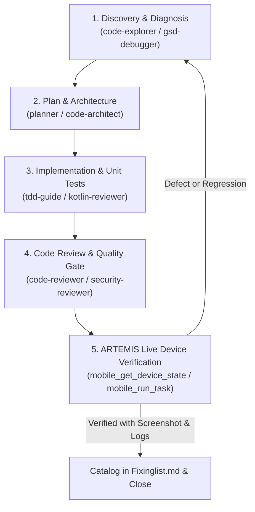

# CoupleFit Multi-Agent Orchestration & ARTEMIS Verification Rules

> **Authority & Scope**: Mandated by user directive. Applied to all bug fixing, feature addition, architectural refactoring, and code correction across the CoupleFit codebase.
> **Source Agent Catalog**: `Documentation/agents1.md` (ECC & GSD-Core Agent Ecosystems).
> **Verification Harness**: Google ARTEMIS Mobile Testing Architecture.

---

## 1. Core Mandate: Multi-Agent Specialization & ARTEMIS Verification

1. **Subagent Delegation Over Monolithic Execution**:
   - Never attempt large, multi-faceted tasks monolithically in a single turn without specialist role breakdown.
   - For every task (fixing bugs, adding features, refactoring, code review, or UI polish), leverage and route work through the specialized subagents defined in `agents1.md` and registered in `<subagents>`.

2. **Absolute ARTEMIS Verification Contract**:
   - **Never claim a fix or feature works based on code inspection alone.**
   - Every change MUST be verified on a live target device or active emulator (`emulator-5554`) using **Google ARTEMIS MCP tools**:
     - `mobile_get_device_state(view_type="hierarchy")`: Verify accessibility tree, element presence, semantic tags, and occlusion warnings.
     - `mobile_get_device_state(view_type="screenshot")`: Visual proof of correct rendering, layout proportions, typography, and contrast.
     - `mobile_run_task`: Execute end-to-end interactive user flows and assert expected transitions.
     - `mobile_diagnose`: Pre-flight environment check whenever device connection, locks, or ADB issues arise.
   - In addition to ARTEMIS, all local test suites must remain green:
     - `.\gradlew.bat testDebugUnitTest` must pass with 100% success.
     - `.\gradlew.bat compileDebugAndroidTestKotlin` must compile with zero errors.

---

## 2. Agent Routing & Dispatch Matrix (from `agents1.md`)

When handling tasks, consult and route according to this functional matrix:

| Task Phase / Domain | Primary Specialist Agent | Supporting / Review Agents | Mandated Responsibility |
| :--- | :--- | :--- | :--- |
| **Bug Diagnosis & Fixing** | `gsd-debugger` / `gsd-code-fixer` | `silent-failure-hunter`, `build-error-resolver` | Form hypotheses, trace call stacks, fix root causes with minimal diffs, prevent silent error swallowing. |
| **Android / Kotlin Code** | `kotlin-reviewer` | `kotlin-build-resolver`, `build-error-resolver` | Enforce Kotlin idioms, Compose state immutability, coroutine lifecycle safety, Room/Flow reactivity, zero build errors. |
| **Architecture & Planning** | `code-architect` / `planner` | `gsd-planner`, `type-design-analyzer` | Deconstruct features into clear execution blueprints, domain models, invariant-enforcing types, and dependency waves. |
| **Code Review & Quality Gate**| `code-reviewer` | `gsd-code-reviewer`, `comment-analyzer` | **Mandatory on all diffs**: Review for regressions, clean architecture, edge cases, comment hygiene, and maintainability. |
| **Security & Privacy** | `security-reviewer` | `database-reviewer` | Enforce Health Connect least-privilege (zero write permissions), secure Firestore rules, token security, and PHI privacy. |
| **UI, Motion & Accessibility** | `a11y-architect` | `motion-reviewer`, `gsd-ui-checker` | Guarantee WCAG 2.2 AA contrast, 44x44dp tap targets, TalkBack semantics, smooth 60fps animations, reduced-motion fallbacks. |
| **Code Simplification & Polish**| `code-simplifier` | `refactor-cleaner`, `performance-optimizer` | Remove dead code, simplify complex Compose trees, optimize recomposition bounds, eliminate memory leaks. |
| **Verification & Goal Closure**| `gsd-verifier` | `pr-test-analyzer`, `e2e-runner` | Goal-backward verification: prove that the built solution delivers what was promised; inspect live ARTEMIS traces. |

---

## 3. Standard Execution Workflow for All Tasks

Every task must strictly proceed through the following 5-phase loop:



### Phase 1: Discovery & Diagnosis
- Read target files, locate relevant entities, and inspect current UI state on device via ARTEMIS.
- Use `mobile_get_device_state(view_type="hierarchy")` to discover existing element IDs, bounds, and view hierarchies before modifying code.

### Phase 2: Plan & Architecture
- Blueprint minimal, high-impact diffs.
- Identify backward compatibility constraints (e.g. Preserving data class defaults, Room schema compatibility, navigation aliases).

### Phase 3: Implementation & Local Tests
- Implement changes using clean Kotlin / Compose idioms.
- Run `.\gradlew.bat testDebugUnitTest` and `.\gradlew.bat compileDebugAndroidTestKotlin`.
- Zero tolerance for test regressions or swallowed exceptions.

### Phase 4: Specialist Code Review
- Audit modified files against the specialist standards in `agents1.md`:
  - `kotlin-reviewer`: Coroutine scopes, Flow collection lifecycle, state hoisting.
  - `security-reviewer`: Health Connect permissions, Firebase rules, data leakage.
  - `a11y-architect`: Minimum touch targets (44dp), content descriptions, color contrast.

### Phase 5: ARTEMIS Live Device Verification
- Build and install debug APK on the connected device/emulator:
  ```powershell
  .\gradlew.bat assembleDebug
  adb -s <device_serial> install -r app\build\outputs\apk\debug\app-debug.apk
  ```
- Launch app and verify behavior:
  - Query UI tree with `mobile_get_device_state(view_type="hierarchy")`.
  - Capture visual proof with `mobile_get_device_state(view_type="screenshot")`.
  - Copy screenshot into conversation artifacts and inspect visually with `read_file`.
- Only when screenshot and logs confirm proper behavior, update `Documentation/Fixinglist.md` and present completion evidence to the user.

---

## 4. GSD Project Management & Execution Lifecycle Mandate

As you manage this project, adhere strictly to the following lifecycle sequence:
1. **Oversee Progression (`/gsd-next`)**: Begin by leveraging `/gsd-next` to oversee overall phase progression and determine immediate priorities.
2. **Draft Milestone Plan (`/gsd-plan-phase`)**: Use `/gsd-plan-phase` to draft a structured milestone plan clearly defining explicit acceptance criteria, task dependencies, and test bars.
3. **Execute Milestone Tasks (`/gsd-execute-phase`)**: Once the plan is solid, employ `/gsd-execute-phase` to carry out planned milestone tasks in strict dependency order, ensuring context remains lean and right-sized.
4. **Deterministic Verification (`/gsd-verify-work`)**: Apply `/gsd-verify-work` to execute automated test suites and deterministic verification checks against established milestone criteria, confirming standards are met.
5. **Shipment & Tagging (`/gsd-ship`)**: Finalize verified work with `/gsd-ship` to check git status, commit with conventional messaging, and tag releases.
6. **Post-Shipment Cleanup (`/gsd-cleanup`)**: Run `/gsd-cleanup` to safely eliminate unused files, orphan stubs, commented code, and stale artifacts—**never delete Markdown (`.md`) files**.
7. **Inbox Triage (`/gsd-inbox`)**: Use `/gsd-inbox` to create `triage.md` and organize captured notes, tickets, and ideas into actionable milestones.
8. **Knowledge Graph (`/gsd-graphify`)**: Apply `/gsd-graphify` to build a local knowledge graph linking files, symbols, documentation, and dependencies into a comprehensive view.

