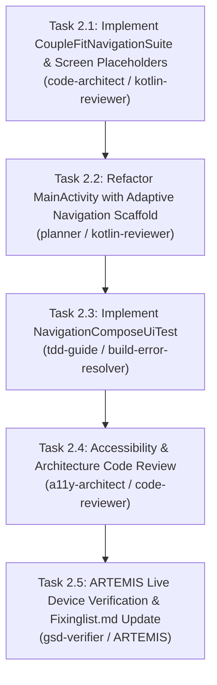

# Milestone Phase 2 Plan: Adaptive Persistent Navigation Shell (`CSA-02` / `NAV-01`) 🗺️

> **Parent Objective**: Resolve `CSA-02` & `NAV-01` in accordance with `card-sort-analysis.md` §7.1 and `INFORMATION_ARCHITECTURE.md` §2.
> **Assigned Specialists**: `code-architect`, `planner`, `kotlin-reviewer`, `a11y-architect`, `build-error-resolver`, `code-reviewer`, `gsd-verifier`.
> **Testing Harness**: Google ARTEMIS Mobile Automation Harness + JUnit / Compose UI Testing.

---

## 1. Acceptance Criteria & Test Bars

### Functional Acceptance Criteria:
1. **Compact Viewports (<600dp)**:
   - Root application renders a persistent Material 3 `NavigationBar` containing the 4 validated tabs:
     1. `Today` (Icon: `Icons.Default.Home`, Label: "Today")
     2. `Challenges` (Icon: `Icons.Default.Star`, Label: "Challenges")
     3. `HealthTrends` (Icon: `Icons.Default.DateRange`, Label: "Trends")
     4. `CoupleHub` (Icon: `Icons.Default.Favorite`, Label: "Couple Hub")
   - Bar height complies with M3 specifications (80dp height) and adheres to Fitts's Law thumb-zone guidelines.
2. **Expanded Viewports (≥600dp)**:
   - Root application renders a persistent Material 3 `NavigationRail` containing the 4 tabs on the leading (left) edge.
3. **Tab State & Backstack Preservation**:
   - Switching between tabs preserves screen scroll position, view model state, and user interactions without reloading.
   - Re-selecting the current tab does not cause backstack churn or duplicate instances (`launchSingleTop = true`, `restoreState = true`).
4. **Settings & Global Actions**:
   - TopAppBar retains the Settings gear icon, triggering `SettingsScreen` with smooth animated transitions.
   - Back button on device or back gesture pops from Settings back to the previously active tab.
5. **Accessibility (WCAG 2.2 AA AA-compliant)**:
   - All navigation items have explicit content descriptions, active pill indicators, and minimum 48x48dp interactive bounds.

### Verification Bars:
- `./gradlew.bat testDebugUnitTest` must pass with 100% success (zero regressions).
- `./gradlew.bat compileDebugAndroidTestKotlin` must compile with zero errors.
- New UI test `NavigationComposeUiTest.kt` verifying 4-tab switching and state preservation.
- Live device/emulator verification with ARTEMIS (`mobile_get_device_state(view_type="screenshot")` and `view_type="hierarchy"`).

---

## 2. Task Breakdown & Dependency Wave

### Task 2.1: Implement `CoupleFitNavigationSuite.kt` & Screen Stubs
- Create `com.couplefit.ui.navigation.CoupleFitNavigationSuite.kt` hosting the adaptive navigation bar and rail composables.
- Create placeholder/hub composables for `ChallengesScreen.kt`, `HealthTrendsScreen.kt`, and `CoupleHubScreen.kt` adhering to the wireframe layout specs in `card-sort-analysis.md` §7.2.

### Task 2.2: Refactor `MainActivity.kt` to Host Adaptive Navigation
- Update `MainActivity.kt` to wrap authenticated content in `CoupleFitNavigationSuite`.
- Replace the binary `isSettingsOpen` flag with full navigation state supporting the 4 top-level tabs and settings.

### Task 2.3: Implement `NavigationComposeUiTest.kt`
- Write automated Compose UI test asserting that all 4 tabs exist, have proper accessibility tags, and switch between screens correctly.

### Task 2.4: Accessibility & Code Review
- Audit contrast, touch target sizes (≥48dp), TalkBack semantics, and clean architecture.

### Task 2.5: Google ARTEMIS Verification & Cataloging
- Build APK, deploy to device/emulator, capture screenshot and hierarchy via ARTEMIS.
- Update `Documentation/Fixinglist.md` and commit with Conventional Commits.
