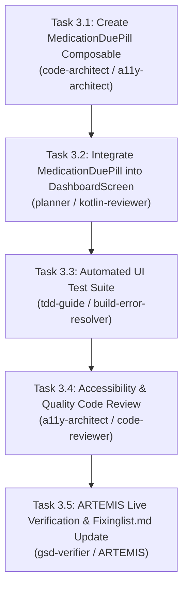

# Milestone Phase 3 Plan: Contextual "Medication Due" Pill on Today (`CSA-03`) 💊

> **Parent Objective**: Resolve `CSA-03` in accordance with `card-sort-analysis.md` §6.3 (Tree Test TS-04) and §7.2 (Wireframe 1).
> **Assigned Specialists**: `code-architect`, `planner`, `kotlin-reviewer`, `a11y-architect`, `build-error-resolver`, `code-reviewer`, `gsd-verifier`.
> **Testing Harness**: Google ARTEMIS Mobile Automation Harness + JUnit / Compose UI Testing.

---

## 1. Acceptance Criteria & Test Bars

### Functional Acceptance Criteria:
1. **Contextual Placement on Today Screen**:
   - The `Today` operational dashboard (`DashboardScreen.kt`) features a contextual notification pill positioned immediately beneath the date and header row and above the dual activity rings.
2. **Interactive Dose Logging**:
   - The pill displays the next scheduled medication (default: `💊 08:00 AM Vitamin D3 Due`).
   - Features an explicit one-tap `"Log [✓]"` action button that records the dose immediately without navigating away to the `Health Trends` tab.
   - Upon logging, provides positive visual feedback (`"Dose Logged! 🎉"`) accompanied by subtle haptic feedback.
3. **Session Dismissal**:
   - Features a subtle dismiss button (`✕`) allowing the user to dismiss the reminder for the current session.
   - Uses smooth `AnimatedVisibility` (expand/shrink and fade) to avoid jarring layout shifts.
4. **Accessibility (WCAG 2.2 AA AA-compliant)**:
   - Minimum 48x48dp touch target on both the "Log" action and the dismiss action.
   - Clear TalkBack accessibility content descriptions: `"Log Vitamin D3 dose as taken"` and `"Dismiss medication reminder"`.
   - Accessible color contrast conforming to WCAG 2.2 AA (≥4.5:1 for text, ≥3.0:1 for container borders).

### Verification Bars:
- `./gradlew.bat testDebugUnitTest` must pass with 100% success (zero regressions).
- `./gradlew.bat compileDebugAndroidTestKotlin` must compile with zero errors.
- New UI test `MedicationDuePillComposeUiTest.kt` verifying pill presence, log interaction, and dismissal.
- Live device verification with ARTEMIS.

---

## 2. Task Breakdown & Dependency Wave

### Task 3.1: Create `MedicationDuePill.kt`
- Create `com.couplefit.ui.components.MedicationDuePill.kt`.
- Support animated logging state, custom medication name, scheduled time, and dismiss callback.

### Task 3.2: Integrate into `DashboardScreen.kt`
- Add `MedicationDuePill` at the top of the content column in `DashboardScreen.kt`.
- Maintain state for logged / dismissed status.

### Task 3.3: Write `MedicationDuePillComposeUiTest.kt`
- Automated test validating rendering, clicking "Log", and clicking "Dismiss".

### Task 3.4: Code & Accessibility Review
- Verify touch targets and contrast with `a11y-architect` and `kotlin-reviewer`.

### Task 3.5: ARTEMIS Verification & Cataloging
- Verify on live device, update `Documentation/Fixinglist.md`, and commit.
