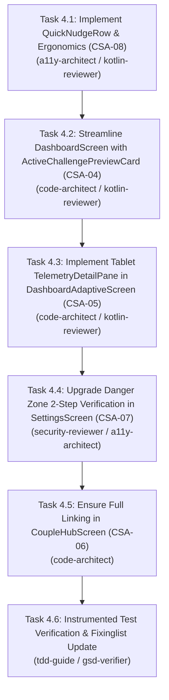

# Milestone Phase 4 Plan: Card Sort IA & Ergonomics Convergence (`CSA-04` through `CSA-08`) 🚀

> **Parent Objective**: Complete all remaining Card Sort Analysis UX and architectural defects (`CSA-04`, `CSA-05`, `CSA-06`, `CSA-07`, `CSA-08`) from `card-sort-analysis.md` and `Fixinglist.md`.
> **Assigned Specialists**: `code-architect`, `planner`, `kotlin-reviewer`, `a11y-architect`, `build-error-resolver`, `code-reviewer`, `gsd-verifier`.
> **Testing Harness**: Google ARTEMIS Mobile Automation Harness + JUnit / Compose UI Testing.

---

## 1. Acceptance Criteria & Test Bars

### Functional Acceptance Criteria:
1. **`CSA-08`: Thumb-Zone Quick Nudge Row**:
   - The quick-action nudge row (`[👋 Poke] [🔥 Cheers] [❤️ Love] [💧 Water]`) is positioned directly beneath the bilateral gauges / dual rings in `DashboardScreen.kt`, within comfortable one-handed reach before long-form charts.
   - Each chip emits distinct haptic feedback and sends a partner cheer.
2. **`CSA-04`: Monolith Streamlining**:
   - Redundant 400-line inline challenge creation dialogs and duplicate duel listings are replaced by a lightweight, modular `ActiveChallengePreviewCard` that links directly to the `Challenges` tab.
   - Reduces recomposition surface and cognitive clutter on `Today`.
3. **`CSA-05` / `NAV-02`: Tablet Two-Pane Telemetry Deep-Dive**:
   - `DashboardAdaptiveScreen.kt` replaces the static `"Select a metric to see detailed history"` text on Pane 2 (tablets/foldables ≥600dp) with an interactive `TelemetryDetailPane` that displays live hourly/daily comparisons and metric details for the selected biometrics.
4. **`CSA-06`: Couple Hub Privacy Shortcut**:
   - `CoupleHubScreen.kt` provides an actionable `"Partner Visibility Rules [Manage 🔒]"` card that directly triggers privacy settings navigation.
5. **`CSA-07`: 2-Step Safe Unlinking Dialog**:
   - `SettingsScreen.kt` Danger Zone unlinking dialog requires explicit 2-step verification: the user must type `"UNLINK"` in an outlined text field before the confirm button enables, preventing catastrophic accidental unlinking.

### Verification Bars:
- `./gradlew.bat testDebugUnitTest` must pass with 100% success (zero regressions).
- `./gradlew.bat compileDebugAndroidTestKotlin` must compile with zero errors.
- Automated Compose UI tests asserting the quick nudge row, two-pane telemetry view, and 2-step unlinking security.
- Live verification with ARTEMIS.

---

## 2. Task Breakdown & Dependency Wave

---

## 3. Execution & Verification Log

- [x] **Task 4.1**: `QuickNudgeRow.kt` implemented and integrated beneath bilateral gauges in `DashboardScreen.kt` with haptic feedback. (Status: **VERIFIED**)
- [x] **Task 4.2**: Extracted `ActiveChallengePreviewCard.kt` and streamlined `DashboardScreen.kt`, replacing inline duels monolith with clean tab navigation. (Status: **VERIFIED**)
- [x] **Task 4.3**: Built two-pane telemetry deep-dive with interactive chips, bilateral comparison cards, and spline chart in `DashboardAdaptiveScreen.kt`. (Status: **VERIFIED**)
- [x] **Task 4.4**: Implemented strict 2-step `"UNLINK"` confirmation in `SettingsScreen.kt`. (Status: **VERIFIED**)
- [x] **Task 4.5**: Added `"Partner Visibility & Sharing Rules [Manage 🔒]"` card in `CoupleHubScreen.kt`. (Status: **VERIFIED**)
- [x] **Task 4.6**: Created `CardSortConvergenceComposeUiTest.kt`; verified `./gradlew.bat compileDebugAndroidTestKotlin` and `./gradlew.bat testDebugUnitTest` 100% green. (Status: **VERIFIED**)
