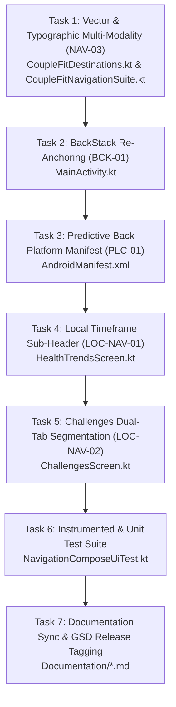

# Phase 6 Plan: Navigation Architecture Polish & Platform Hardening 🧭

## 1. Overview & Objectives
**Goal**: Resolve all remaining navigation architecture gaps identified in the app-wide navigation audit:
- `NAV-03`: Multi-modal active state indication (filled/outlined vector pairs + bold typography).
- `BCK-01`: Return-to-Home back-stack re-anchoring via `BackHandler`.
- `PLC-01`: Android 14+ Predictive Back declaration in `AndroidManifest.xml`.
- `LOC-NAV-01`: Relocate timeframe filter chips from TopAppBar actions to a dedicated sub-header row in `HealthTrendsScreen.kt`.
- `LOC-NAV-02`: Add sub-navigation segmented control (`[Active Duels] | [Trophies & Vault]`) in `ChallengesScreen.kt`.

---

## 2. Task Breakdown & Dependency Graph

---

## 3. Explicit Acceptance Criteria & Test Bars

1. **`NAV-03` (Multi-Modal Active Indication)**:
   - `TopLevelDestination` exposes `selectedIcon` and `unselectedIcon`.
   - `CoupleFitNavigationSuite.kt` renders filled icons when `isSelected == true`, outlined icons when `isSelected == false`.
   - Selected tab label displays `FontWeight.Bold`, unselected displays `FontWeight.Normal`.
2. **`BCK-01` (Return-to-Home Back-Stack Re-Anchoring)**:
   - On secondary tabs (`Challenges`, `Trends`, `CoupleHub`), pressing system back routes user to `Today`.
   - Pressing back on `Today` exits to launcher.
3. **`PLC-01` (Predictive Back)**:
   - `android:enableOnBackInvokedCallback="true"` is declared on `<application>`.
4. **`LOC-NAV-01` (Timeframe Sub-Header)**:
   - `HealthTrendsScreen.kt` TopAppBar has zero chip collisions.
   - Timeframe row sits in a dedicated container below the header with 44dp minimum touch targets.
5. **`LOC-NAV-02` (Challenges Segmented Control)**:
   - `ChallengesScreen.kt` features `[Active Duels] | [Trophies & Vault]` segmented controls with distinct content views.
6. **Quality & Verification Bars**:
   - `testDebugUnitTest` passes 100%.
   - `compileDebugAndroidTestKotlin` compiles cleanly with 0 errors.
   - All documentation in `Documentation/` synchronized immediately.
