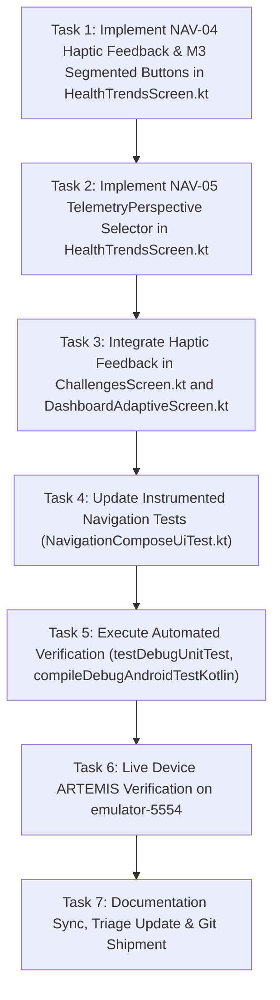

# Phase 6C Plan: Local Navigation Tactile Polish & Bilateral Perspective (NAV-04, NAV-05) 🧭

> **Associated Defect IDs**: `NAV-04`, `NAV-05`  
> **Skill Governing**: [`/designer-skills:navigation-patterns`](file:///C:/Users/akash/.gemini/config/plugins/designer-skills/skills/navigation-patterns/SKILL.md)  
> **Associated Specs**: [`Documentation/navigation_patterns_appwide_audit.md`](../../Documentation/navigation_patterns_appwide_audit.md), [`Documentation/card-sort-analysis.md`](../../Documentation/card-sort-analysis.md)  
> **Target Files**:
> - `app/src/main/java/com/couplefit/ui/trends/HealthTrendsScreen.kt`
> - `app/src/main/java/com/couplefit/ui/challenge/ChallengesScreen.kt`
> - `app/src/main/java/com/couplefit/ui/dashboard/DashboardAdaptiveScreen.kt`
> - `Documentation/`

---

## 1. Executive Summary & Defect Scope

### `NAV-04`: Local Navigation Tactile Polish & Animated Indicator Transitions
- **Problem**: Local segmented controls (`Day/Week/Month/Year` in Trends, `Active/Trophies` in Challenges, and telemetry chips in Adaptive) previously used static container toggles without animated indicator pills or tactile haptic feedback.
- **Goal**:
  1. Inject `LocalHapticFeedback.current.performHapticFeedback(HapticFeedbackType.TextHandleMove)` on every local segmented tab click.
  2. Implement fluid animated indicator transitions with Material 3 `SecondaryTabRow` and `SingleChoiceSegmentedButtonRow` / animated pill styling.
  3. Ensure multi-modal states (bold typography + container tint + distinct icon vector).

### `NAV-05`: Unified Bilateral Telemetry vs. Perspective Filtering
- **Problem**: Deciding how couple telemetry is partitioned. Segregating `[You]` vs `[Partner]` into hidden sub-tabs on the main `Today` dashboard destroys the shared synchrony mental model and introduces high interaction cost.
- **Architectural Solution**:
  1. **Strictly Preserve 0-Tap Unified Bilateral Telemetry on `Today`**: Concentric dual activity rings, side-by-side metric cards, and quick nudges remain simultaneously visible without tab switching.
  2. **Implement Perspective Filtering on `HealthTrendsScreen.kt`**: For dense historical telemetry, provide a local `TelemetryPerspective` segmented control:
     `[Both 👥] [You 👤] [Partner 💖]` with animated indicator transitions and tactile haptics, allowing users to isolate curves without cluttering the home dashboard.

---

## 2. Acceptance Criteria & Test Bars

1. **`AC-NAV04-01` (Haptic Integration)**:
   - All local view switches (timeframe chips, challenge tabs, trophy filters, perspective filters) trigger tactile haptic response.
2. **`AC-NAV04-02` (Animated Indicator Transitions)**:
   - Segmented buttons and tabs feature smooth spring or tween indicator animations and bold active typography.
3. **`AC-NAV05-01` (Bilateral Perspective Filtering in Trends)**:
   - `HealthTrendsScreen.kt` features a sticky `TelemetryPerspective` row (`Both`, `You`, `Partner`) filtering comparative charts.
4. **`AC-NAV05-02` (Today Screen Invariant Preservation)**:
   - `Today` dashboard maintains unified 0-tap dual-ring display.
5. **`AC-NAV-05` (Test & Device Verification)**:
   - `compileDebugAndroidTestKotlin`: 0 errors.
   - `testDebugUnitTest`: 100% passing.
   - Live device verification on `emulator-5554` via ARTEMIS.

---

## 3. Dependency Graph

