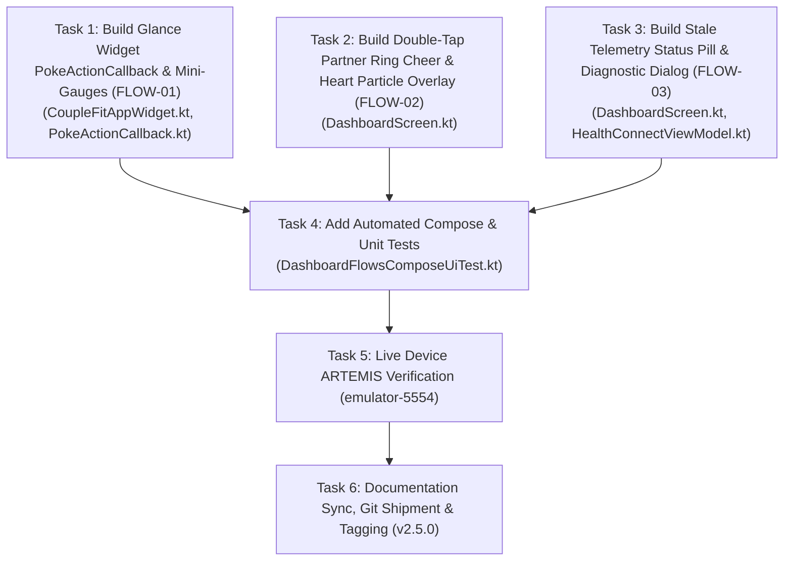

# Phase 7 Milestone Plan: User Flow Innovations (FLOW-01, FLOW-02, FLOW-03) 🎯

> **Governing Standards**: [`AGENTS.md`](../AGENTS.md) & [`Documentation/INDEX.md`](../Documentation/INDEX.md)  
> **Source Foundations**: [`Documentation/user_flow_diagram_flow01_flow02_flow03_analysis.md`](../Documentation/user_flow_diagram_flow01_flow02_flow03_analysis.md)  
> **Associated Defect IDs**: `FLOW-01`, `FLOW-02`, `FLOW-03`  
> **Target Components**: 
> - `CoupleFitAppWidget.kt` & `PokeActionCallback.kt` (`FLOW-01`)
> - `DashboardScreen.kt` (`FLOW-02`, `FLOW-03`)
> - `HealthConnectViewModel.kt` (`FLOW-03`)
> **Date**: October 2026

---

## 1. Executive Summary & Problem Scope

Phase 7 delivers three core user flow innovations identified during interaction design and user testing audits:
1. **`FLOW-01` (Zero-Tap Home Screen Glance Widget & Quick Poke)**:
   - Provide an interactive 4x2 Jetpack Glance Home Screen widget with bilateral mini-gauges and an inline, one-tap "Poke 👋" action button running an `ActionCallback` without full app foreground cold start.
2. **`FLOW-02` (Double-Tap Partner's Ring to Cheer)**:
   - Implement direct-manipulation gesture detection (`detectTapGestures(onDoubleTap = ...)`) on the partner's activity gauge on the Today screen, emitting a heart/confetti delight animation, tactile haptics, and sending an instant cheer nudge.
3. **`FLOW-03` (Offline / Stale Telemetry Transparency & Recovery)**:
   - Replace confusing static vitals with an intelligent, tappable status pill (`[🟡 Partner synced 42m ago • Showing cached vitals ℹ️]` vs `[🟢 Partner synced 2m ago • Live ⚡]`) and an interactive `TelemetryDiagnosticDialog` with a one-tap "Ping Partner Device 📡" action.

---

## 2. Explicit Acceptance Criteria & Test Bars

- **`AC-FLOW-01` (Glance Widget Interactive Action)**:
  - Widget renders bilateral step and active duration comparisons.
  - Widget provides an inline "Poke 👋" button that executes `PokeActionCallback` without launching `MainActivity`.
  - Whole-container click continues to launch `MainActivity` with `CLEAR_TOP | NEW_TASK`.
- **`AC-FLOW-02` (Double-Tap Ring Cheer)**:
  - Double-tapping partner's gauge canvas in `SideBySideActivityCard` triggers haptic feedback (`TextHandleMove` / `LongPress`) and animates a heart cheer particle effect.
  - Fires `healthConnectViewModel.sendNudgeToPartner(...)` with a 3-second debounce cooldown.
  - Does not interfere with single-tap or vertical parent scroll gestures.
- **`AC-FLOW-03` (Stale Telemetry Status Pill & Ping Action)**:
  - Computes sync staleness: marks status as stale/cached when partner sync delta > 15 minutes.
  - Renders contextual pill above activity gauges with distinct color tokens (`SystemGreen` for live, `SystemOrange` for stale).
  - Tapping status pill opens `TelemetryDiagnosticDialog` displaying partner's sync status and a "Ping Partner Device 📡" action button.
- **`AC-FLOW-04` (Deterministic Verification & Green Tests)**:
  - `./gradlew testDebugUnitTest` must pass with 100% success.
  - `./gradlew compileDebugAndroidTestKotlin` must compile with 0 errors.
  - Live device ARTEMIS verification on `emulator-5554` with screenshots and UI hierarchy dumps.

---

## 3. Dependency Graph & Task Order

