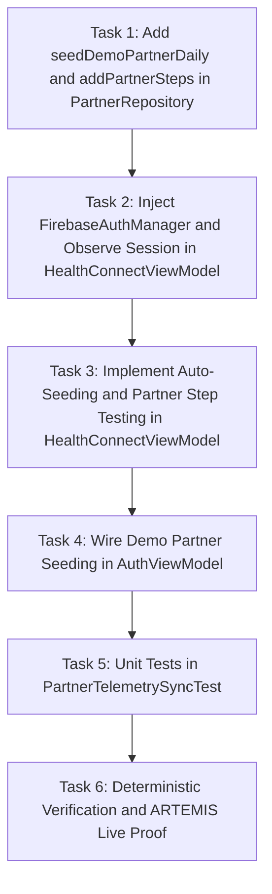

# Phase 51 Plan: Real-Time Partner Telemetry Synchronization & Demo Seeding Engine (`PTR-01`) 🔄👫

**Milestone Version**: `v2.9.37-partner-telemetry-sync-ptr01`  
**Governing Standard**: [`AGENTS.md`](file:///D:/Couple_fit/CoupleFit/AGENTS.md)  
**Target Codebase**: Android Jetpack Compose / M3 / Room / Firebase / Clean Architecture  
**Verification Harness**: Google ARTEMIS Mobile Automation Harness on `emulator-5554`  

---

## 1. Problem Statement & Root Cause

The user reported: *"i can see my steps in my app but i cant see my partners data in my app, can you fix this?"*

### Root Cause Analysis:
1. **Static Hardcoded Session State in `HealthConnectViewModel`**:
   - `HealthDashboardUiState` initialized with static mock values (`coupleId = "couple_1"`, `partnerId = "partner_1"`, `myUid = "me"`).
   - `HealthConnectViewModel` did not observe `FirebaseAuthManager.observeUserSession()`. When a user signed in, entered demo mode, or linked with a partner, `HealthConnectViewModel` remained bound to `"couple_1"`, ignoring the actual authenticated `UserSession`.
2. **Missing Firestore Listener Re-binding**:
   - `partnerRepository.listenToPartnerDaily()` was invoked once during `init` with `"couple_1"` and never restarted when user pairing was completed or when session credentials were loaded.
3. **Empty Initial State / Lack of Room Seeding**:
   - In offline, guest, or demo modes, or prior to the partner's first Firestore push, Room's `partnerDaily` table was completely empty.
   - When `partnerDaily` is null, the UI defaults to `0 steps`, `0 active mins`, `0 kcal`, and `🟡 Awaiting sync • Cached ℹ️`.
4. **Asymmetric Test/Simulation Controls**:
   - `DashboardScreen` provided `+1k Test Steps` which only updated the solo user's Room aggregate (`HealthDailyAggregateEntity`), with no corresponding function to simulate or test partner progress or dual ring closures.

---

## 2. Explicit Acceptance Criteria

1. **Dynamic Session Observation**:
   - `HealthConnectViewModel` injects `FirebaseAuthManager` and observes `userSession: Flow<UserSession?>`.
   - Live session updates dynamically refresh `coupleId`, `partnerId`, `myUid`, and `isPartnerLinked` in `HealthDashboardUiState`.
2. **Dynamic Firestore Listener Re-triggering**:
   - Whenever `coupleId` and `partnerId` change to valid identifiers, `HealthConnectViewModel` cancels any stale listener and starts `partnerRepository.listenToPartnerDaily(coupleId, partnerId, dateStr)`.
3. **Automatic Room Seeding for Demo & Initial State**:
   - In `PartnerRepository`, introduce `seedDemoPartnerDaily(partnerId, dateStr)` to insert an initial realistic partner activity record (e.g., 7,420 steps, 48m active, 385 kcal, 72 bpm, 98.4% SpO2) when no record exists.
   - On Demo/Guest entry in `AuthViewModel` (`signInAsGuest` / `enterDemoDashboard`), ensure partner daily data is seeded in Room so the user immediately sees partner telemetry alongside their own.
4. **Partner Telemetry Simulation API**:
   - Add `addSamplePartnerSteps(count: Long = 1000L)` in `HealthConnectViewModel` and `PartnerRepository` allowing direct manipulation and testing of partner activity.
5. **Deterministic Testing**:
   - Unit tests pass 100% green (`testDebugUnitTest`).
   - Android instrumentation tests compile without errors (`compileDebugAndroidTestKotlin`).
   - Live Android verification on `emulator-5554` via ARTEMIS showing non-zero partner steps and active bilateral telemetry.

---

## 3. Task Breakdown & Dependency Graph

- **Task 1**: Add `seedDemoPartnerDaily` and `addPartnerSteps` to `PartnerRepository` and `PartnerRepositoryImpl`.
- **Task 2**: Inject `FirebaseAuthManager` into `HealthConnectViewModel` and observe `userSession`.
- **Task 3**: Dynamic re-listening and partner step simulation in `HealthConnectViewModel`.
- **Task 4**: Pre-seed demo partner telemetry during guest/demo login in `AuthViewModel`.
- **Task 5**: Write unit tests verifying partner data persistence, flow combination, and session binding in `PartnerTelemetrySyncTest.kt`.
- **Task 6**: Execute test suites and verify on live Android device via ARTEMIS.
