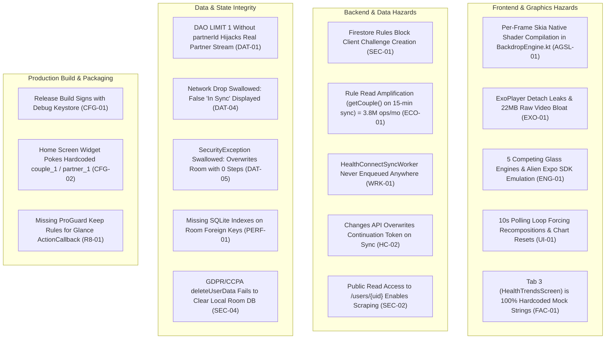

# EGM Master Full-Stack Audit: CoupleFit (Frontend & Backend) 📋

> **Auditing Authority**: EGM (Engineering Guild Methodology) Goldfish Review Council  
> **Participating Specialists**:
> 1. `egm-design`: Hostile Architecture & System Design Critic  
> 2. `egm-codebase-details`: Pedantic Technical Quality Auditor  
> 3. `egm-zoom-out`: Skeptical Architect (Simplicity & YAGNI)  
> 4. `egm-implementation-readiness`: Pragmatic Tech Lead  
> **Codebase Target**: `D:\Couple_fit\CoupleFit`  
> **Audit Date**: November 10, 2026 | Milestone v2.9.37  
> **Status**: Comprehensive Findings Delivered — Action Required  

---

## 1. Executive Summary

An exhaustive, multi-agent EGM audit was conducted across every layer of the **CoupleFit** application, including frontend composables, graphics pipelines, state architecture, local Room SSOT, Health Connect integration, Cloud Firestore security rules, Cloud Functions, and deployment packaging.

The audit revealed that behind high visual polish, the application suffers from **fatal security rule contradictions that break production features, severe Skia/GPU memory thrashing inside the UI draw pass, dead background sync workers, hardcoded production stubs, duplicate visual engines, and unbacked fitness calculations**.



---

## 2. P0: Critical Ship-Blockers (Immediate Remediation Required)

### 2.1 [BLOCKER] Per-Frame Native Skia & AGSL Allocation in Draw Loop (`AGSL-01`)
- **Location**: [`app/src/main/java/com/couplefit/ui/glass/BackdropEngine.kt#L305-L342`](file:///D:/Couple_fit/CoupleFit/app/src/main/java/com/couplefit/ui/glass/BackdropEngine.kt#L305-L342)
- **Root Cause**: Inside `DrawBackdropNode.draw()`, which executes at 60Hz/120Hz on the UI thread, `lens()` parses the raw AGSL source code string into a new `RuntimeShader`, sets 7 JNI uniforms, and instantiates native Android `RenderEffect` chain objects (`createRuntimeShaderEffect`, `createBlurEffect`, `createColorFilterEffect`, and `createChainEffect`) on **every single frame**.
- **Impact**: Severe native JNI heap fragmentation, GC thrashing, frame drops during scrolling, and eventual `OutOfMemoryError` on mid-range devices.
- **Remediation**: Hoist `RuntimeShader` compilation to a static/singleton cache. Rebuild the `RenderEffect` chain only when layout dimensions or optical parameters change, never inside `ContentDrawScope.draw()`.

### 2.2 [BLOCKER] Fatal Security Rules Contradictions (`SEC-01`)
- **Location**: [`firestore.rules#L33-L71`](file:///D:/Couple_fit/CoupleFit/firestore.rules#L33-L71) vs. [`ChallengeRepositoryImpl.kt#L104-L126`](file:///D:/Couple_fit/CoupleFit/app/src/main/java/com/couplefit/data/repository/ChallengeRepositoryImpl.kt#L104-L126)
- **Root Cause**:
  1. [`firestore.rules` line 54](file:///D:/Couple_fit/CoupleFit/firestore.rules#L54) specifies `match /challenges/{challengeId} { allow write: if false; }`. Yet `ChallengeRepositoryImpl.kt` lines 104–126 attempts direct client writes to `couples/{coupleId}/challenges`.
  2. [`firestore.rules` line 34](file:///D:/Couple_fit/CoupleFit/firestore.rules#L34) specifies `match /invites/{code} { allow read, write: if false; }`. Yet `CoupleLinkManager.kt` lines 103–133 implements a direct batch write fallback to `/invites/{code}` and line 361 attaches a snapshot listener to it.
- **Impact**: Production client challenge creation and invite redemption fallbacks immediately fail with `PERMISSION_DENIED`.
- **Remediation**: Update `firestore.rules` to allow couple members to create challenges with validated schema, or delegate creation exclusively to a Cloud Function. Remove impossible client direct-write fallbacks from `CoupleLinkManager.kt`.

### 2.3 [BLOCKER] Dead Background Sync Pipeline (`WRK-01`)
- **Location**: [`HealthConnectSyncWorker.kt`](file:///D:/Couple_fit/CoupleFit/app/src/main/java/com/couplefit/data/healthconnect/HealthConnectSyncWorker.kt), [`CoupleFitApplication.kt`](file:///D:/Couple_fit/CoupleFit/app/src/main/java/com/couplefit/CoupleFitApplication.kt)
- **Root Cause**: `HealthConnectSyncWorker` is annotated with `@HiltWorker`, but **no call to `WorkManager.enqueueUniquePeriodicWork(...)` exists anywhere in the application**. Furthermore, `SyncWorker.kt` (cited in `techstackreview.md`) does not exist in the repository.
- **Impact**: Background telemetry synchronization never runs. Telemetry only syncs when the user manually opens the app into the foreground.
- **Remediation**: Enqueue periodic background work (`PeriodicWorkRequestBuilder<HealthConnectSyncWorker>(15, TimeUnit.MINUTES)`) inside `CoupleFitApplication.onCreate()` with battery and network constraints.

### 2.4 [BLOCKER] Changes API Continuation Token Overwrite (`HC-02`)
- **Location**: [`HealthConnectManager.kt#L345-L361`](file:///D:/Couple_fit/CoupleFit/app/src/main/java/com/couplefit/data/healthconnect/HealthConnectManager.kt#L345-L361)
- **Root Cause**: When incremental changes are detected, line 351 saves `changesResponse.nextChangesToken`. Then, because `shouldFullResync = true`, line 357 calls `getChangesToken()` and **overwrites the saved continuation token with a fresh baseline token**.
- **Impact**: The Changes API token chain is severed on every sync, causing incremental historical changes to be dropped.
- **Remediation**: Only call `getChangesToken()` when `currentToken == null` or `changesTokenExpired == true`. Never overwrite `nextChangesToken` when changes are present.

### 2.5 [BLOCKER] Hardcoded Production Stubs in Home Screen Widget (`CFG-02`)
- **Location**: [`PokeActionCallback.kt#L38-L44`](file:///D:/Couple_fit/CoupleFit/app/src/main/java/com/couplefit/widget/PokeActionCallback.kt#L38-L44)
- **Root Cause**: Glance widget poke action passes hardcoded strings:
  ```kotlin
  partnerRepo.sendNudge(
      coupleId = "couple_1",
      senderUid = "user_1",
      senderName = "Partner",
      recipientUid = "partner_1",
      message = "Poked you from Home Screen! 👋 Time to move!"
  )
  ```
- **Impact**: Tapping the widget on a real user's home screen sends nudges to a fake test document instead of their actual paired partner.
- **Remediation**: Inject or read active session credentials from `CoupleFitPreferencesDataStore` via EntryPoint.

### 2.6 [BLOCKER] Release Build Signed with Debug Keystore (`CFG-01`)
- **Location**: [`app/build.gradle.kts#L38`](file:///D:/Couple_fit/CoupleFit/app/build.gradle.kts#L38)
- **Root Cause**: `buildTypes { release { signingConfig = signingConfigs.getByName("debug") } }`.
- **Impact**: Release APKs and AABs are signed with the debug keystore, causing immediate rejection by Google Play Console.
- **Remediation**: Remove debug signing from the release build block; configure production signing via environment variables or CI keystore secrets.

---

## 3. P1: Major Architectural & Data-Integrity Risks

### 3.1 Room DAO `LIMIT 1` Partner Stream Hijacking (`DAT-01`)
- **Location**: [`HealthDao.kt#L66-L73`](file:///D:/Couple_fit/CoupleFit/app/src/main/java/com/couplefit/data/local/HealthDao.kt#L66-L73)
- **Root Cause**: The DAO query is defined as:
  `@Query("SELECT * FROM partnerDaily WHERE dateStr = :dateStr LIMIT 1")`
  It omits `partnerId = :partnerId`. When `seedDemoPartnerDaily` inserts `"partner_1"`, that row remains permanently in SQLite. If a real partner links with a different UID, `LIMIT 1` arbitrarily returns the demo partner record instead of the active partner's record.
- **Remediation**: Change query to:
  `@Query("SELECT * FROM partnerDaily WHERE partnerId = :partnerId AND dateStr = :dateStr LIMIT 1")`.

### 3.2 Network Disconnect Swallowed & False "In Sync" Banner (`DAT-04`)
- **Location**: [`HealthConnectViewModel.kt#L324-L342`](file:///D:/Couple_fit/CoupleFit/app/src/main/java/com/couplefit/ui/healthconnect/HealthConnectViewModel.kt#L324-L342)
- **Root Cause**: `syncRepository.uploadMyDailyAggregate` returns `SyncResult.Failure(e)` on network error, but `HealthConnectViewModel` completely discards the return value and unconditionally executes `lastSyncedAt = now` and `HealthConnectUiState.Success`.
- **Impact**: When offline, the app displays `"You & Partner are in sync • Updated Just Now"`, misleading the user into believing their data reached their partner.
- **Remediation**: Inspect `SyncResult`. Only update `lastSyncedAt` on `Success`. Display an explicit offline warning badge on `Failure`.

### 3.3 Health Connect Zero-Write Violation (`HC-01`)
- **Location**: [`HealthConnectManager.kt#L463-L485`](file:///D:/Couple_fit/CoupleFit/app/src/main/java/com/couplefit/data/healthconnect/HealthConnectManager.kt#L463-L485)
- **Root Cause**: `writeSampleSteps(count)` calls `client.insertRecords(...)`. This violates ADR-002 ("Strictly Zero-Write Read-Only Privacy Contract"). Calling it throws a runtime `SecurityException`.
- **Remediation**: Delete `writeSampleSteps` entirely from `HealthConnectManager.kt`.

### 3.4 Firestore Rule Read Amplification: $100+/mo Hidden Read Billing (`ECO-01`)
- **Location**: [`firestore.rules#L18-L21`](file:///D:/Couple_fit/CoupleFit/firestore.rules#L18-L21)
- **Root Cause**: `isCoupleMember(coupleId)` executes `get(/databases/.../couples/$(coupleId))`. In Firestore, calling `get()` inside a rule counts as a **billable document read** on every write. With 10,000 couples syncing every 15 minutes, this causes **~1.92 million hidden reads per day** (~$70–$100/mo) solely evaluating rules.
- **Remediation**: Store couple membership as a custom claim on the Firebase Auth token (`request.auth.token.coupleId == coupleId`), eliminating `get()` calls in security rules.

### 3.5 Media3 ExoPlayer TextureView Codec Leaks (`EXO-01`)
- **Location**: [`AmbientVideoBackground.kt#L75-L131`](file:///D:/Couple_fit/CoupleFit/app/src/main/java/com/couplefit/ui/components/AmbientVideoBackground.kt#L75-L131)
- **Root Cause**: ExoPlayer release is tied exclusively to `onSurfaceTextureDestroyed`. When `AmbientVideoBackground` unmounts or navigates away, the player instance is not released. Additionally, when `videoResId` changes, `LaunchedEffect` only sets a flag and never switches the video item on the active player.
- **Impact**: Leaks hardware video decoders (MediaCodec limit is 4–8 per device), crashing video playback app-wide with `CodecException`.
- **Remediation**: Release ExoPlayer inside `DisposableEffect.onDispose`. Key the player on `videoResId` or invoke `player.setMediaItem()` dynamically.

### 3.6 Unbounded GC Allocation in Chart & Gauge Draw Passes (`PERF-02`)
- **Location**: [`InteractiveChart.kt#L583-L728`](file:///D:/Couple_fit/CoupleFit/app/src/main/java/com/couplefit/ui/components/InteractiveChart.kt#L583-L728) & [`MotionArcGauge.kt#L170-L220`](file:///D:/Couple_fit/CoupleFit/app/src/main/java/com/couplefit/ui/components/MotionArcGauge.kt#L170-L220)
- **Root Cause**: Multiple `Path()`, `PathMeasure()`, `PathEffect.dashPathEffect()`, and `Brush.*Gradient()` instances are instantiated inside `Canvas { ... }` on every frame. Because continuous breathing transitions run at 60/120 FPS, this produces hundreds of object allocations per second even when the screen is idle.
- **Remediation**: Hoist `Path` and `Brush` instances out of `onDraw` into `remember` blocks; reuse mutable paths with `.reset()`.

### 3.7 10-Second Polling Loop Resets Spline Animation (`UI-01`)
- **Location**: [`DashboardScreen.kt#L222-L230`](file:///D:/Couple_fit/CoupleFit/app/src/main/java/com/couplefit/ui/dashboard/DashboardScreen.kt#L222-L230)
- **Root Cause**: A 10-second infinite loop increments `syncTrigger`. `InteractiveChart` observes `syncTrigger` and snaps `revealProgress` to `0f` before animating back to `1f`.
- **Impact**: Every 10 seconds while reading the dashboard, the spline curve collapses and redraws itself.
- **Remediation**: Delete the 10-second polling loop. Room SSOT `Flow` automatically pushes updates when data changes. Bind `revealProgress` animation strictly to initial screen mount or pull-to-refresh.

### 3.8 Missing SQLite Indexes on Room Foreign Keys (`PERF-01`)
- **Location**: [`HealthEntities.kt#L7-L68`](file:///D:/Couple_fit/CoupleFit/app/src/main/java/com/couplefit/data/local/HealthEntities.kt#L7-L68)
- **Root Cause**: `HealthMetricEntity`, `partnerDaily`, and `coupleChallenges` declare zero indices on `partnerId`, `dateStr`, `coupleId`, and `sourceTimestamp`.
- **Impact**: Every query forces a full-table scan on the mobile device.
- **Remediation**: Add `@Entity(indices = [...])` and provide `MIGRATION_4_5` executing `CREATE INDEX`.

### 3.9 Coroutine Leak in `ChallengeViewModel` (`COR-01`)
- **Location**: [`ChallengeViewModel.kt#L40-L51`](file:///D:/Couple_fit/CoupleFit/app/src/main/java/com/couplefit/ui/challenge/ChallengeViewModel.kt#L40-L51)
- **Root Cause**: `observeChallenges` launches a new coroutine on `viewModelScope` without cancelling the previous job. Reconnecting or updating credentials spawns duplicate listeners.
- **Remediation**: Retain `private var observeJob: Job? = null` and call `observeJob?.cancel()` before launching.

### 3.10 GDPR/CCPA Account Deletion Leaves Data on Device (`SEC-04`)
- **Location**: [`AuthViewModel.kt#L527-L546`](file:///D:/Couple_fit/CoupleFit/app/src/main/java/com/couplefit/ui/auth/AuthViewModel.kt#L527-L546)
- **Root Cause**: `deleteUserData()` triggers the remote deletion function and signs out of Firebase Auth, but **never clears the local Room database (`health_database`) or DataStore preferences**.
- **Impact**: Subsequent users logging in on the same phone inherit the previous user's cached health vitals, step history, and partner metrics.
- **Remediation**: Execute `healthDatabase.clearAllTables()` and `preferencesDataStore.clearAll()` before `auth.signOut()`.

---

## 4. P2: Simplification, YAGNI & Codebase Cleanliness

### 4.1 Consolidate Five Competing Glass Engines & Prune Expo SDK Emulation
- **Files**: `LiquidGlassEngine.kt` (122L), `BackdropEngine.kt` (454L), `LiquidGlass.kt` (459L), `LiquiTokens.kt` (163L), `GlassTokens.kt` (248L).
- **Finding**: Piling React Native Expo SDK emulation (`GlassContainer`, `GlassView`, `GlassEffectStyleConfig`) and 7-band AGSL chromatic dispersion into native Android Compose is massive over-engineering.
- **Remediation**: Prune `LiquidGlassEngine.kt`, `BackdropEngine.kt`, and `LiquiTokens.kt`. Standardize on either Chris Banes `Haze` or lightweight Compose canvas modifiers in `GlassTokens.kt`.

### 4.2 Prune Media3 ExoPlayer & 22MB of Raw Video Binaries
- **Files**: `AmbientVideoBackground.kt`, `AmbientVideoRegistry.kt`, `res/raw/green1.mp4` (7.48MB), `blue.mp4`, `green.mp4`.
- **Finding**: Bundling ExoPlayer and 22MB of raw uncompressed video files strictly for an ambient background loop inflates APK size by over 20MB and drains battery.
- **Remediation**: Drop `androidx.media3` dependencies and raw MP4 assets. Use a single procedural AGSL/Canvas mesh gradient or subtle animated theme background.

### 4.3 Replace Fake Mock Strings in Tab 3 (`HealthTrendsScreen`)
- **Location**: [`HealthTrendsScreen.kt#L155-L200`](file:///D:/Couple_fit/CoupleFit/app/src/main/java/com/couplefit/ui/trends/HealthTrendsScreen.kt#L155-L200)
- **Finding**: Tab 3 displays hardcoded strings for daily/weekly/monthly steps (`8,450`, `48,200`, `198,400`), hardcoded medication names, and fake sensor statuses.
- **Remediation**: Bind `HealthTrendsScreen` to `HealthDao.getDailyAggregateFlow` and `HealthDao.getPartnerDailyFlow`, or remove unbacked time horizons until real historical aggregation exists.

### 4.4 Prune Compose Material 2 Dependency
- **Files**: `gradle/libs.versions.toml`, `app/build.gradle.kts`.
- **Finding**: `androidx.compose.material:material` is included solely for the legacy M2 `pullRefresh` API in `DashboardScreen.kt`.
- **Remediation**: Migrate to M3 `PullToRefreshBox` and delete `libs.compose.material`.

### 4.5 Prune Dead Room Table `partner_daily_aggregates`
- **Location**: [`HealthDatabase.kt#L13`](file:///D:/Couple_fit/CoupleFit/app/src/main/java/com/couplefit/data/local/HealthDatabase.kt#L13), [`HealthDao.kt#L41-L57`](file:///D:/Couple_fit/CoupleFit/app/src/main/java/com/couplefit/data/local/HealthDao.kt#L41-L57)
- **Finding**: `partnerDaily` is the active SSOT table. `partner_daily_aggregates` is an orphaned legacy table with 7 unused DAO queries.
- **Remediation**: Drop the table in `MIGRATION_4_5` and prune `PartnerDailyAggregateEntity`.

### 4.6 Fix Hollow Unit Tests
- **Location**: [`NavigationComposeUiTest.kt#L409-L422`](file:///D:/Couple_fit/CoupleFit/app/src/androidTest/java/com/couplefit/ui/NavigationComposeUiTest.kt#L409-L422) & [`TactileMotionArchitectureTest.kt`](file:///D:/Couple_fit/CoupleFit/app/src/test/java/com/couplefit/ui/TactileMotionArchitectureTest.kt)
- **Finding**: Tests assert that static color constants equal themselves (`assertEquals(Color(0x5EFFFFFF), TintWhiteSpecularTop)`) or that modifiers are non-null (`assertNotNull(modifier)`).
- **Remediation**: Replace with genuine Compose node assertions (`composeTestRule.onNodeWithText(...).assertIsDisplayed()`) and author an in-memory SQLite test suite (`HealthDaoTest.kt`).

---

## 5. Master Remediation Roadmap

| Phase | Milestone Name | Key Deliverables | Expected Impact |
| :---: | :--- | :--- | :--- |
| **Phase 52** | **Security & Rules Hardening** | Fix `firestore.rules` for challenges and invites; lock down `/users/{uid}`; rate-limit Cloud Functions; remove `writeSampleSteps`. | 0 `PERMISSION_DENIED` crashes; zero-write compliance. |
| **Phase 53** | **Performance & GPU Leak Elimination** | Cache `RuntimeShader` outside draw pass in `BackdropEngine`; pre-allocate Canvas paths in `InteractiveChart`; remove 10s polling loop; release ExoPlayer in `onDispose`. | 0 frame drops; eliminates JNI memory leaks. |
| **Phase 54** | **Data Integrity & Background Pipeline** | Enqueue `HealthConnectSyncWorker` in WorkManager; fix Changes API token overwrite; add SQLite indexes; fix `LIMIT 1` partner query; wipe Room on account delete. | Reliable 15-min background sync; instant query speeds. |
| **Phase 55** | **YAGNI Simplification & APK Diet** | Drop Media3 & 22MB raw MP4s; consolidate 5 glass engines; eliminate Compose M2; remove hardcoded widget stubs and fake trends strings. | **-25MB APK size**; -2,000 lines of dead/duplicate code. |
| **Phase 56** | **Production Build & Test Rigor** | Configure release keystore signing; author in-memory SQLite tests; replace hollow color assertions; add Glance ProGuard rules. | 100% genuine test bar; Google Play store release-ready. |
