# CoupleFit — Information Architecture (IA) Specification 🗺️

> **Command Trigger**: `/designer-skills:information-architecture`  
> **Associated Defect Logs in Fixinglist.md**: `IA-03`, `IA-04`


**Document Version**: 2.1.0  
**Status**: Approved & Architected  
**Standard**: Diataxis / ISO/IEC 25010 UX Hierarchy  
**Last Updated**: October 2026

---

## 1. Executive Summary & IA Philosophy

CoupleFit is an offline-first, dual-user collaborative fitness telemetry platform on Android. The user experience centers on shared fitness accountability, real-time biometrics, and gamified challenges between two linked partners.

### Core IA Principles & Heuristics
1. **Findability (<3 Taps)**: Every primary action (checking partner vitals, nudging partner, toggling metric privacy, viewing active challenges) is reachable within two to three taps from the home screen.
2. **Wayfinding & Scent**: Category labels avoid internal developer jargon (e.g. *"Health Sync & Sensors"* instead of *"WorkManager Changes API Client"*; *"Partner Connection"* instead of *"Zero-Trust Firestore Membership"*).
3. **Task-Oriented Grouping**: Features are organized around what couples *do* together (Compete, Celebrate, Synchronize, Protect Privacy) rather than internal backend services.
4. **Progressive Disclosure**: High-frequency operational metrics stay front-and-center, while configuration, sync intervals, and legal compliance are cleanly layered in subordinate hubs.
5. **Fail-Safe Danger Isolation**: Irreversible actions (Unlinking partner, purging cloud telemetry, deleting account) are sequestered into explicit danger zones with two-step validation.

---

## 2. Complete App Site Map & Navigation Model

### 2.1 Global Navigation Architecture

The application adopts an **Adaptive Navigation Model**:
- **Compact Viewports (Phones, <600dp)**: Persistent Material 3 Bottom Navigation Bar with 4 primary destinations + Header Utility Avatar for Settings.
- **Medium & Expanded Viewports (Foldables & Tablets, ≥600dp)**: Left-aligned Navigation Rail / Expanded Two-Pane Drawer with simultaneous Master-Detail views.

```mermaid
graph TD
    classDef entry fill:#4A154B,stroke:#fff,stroke-width:2px,color:#fff;
    classDef primary fill:#1E293B,stroke:#38BDF8,stroke-width:2px,color:#fff;
    classDef sub fill:#0F172A,stroke:#64748B,stroke-width:1px,color:#E2E8F0;
    classDef utility fill:#312E81,stroke:#818CF8,stroke-width:2px,color:#fff;
    classDef modal fill:#431407,stroke:#F97316,stroke-width:1px,color:#fff;

    DL["🔗 Deep Link / App Link<br/>(couplefit.app/invite/{code})"]:::entry
    ICON["📱 App Launcher / Glance Widget"]:::entry

    %% Entry & Auth Flow
    AUTH{"Auth & Pairing Gate"}:::entry
    SIGNIN["Sign In / Register"]:::sub
    INVITE["Generate 6-Digit Code"]:::sub
    ENTERCODE["Enter Partner Code"]:::sub
    CONFIRM["Linked Celebration Screen"]:::sub

    %% Primary Navigation Bar
    ROOT["CoupleFit Main Shell<br/>(Scaffold + Adaptive Rail/Bar)"]:::primary

    TAB1["1. Today (Dashboard)"]:::primary
    TAB2["2. Challenges"]:::primary
    TAB3["3. Health & Trends"]:::primary
    TAB4["4. Couple Hub"]:::primary
    UTILITY["⚙️ Settings & Privacy"]:::utility

    %% Level 2 - Today Sub-screens & Overlays
    RING_DETAIL["Dual Ring Detail View<br/>(Steps / Active / Cal)"]:::sub
    NUDGE_MODAL["Quick Nudge & Reactions Modal"]:::modal
    VITALS_SHEET["Live Biometric Telemetry<br/>(HR Bézier / SpO2 Graph)"]:::sub
    OFFLINE_BANNER["Offline / Cache Indicator"]:::modal

    %% Level 2 - Challenges
    CHALLENGE_LIST["Active & Past Duels"]:::sub
    CREATE_CHALLENGE["Start Challenge Modal<br/>(Steps Race / Streaks)"]:::modal
    CHALLENGE_DETAIL["Challenge Leaderboard & History"]:::sub

    %% Level 2 - Health & Trends
    METRICS_HISTORY["Historical Analytics<br/>(Day / Week / Month / Year)"]:::sub
    MEDICATION_LOG["Medication Tracker & Schedules"]:::sub
    SENSORS_STATUS["Sensor & Source Diagnostic"]:::sub

    %% Level 2 - Couple Hub
    PARTNER_PROFILE["Partner Activity Card & Milestones"]:::sub
    SHARED_STREAKS["Shared Streaks & Memories"]:::sub
    AWARDS_VAULT["Trophies & Milestone Vault"]:::sub

    %% Settings Hubs
    SET_ACCOUNT["Account & Partnership"]:::sub
    SET_SYNC["Health Sync & Sensors"]:::sub
    SET_PREFS["App Experience & Theme"]:::sub
    SET_PRIVACY["Privacy, Security & Data Rights"]:::sub
    SET_ABOUT["About & Support"]:::sub

    %% Connections
    ICON --> AUTH
    DL --> AUTH
    AUTH -->|Unpaired| SIGNIN
    SIGNIN --> INVITE
    SIGNIN --> ENTERCODE
    INVITE --> CONFIRM
    ENTERCODE --> CONFIRM
    CONFIRM --> ROOT
    AUTH -->|Already Paired| ROOT

    ROOT --> TAB1
    ROOT --> TAB2
    ROOT --> TAB3
    ROOT --> TAB4
    ROOT --> UTILITY

    TAB1 --> RING_DETAIL
    TAB1 --> NUDGE_MODAL
    TAB1 --> VITALS_SHEET
    TAB1 --> OFFLINE_BANNER

    TAB2 --> CHALLENGE_LIST
    TAB2 --> CREATE_CHALLENGE
    TAB2 --> CHALLENGE_DETAIL

    TAB3 --> METRICS_HISTORY
    TAB3 --> MEDICATION_LOG
    TAB3 --> SENSORS_STATUS

    TAB4 --> PARTNER_PROFILE
    TAB4 --> SHARED_STREAKS
    TAB4 --> AWARDS_VAULT

    UTILITY --> SET_ACCOUNT
    UTILITY --> SET_SYNC
    UTILITY --> SET_PREFS
    UTILITY --> SET_PRIVACY
    UTILITY --> SET_ABOUT
```



---

### 2.2 Content Inventory & Navigation Depth

| Level | Screen / Destination | Scope & Primary Purpose | Access Point | Parent Route |
| :--- | :--- | :--- | :--- | :--- |
| **L0** | `App Launch / Deep Link` | Routing gate checking Auth State, Pairing status, and App Links | System Intent | N/A |
| **L1** | `SignInScreen` | Google / Firebase Auth sign-in or demo sandbox mode | Gatekeeper | Root |
| **L1** | `InvitePartnerScreen` | Displays 6-digit code, QR code, and Android App Link share sheet | Auth Flow | `SignInScreen` |
| **L1** | `EnterCodeScreen` | 6-digit numeric input with clipboard auto-paste & link validation | Auth Flow | `SignInScreen` |
| **L1** | `LinkedConfirmation` | Micro-animation celebration confirming mutual pairing | Auth Flow | Code validation |
| **L1** | **`Dashboard (Today)`** | **Primary Home**: Dual Activity Rings, real-time vitals, quick nudge | Bottom Nav (Tab 1) | Main Shell |
| **L2** | `ActivityRingDetail` | Individual ring breakdown (Steps, Active Mins, Calories) for both users | Tap on Ring | `Dashboard` |
| **L2** | `VitalsDetailSheet` | Live continuous Heart Rate curve, resting HR, and $SpO_2$ saturation | Tap on Heart Card | `Dashboard` |
| **L2** | `NudgeModal` | Send emoji nudges, haptic taps, or quick audio cheer to partner | Tap Nudge Button | `Dashboard` |
| **L1** | **`Challenges`** | Step races, active minutes duels, hourly cron leaderboard | Bottom Nav (Tab 2) | Main Shell |
| **L2** | `StartChallengeDialog`| Select challenge type, target goal (steps/mins), and duration | FAB / Header Button | `Challenges` |
| **L2** | `ChallengeHistory` | Completed challenges, historical winner badges, trophy log | Sub-tab | `Challenges` |
| **L1** | **`Health & Trends`** | Multi-week telemetry trends, sleep/vitals correlations, meds log | Bottom Nav (Tab 3) | Main Shell |
| **L2** | `MedicationScheduler`| Daily dosage management, adherence timestamps, reminders | Action Card | `Health & Trends` |
| **L1** | **`Couple Hub`** | Mutual anniversary, shared streak vault, partner profile card | Bottom Nav (Tab 4) | Main Shell |
| **L2** | `MilestonesVault` | 10k step badges, unbroken 30-day streak awards, photo memories | Sub-section | `Couple Hub` |
| **L1** | **`Settings Hub`** | Root configuration screen partitioned into 4 high-level modules | Header Action / Nav | Main Shell |
| **L2** | `AccountSettings` | Profile info, partner pairing status, unlink partner | Hub Item 1 | `Settings` |
| **L2** | `HealthSyncSettings` | Health Connect permissions, Samsung Health bridge, sync rates | Hub Item 2 | `Settings` |
| **L2** | `AppPreferences` | Dark theme, circular reveal origin, reduce motion, haptics, units | Hub Item 3 | `Settings` |
| **L2** | `PrivacyTransparency`| Per-metric sharing switches, biometric lock, GDPR data export | Hub Item 4 | `Settings` |
| **L2** | `AboutSupport` | Version info, terms of service, privacy policy, open-source | Hub Item 5 | `Settings` |

---

## 3. Re-Architected Settings Information Architecture

### 3.1 Problem with Legacy Architecture
The legacy implementation bundled **9 expandable accordion blocks** inside a single, monolithic 1000-line screen (`SettingsScreen.kt`), resulting in:
- High cognitive load and severe visual fatigue (endless vertical scrolling).
- Fragmented privacy controls (metric toggles located in Group 2, while Biometric Lock and Unlink Partner were in Group 8).
- Displaced functional features (Medication tracking placed inside utility system preferences).
- Danger actions (Unlink Partner, Delete All Data, Sign Out) dispersed across multiple accordions without unified hazard guards.

### 3.2 The Modern 4-Hub Structure
The new Settings IA restructures all options into **4 logical, task-oriented hubs** plus a lean footer:

```mermaid
graph TD
    classDef root fill:#0F172A,stroke:#38BDF8,stroke-width:2px,color:#fff;
    classDef hub fill:#1E293B,stroke:#94A3B8,stroke-width:1.5px,color:#F8FAFC;
    classDef leaf fill:#334155,stroke:#475569,stroke-width:1px,color:#CBD5E1;
    classDef danger fill:#450A0A,stroke:#EF4444,stroke-width:1.5px,color:#FCA5A5;

    SETTINGS["⚙️ Settings Root"]:::root

    H1["1. Partnership & Account"]:::hub
    H2["2. Health Sync & Data Sharing"]:::hub
    H3["3. App Experience & System"]:::hub
    H4["4. Privacy & Security Center"]:::hub
    H5["5. About & Support"]:::hub

    %% Hub 1 Items
    H1 --> P1["User Profile (Name, Avatar, Email)"]:::leaf
    H1 --> P2["Partner Pairing Status (Active / ID / Code)"]:::leaf
    H1 --> P3["Invite Code Manager (Generate / Renew)"]:::leaf
    H1 --> P4["Sign Out"]:::leaf
    H1 --> D1["⚠️ Unlink Partner (Requires Mutual Notice)"]:::danger

    %% Hub 2 Items
    H2 --> S1["Health Connect Status & Permissions"]:::leaf
    H2 --> S2["Samsung Health Bridge Connection"]:::leaf
    H2 --> S3["Background Sync Frequency (15m / Manual)"]:::leaf
    H2 --> S4["Granular Sharing Toggles (Steps, HR, SpO2, ECG)"]:::leaf
    H2 --> S5["Hardware Sensor Diagnostics"]:::leaf

    %% Hub 3 Items
    H3 --> E1["Theme Mode (Light / Dark / System Follow)"]:::leaf
    H3 --> E2["Accessibility & Motion (Reduce Motion, Haptics)"]:::leaf
    H3 --> E3["Notification Rules & Quiet Hours"]:::leaf
    H3 --> E4["Units of Measurement (Metric / Imperial, 12h/24h)"]:::leaf

    %% Hub 4 Items
    H4 --> SEC1["Biometric App Lock (Fingerprint / Face Unlock)"]:::leaf
    H4 --> SEC2["Data Transparency Audit (View Shared Payloads)"]:::leaf
    H4 --> SEC3["Export My Data (GDPR / CCPA JSON Dump)"]:::leaf
    H4 --> D2["🚨 Permanent Account & Cloud Purge"]:::danger

    %% Hub 5 Items
    H5 --> A1["App Version & Build Status"]:::leaf
    H5 --> A2["Privacy Policy & Terms of Service"]:::leaf
    H5 --> A3["Open Source Acknowledgments"]:::leaf
    H5 --> A4["Diagnostic Logs / Contact Support"]:::leaf

    SETTINGS --> H1
    SETTINGS --> H2
    SETTINGS --> H3
    SETTINGS --> H4
    SETTINGS --> H5
```



### 3.3 Detailed Settings Taxonomy Matrix

| Hub | Section Label | Component / Control | Data Binding / Target | Security / UX Guard |
| :--- | :--- | :--- | :--- | :--- |
| **1. Partnership & Account** | Profile Header | User Avatar, Display Name, Account Email | Firebase Auth CurrentUser | Read-only with edit modal |
| | Partner Connection | "Linked with [Partner Name]" + Connectivity indicator | Firestore `/couples/{id}` | Status badge (Online / Synced) |
| | Share Invite Code | 6-digit active code + App Link generator | `AuthViewModel.generateInvite` | 24-hour expiration pill |
| | Danger Zone | Button: "Unlink Partner" | Cloud Function `unlinkPartner` | Reversible within 48h; confirmation dialog |
| | Session Control | Button: "Sign Out" | `FirebaseAuth.signOut()` | Clears session token, preserves local Room DB |
| **2. Health Sync & Sharing** | Core Providers | Health Connect Status + Permission launcher | Android Health Connect SDK | Shows "Granted" or "Action Needed" badge |
| | Wearable Bridge | Samsung Health Bridge sync switch | Samsung Privileged SDK / HC | Info modal explaining background sync |
| | Sync Schedule | Segmented Radio: 15m / 30m / Hourly / Manual | `WorkManager` Periodic Constraints | Battery saver optimization tip |
| | Metric Sharing | Toggles: Steps, Workouts, Heart Rate, SpO2, ECG, Stress | `DataStore<MetricSharingPrefs>` | Live auto-save with green confirmation pill |
| **3. App Experience** | Appearance | Switch: Dark Mode (with Circular Reveal origin) | Theme SharedPreferences | Animated origin ripple |
| | Motion & FX | Switch: Reduce Motion | System Animator Scale sync | Overrides spring physics with cross-fades |
| | Notifications | Toggles: Critical Vitals, Partner Nudges, Daily Summary | FCM Topic Subscriptions | Direct link to Android App Notification settings |
| | Quiet Hours | Time Pickers: Start (22:00) to End (07:00) | Notification Policy Filter | Suppresses non-critical partner nudges |
| | Measurement | Segments: Metric (km, kg) vs Imperial (mi, lbs) | UnitFormatter utility | Instantly re-renders charts and counter rings |
| **4. Privacy & Security** | Access Guard | Switch: Biometric App Lock | AndroidX BiometricPrompt | Hardware-backed keyguard verification |
| | Transparency | Link: Data Transparency & Audit Ledger | `PrivacyTransparencyScreen` | Shows exact JSON payloads synced to partner |
| | Regulatory | Button: Export My Data | Room DB & Firestore JSON serializer | Downloads encrypted ZIP to Downloads |
| | Ultimate Purge | Button: Delete My Account & Telemetry | Cloud Function `deleteUserData` | 3-second hold-to-confirm modal with typing confirmation |
| **5. About & Support** | Build Specs | Version 2.1.0 (Build 20261024) | `BuildConfig.VERSION_NAME` | Tap 5x for Developer Debug Overlay |
| | Legal | Clickable Links: Privacy Policy & Terms of Service | In-App Custom Tabs Browser | Complies with Google Play Health Policy |
| | Open Source | Dialog: Licenses & Third-party Libraries | Compose License Viewer | Lists Apache 2.0 / MIT dependencies |

---

## 4. Documentation Hierarchy & Governance

To eliminate documentation fragmentation across the repository, all documentation is organized under the **Diataxis Framework** (Tutorials, How-To Guides, Reference, and Architectural Explanations):

```
CoupleFit/
├── README.md                               <-- Root entry point (High-level overview & quickstart)
└── Documentation/
    ├── INDEX.md                            <-- Central Documentation Hub & Table of Contents
    ├── INFORMATION_ARCHITECTURE.md         <-- (This Document) Complete IA, Sitemap & Settings Specs
    │
    ├── 1_architecture/                     <-- [Explanations] Deep Architectural Design & Concepts
    │   ├── SYSTEM_ARCHITECTURE.md          (Offline-First SSOT, Room DB & Health Connect Flow)
    │   ├── ZERO_TRUST_FIREBASE.md          (Cloud Functions membership rules, invite expiry, FCM)
    │   └── JETPACK_GLANCE_WIDGET.md        (Zero-network widget state machine)
    │
    ├── 2_specifications/                   <-- [Reference] Formal Contracts & Standards
    │   ├── DATA_SCHEMA_ROOM_FIRESTORE.md   (Entity schemas, aggregate daily payloads, indices)
    │   ├── UI_UX_DESIGN_SYSTEM.md          (Color tokens, Apple-style rings, typography, motions)
    │   └── PRIVACY_GDPR_COMPLIANCE.md      (Hardware FBE, metric masking, deleteUserData contract)
    │
    ├── 3_operations_and_releases/          <-- [How-To Guides & Logs] Milestones & Release Audit
    │   ├── phases.md                       (Phase 1 to Phase 6 implementation timeline)
    │   ├── techstackreview.md              (Dependency audit & production readiness checklist)
    │   ├── CHANGELOG_TRANSFORMATION.md     (Clean Architecture transformation history)
    │   ├── RELEASE_NOTES_v2.0.0.md         (Major v2.0.0 release notes)
    │   └── RELEASE_NOTES_v2.0.1.md         (v2.0.1 Health Connect ProGuard fix notes)
    │
    └── 4_sdlc_and_tooling/                 <-- [Tutorials & Agent Cheatsheets]
        ├── skillscommand.md                (Directory of all 288 agent skills & commands)
        └── antigravity_sdlc_master.md      (Antigravity SDLC prompts, recipes & workflows)
```

---

## 5. Verification & Tree-Testing Scenarios

To ensure the Information Architecture satisfies usability standards, the following 4 primary user tasks were benchmarked against click depth:

| User Task Scenario | Initial Screen | Navigation Sequence | Click Depth | Pass / Fail |
| :--- | :--- | :--- | :---: | :---: |
| **T1: Disable Heart Rate sharing with partner** | Today Dashboard | `Avatar (Settings) -> Health Sync & Sharing -> Heart Rate Toggle` | **2 taps** | **PASS** (Benchmark: ≤3) |
| **T2: Start a 7-day Step Duel with partner** | Today Dashboard | `Bottom Nav (Challenges) -> Tap "+" (Start Challenge) -> Select "Step Race" -> Confirm` | **3 taps** | **PASS** (Benchmark: ≤3) |
| **T3: Check partner's daily calorie progress** | Today Dashboard | `Directly visible on Home Screen Dual Ring` | **0 taps** | **PASS** (Benchmark: 0) |
| **T4: Export personal telemetry data (GDPR)** | Today Dashboard | `Avatar (Settings) -> Privacy & Security Center -> Export My Data` | **2 taps** | **PASS** (Benchmark: ≤3) |

---
*Maintained by the CoupleFit Engineering & UX Team.*
