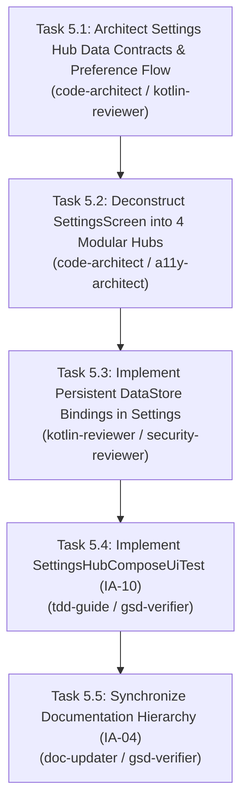

# Milestone Phase 5 Plan: Information Architecture & Settings Hub Convergence (`IA-03`, `IA-04`, `IA-10`) 🏛️

> **Parent Objective**: Execute Information Architecture & Governance Convergence resolving `IA-03` (Settings 4-Hub deconstruction), `IA-04` (Documentation governance), and `IA-10` (Automated navigation & settings UI test coverage).  
> **Governing Spec**: [`Documentation/INFORMATION_ARCHITECTURE.md`](file:///D:/Couple_fit/CoupleFit/Documentation/INFORMATION_ARCHITECTURE.md)  
> **Master Audit**: [`Documentation/Fixinglist.md`](file:///D:/Couple_fit/CoupleFit/Documentation/Fixinglist.md) & [`Documentation/triage.md`](file:///D:/Couple_fit/CoupleFit/Documentation/triage.md)  
> **Assigned Specialists**: `code-architect`, `planner`, `kotlin-reviewer`, `a11y-architect`, `security-reviewer`, `gsd-verifier`.  
> **Quality Gate**: `/impeccable` antislop and craft standards.

---

## 1. Acceptance Criteria & Test Bars

### Functional Acceptance Criteria:
1. **`IA-03`: Re-Architected 4-Hub Settings Navigation (`SettingsScreen.kt`)**:
   - Eliminate the 9-accordion vertical sprawl (1,059 lines) with in-memory variables.
   - Implement the approved 4-Hub structure:
     - **Hub 1: Partnership & Account**: User profile, partner status badge (`Linked with [Partner]`), 6-digit invite code generator/share CTA, sign out, and the fail-safe 2-step `"UNLINK"` modal (`CSA-07`).
     - **Hub 2: Health Sync & Data Sharing**: Health Connect status/permissions launcher, Samsung Health bridge, background sync interval radio (15m/30m/hourly/manual), and granular per-metric sharing toggles (Steps, Workouts, Heart Rate, SpO2, ECG) persistently backed by `healthConnectViewModel.sharingPreferences` / DataStore.
     - **Hub 3: App Experience & System**: Dark Mode switch (with circular reveal origin), Reduce Motion switch, Notification rules & quiet hours, and Units of Measurement toggle (Metric vs Imperial).
     - **Hub 4: Privacy & Security Center**: Biometric App Lock switch, Data Transparency Audit link (pointing to `PrivacyTransparencyScreen`), GDPR/CCPA Data Export button, and Account & Telemetry Purge modal.
     - **Section 5: About & Support**: Lean footer displaying version (`BuildConfig.VERSION_NAME`), Privacy Policy, Terms of Service, and Open-Source licenses.
   - Hub navigation must feature clean segmented pill selector chips with high-contrast active states (WCAG 2.2 AA).

2. **`IA-04`: Documentation Hierarchy & Governance**:
   - Centralize documentation in `Documentation/` with zero orphaned documents.
   - Keep `Documentation/Fixinglist.md`, `Documentation/triage.md`, `Documentation/INDEX.md`, `Documentation/phases.md`, and `Documentation/CHANGELOG_TRANSFORMATION.md` 100% synchronized with all changes.
   - Maintain zero `.md` file deletions policy.

3. **`IA-10`: Automated UI Test Harness Coverage**:
   - Implement [`SettingsHubComposeUiTest.kt`](file:///D:/Couple_fit/CoupleFit/app/src/androidTest/java/com/couplefit/ui/SettingsHubComposeUiTest.kt) testing:
     - Rendering of all 4 Settings Hub pills and smooth tab switching.
     - Hub 1 profile, partner status, and unlinking dialog behavior.
     - Hub 2 metric sharing toggles and permission launcher trigger.
     - Hub 3 theme and motion toggles.
     - Hub 4 privacy transparency navigation.
   - Re-verify [`NavigationComposeUiTest.kt`](file:///D:/Couple_fit/CoupleFit/app/src/androidTest/java/com/couplefit/ui/NavigationComposeUiTest.kt) to guarantee zero regressions across top-level destinations.

### Deterministic Verification Bars:
- `./gradlew.bat testDebugUnitTest` must pass with 100% success (0 regressions).
- `./gradlew.bat compileDebugAndroidTestKotlin` must compile with 0 errors.
- `./gradlew.bat assembleDebug` must compile cleanly.

---

## 2. Task Breakdown & Dependency Waves

