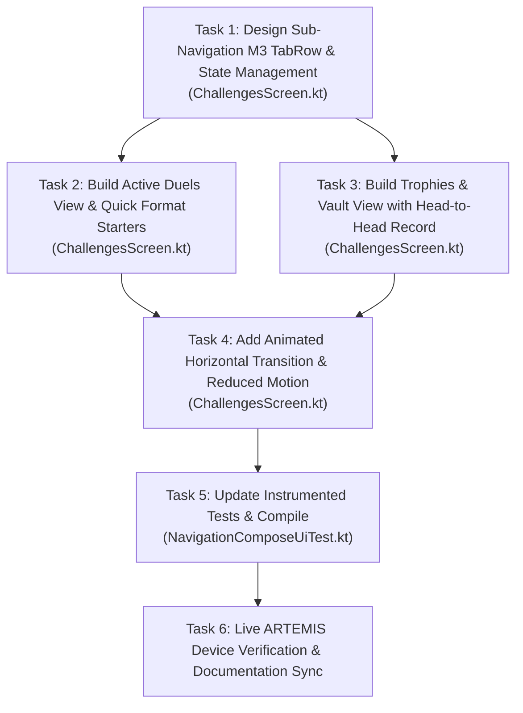

# Phase 6B Plan: Deep Resolution of Challenges Sub-Navigation (LOC-NAV-02) 🎯

> **Associated Defect ID**: `LOC-NAV-02`  
> **Source Audit**: [`Documentation/navigation_patterns_appwide_audit.md`](navigation_patterns_appwide_audit.md) & [`Documentation/card-sort-analysis.md`](card-sort-analysis.md) §7.2  
> **Target Screen**: [`ChallengesScreen.kt`](../app/src/main/java/com/couplefit/ui/challenge/ChallengesScreen.kt)  
> **Standards**: Material 3 Navigation Patterns, WCAG 2.2 Level AA, Antislop/Impeccable UI Quality

---

## 1. Problem Statement & User Research Foundation

In `card-sort-analysis.md` §7.2 (Wireframe 2) and `navigation_patterns_appwide_audit.md` §3 (Layer 2), user testing revealed:
- Mixing ongoing high-stakes active duels with historical milestone trophies in a single unpartitioned scroll produces visual noise, dilutes competitive urgency, and buries earned achievements.
- Basic filter chips are inadequate for top-level screen pagination because they lack swipe continuity, tab indicator animation, and badge affordances.
- **Goal**: Implement a production-grade Material 3 `SecondaryTabRow` (or `SingleChoiceSegmentedButtonRow`) with:
  1. **Dual-Tab Architecture**:
     - **Tab 1: `Active Duels`**: Real-time head-to-head competitions, active invitations, bilateral progress bars, and quick challenge matchmaking formats (`50k Steps Race`, `7-Day Active Streak`, `Weekend Showdown`).
     - **Tab 2: `Trophies & Vault`**: Head-to-Head win/loss record card, category filtering (`All`, `Steps`, `Streaks`), milestone achievement progress bars, and completed duel archive.
  2. **Gesture & Animation Support**: Smooth horizontal paging or animated tab transition respecting `reduceMotion`.
  3. **Multi-Modal Cues**: Icons (`EmojiEvents`, `SportsScore`/`Bolt`), bold typography on active tab, and dynamic badge counts (`1 Active`, `6 Trophies`).

---

## 2. Acceptance Criteria & Test Bars

1. **`AC-LOC-01` (Component Architecture)**:
   - Upgrades sub-navigation to Material 3 `SecondaryTabRow` with `Tab` components containing icons, bold active text, and dynamic badge counts.
2. **`AC-LOC-02` (Active Duels Surface)**:
   - Renders active head-to-head battles with bilateral progress bars, time remaining, and leader status.
   - Houses quick challenge format chips that open `StartChallengeDialog` with pre-filled parameters.
3. **`AC-LOC-03` (Trophies & Vault Surface)**:
   - Renders Head-to-Head win/loss record card (`Wins You vs Partner`, `Win Rate %`, `Win Streak`).
   - Renders categorized milestone badges with progress indicators.
   - Renders completed challenge history archive.
4. **`AC-LOC-04` (Accessibility & Motion)**:
   - WCAG 2.2 AA touch targets (≥48x48dp).
   - TalkBack accessibility content descriptions for each tab and badge.
   - Smooth animated transition with reduced motion override.
5. **`AC-LOC-05` (Deterministic Automated Tests)**:
   - `compileDebugAndroidTestKotlin`: 0 errors.
   - `testDebugUnitTest`: 100% pass rate.
   - `NavigationComposeUiTest.kt`: Asserts sub-tab switching, badge rendering, format chips, and trophy room.
   - Live device verification via ARTEMIS on `emulator-5554` with visual screenshot proof.

---

## 3. Dependency Graph

