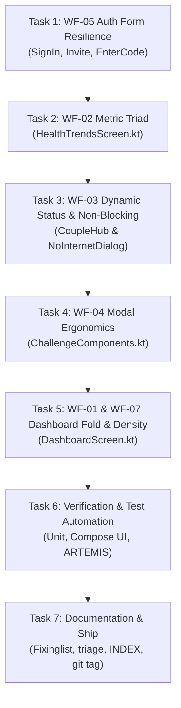

# Phase 8 Execution Plan: Wireframe & Ergonomics Resolution (`WF-01` to `WF-07`) 📐🚀

> **Target Milestone**: Phase 8 — Ergonomics, Fold Integrity & Form Resilience  
> **Lifecycle Governance**: GSD Project Management & Impeccable Quality Bar  
> **Testing Mandate**: Mandatory ARTEMIS verification on `emulator-5554` + 100% green unit/instrumented compilation  
> **Defect Scope**: `WF-01`, `WF-02`, `WF-03`, `WF-04`, `WF-05`, `WF-06`, `WF-07`

---

## 1. Milestone Objective & Scope

Execute surgical, production-grade resolutions for all 7 wireframe and ergonomic issues identified and specified in [`Documentation/wireframe_spec_wf01_wf02_wf03_analysis.md`](file:///D:/Couple_fit/CoupleFit/Documentation/wireframe_spec_wf01_wf02_wf03_analysis.md):
1. **`WF-01` & `WF-07` (Viewport Fold Overflow & "Card Mania")**:
   - Reorganize [`DashboardScreen.kt`](file:///D:/Couple_fit/CoupleFit/app/src/main/java/com/couplefit/ui/dashboard/DashboardScreen.kt):
     - Emancipate hero Activity Rings to float cleanly on canvas.
     - Relocate [`QuickNudgeRow`](file:///D:/Couple_fit/CoupleFit/app/src/main/java/com/couplefit/ui/dashboard/QuickNudgeRow.kt) directly below activity rings into prime thumb zone (`y < 600dp`).
     - Eliminate redundant `PartnerOfflineCard` (120dp).
     - Implement progressive disclosure for [`InteractiveChart`](file:///D:/Couple_fit/CoupleFit/app/src/main/java/com/couplefit/ui/dashboard/InteractiveChart.kt): collapsible 56dp summary pill `[📈 Live Heart Rate Pulse • 72 BPM Avg [Expand ▾]]` expanding to full chart on tap.
2. **`WF-02` (Universal Metric Triad Consistency)**:
   - In [`HealthTrendsScreen.kt`](file:///D:/Couple_fit/CoupleFit/app/src/main/java/com/couplefit/ui/trends/HealthTrendsScreen.kt), add Caloric Burn to `CombinedTelemetryCard` to standardize the Steps + Active Minutes + Calories triad across all surfaces.
3. **`WF-03` (Wireframe Status Synchronization & Non-Blocking State)**:
   - In [`CoupleHubScreen.kt`](file:///D:/Couple_fit/CoupleFit/app/src/main/java/com/couplefit/ui/hub/CoupleHubScreen.kt), replace hardcoded static text with dynamic partner status.
   - In [`MainActivity.kt`](file:///D:/Couple_fit/CoupleFit/app/src/main/java/com/couplefit/MainActivity.kt) & [`NoInternetDialog.kt`](file:///D:/Couple_fit/CoupleFit/app/src/main/java/com/couplefit/ui/components/NoInternetDialog.kt), make network awareness non-blocking so running/workout flows are never disrupted.
4. **`WF-04` (Modal Dialog Ergonomics)**:
   - In [`ChallengeComponents.kt`](file:///D:/Couple_fit/CoupleFit/app/src/main/java/com/couplefit/ui/challenge/ChallengeComponents.kt), optimize `StartChallengeDialog` for mobile thumb reach with bottom-anchored ergonomics and tablet max-width constraint.
5. **`WF-05` / `RSP-01` (Auth & Pairing Form Resilience)**:
   - In [`SignInScreen.kt`](file:///D:/Couple_fit/CoupleFit/app/src/main/java/com/couplefit/ui/auth/SignInScreen.kt), [`InvitePartnerScreen.kt`](file:///D:/Couple_fit/CoupleFit/app/src/main/java/com/couplefit/ui/auth/InvitePartnerScreen.kt), and [`EnterCodeScreen.kt`](file:///D:/Couple_fit/CoupleFit/app/src/main/java/com/couplefit/ui/auth/EnterCodeScreen.kt), implement `ResponsiveAuthContainer` featuring `verticalScroll(rememberScrollState())`, `imePadding()`, and `widthIn(max = 480.dp)`.
6. **`WF-06` (4-State Wireframe Contract)**:
   - In [`DashboardScreen.kt`](file:///D:/Couple_fit/CoupleFit/app/src/main/java/com/couplefit/ui/dashboard/DashboardScreen.kt), replace raw debug test buttons with warm Day-1 motivational guidance.

---

## 2. Task Dependency & Build Order

---

## 3. Explicit Acceptance Criteria & Test Bars

1. **`WF-05` Form Resilience**:
   - `SignInScreen`, `InvitePartnerScreen`, `EnterCodeScreen` must be scrollable via `rememberScrollState()`.
   - `imePadding()` must prevent keyboard from covering action buttons.
   - Screen must remain fully usable in landscape mode (~360dp height).
2. **`WF-01` & `WF-07` Dashboard Above-the-Fold**:
   - Total above-the-fold content height under ~640dp on compact screens.
   - `QuickNudgeRow` visible directly below rings.
   - `InteractiveChart` rendered as expandable 56dp summary pill by default.
   - No duplicate `PartnerOfflineCard`.
3. **`WF-02` Metric Triad**:
   - `CombinedTelemetryCard` displays Steps, Active Minutes, and Calories Burned.
4. **`WF-03` Status Synchronization**:
   - Couple Hub displays dynamic status.
   - Offline notification does not freeze user activity or block dashboard scrolling.
5. **Quality Bars**:
   - `./gradlew.bat testDebugUnitTest` = 100% pass.
   - `./gradlew.bat compileDebugAndroidTestKotlin` = 0 compile errors.
   - ARTEMIS live device screenshot proof on `emulator-5554`.
