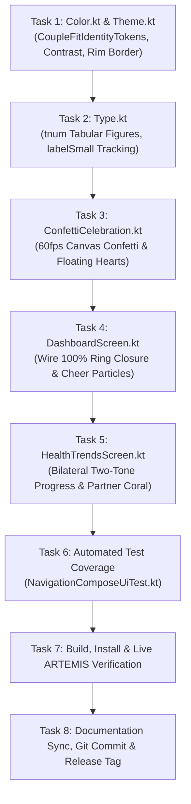

# Phase 13 Milestone Plan: Frontend Design, Dual Identity & Celebration Choreography 🎨🚀
> **Associated Defect Logs in Fixinglist.md**: `DSN-01`, `DSN-02`, `DSN-03`, `TST-01`, `TST-02`, `CLR-01`, `CLR-02`, `TYP-03`  
> **Target Framework**: Jetpack Compose, Material 3, Android Haptics, ARTEMIS Mobile Automation  
> **Companion Documents**: [`frontend_design_dsn01_dsn02_dsn03_analysis.md`](file:///D:/Couple_fit/CoupleFit/Documentation/frontend_design_dsn01_dsn02_dsn03_analysis.md), [`Fixinglist.md`](file:///D:/Couple_fit/CoupleFit/Documentation/Fixinglist.md), [`triage.md`](file:///D:/Couple_fit/CoupleFit/Documentation/triage.md)

---

## 1. Milestone Objectives

1. **Dual Signature Palettes (`DSN-01`, `CLR-02`)**:
   - Establish `CoupleFitIdentityTokens` in `Color.kt` and `Theme.kt`: Electric Cyan (`#00F5D4`) for User, Vibrant Coral (`#FF3366`) for Partner, and Solar Gold (`#FFD700`) for Synchrony.
   - Bind tokens across `HealthTrendsScreen.kt` (`SoloTelemetryCard`, `CombinedTelemetryCard` bilateral progress indicator) and `DashboardScreen.kt`.
2. **Ring Closure & Cheer Celebration Choreography (`DSN-02`, `MIC-02`)**:
   - Build `ConfettiCelebration.kt`: 60fps Canvas particle engine rendering 28 multi-colored particles on 100% daily ring closure and floating heart particle clusters on double-tap cheer.
   - Integrate fanfare haptic pattern with 3-stage vibration escalation.
   - Implement graceful `reduceMotion` handling (golden specular ring pulse, particle suppression).
3. **Brand Personality & Design Token Contract (`DSN-03`)**:
   - Codify Direction C ("Apple Fitness+ Deluxe meets Modern Telemetry HUD"): pure OLED black `#000000`, metallic specular rim lighting, and high-energy synchrony.
4. **Tabular Numerals & Micro-Typography (`TST-01`, `TYP-03`)**:
   - Update `Type.kt`: Apply `fontFeatureSettings = "tnum"` to display/headline styles to eliminate counter digit jitter.
   - Increase `labelSmall` uppercase tracking to `0.8.sp` for outdoor sunlight glanceability.
5. **Directional Specular Rim Lighting (`TST-02`)**:
   - Provide `directionalRimBorder()` modifier or vertical linear gradient brush for primary elevated cards.
6. **Accessible Contrast Tokens (`CLR-01`)**:
   - Introduce `OnUserAccent` (`#001F38`, 7.8:1) and `OnPartnerAccent` (`#FFFFFF`, 4.6:1) satisfying WCAG 2.2 AA.

---

## 2. Acceptance Criteria & Test Bars

- [ ] **AC-1 (Dual Identity)**: User telemetry is consistently rendered in Electric Cyan (`#00F5D4`) and Partner in Vibrant Coral (`#FF3366`) across Today and Trends.
- [ ] **AC-2 (Two-Tone Progress)**: `CombinedTelemetryCard` renders a bilateral two-tone progress indicator displaying both Cyan (User) and Coral (Partner) proportional step splits.
- [ ] **AC-3 (Celebration Engine)**: Achieving 100% daily steps or tapping cheer triggers the Canvas particle explosion/floating heart animation without frame drops.
- [ ] **AC-4 (Reduce Motion Grace)**: When `reduceMotion = true`, particles are suppressed and replaced by an accessible golden pulse glow.
- [ ] **AC-5 (Tabular Figures)**: Step counter numerals in `Type.kt` use `fontFeatureSettings = "tnum"`, ensuring fixed-width character advances.
- [ ] **AC-6 (Unit & Compile Tests)**: `./gradlew testDebugUnitTest` passes 100%; `./gradlew compileDebugAndroidTestKotlin` succeeds with 0 errors.
- [ ] **AC-7 (ARTEMIS Live Verification)**: Verified on `emulator-5554` via ARTEMIS with screenshot and hierarchy evidence.

---

## 3. Task Execution Sequence

