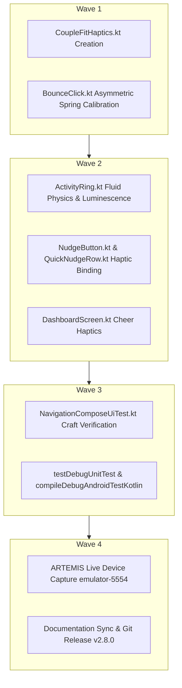

# Phase 14 Milestone Plan: Design Engineering Craft (ENG-01 to ENG-04)

> **Document Path**: `Documentation/PLAN_PHASE_14_DESIGN_ENGINEERING_ENG01_TO_ENG04.md`  
> **Lifecycle Mode**: `/gsd-plan-phase`  
> **Associated Defect IDs**: `ENG-01`, `ENG-02`, `ENG-03`, `ENG-04`, `APL-02`, `ANM-01`, `MIC-01`, `MIC-03`  
> **Target Release**: `v2.8.0-design-eng`

---

## 1. Objective

Elevate CoupleFit from functional correctness to tactile craft excellence. Calibrate spring physics, eliminate layout twitch, ensure uninterrupted fluid progress kinematics, illuminate activity ring tracks, and implement intimate heartbeat haptics according to Emil Kowalski's Design Engineering framework.

---

## 2. Acceptance Criteria & Test Bars

- [ ] **AC-ENG-01**: `BounceClick.kt` implements calibrated spring physics (`dampingRatio = 0.82f, stiffness = 750f` on release; `StiffnessHigh` on press-down) with configurable `pressedScale` (default `0.975f` to prevent layout twitch) and `pressedAlpha` (default `0.88f`).
- [ ] **AC-ENG-02**: `ActivityRing.kt` replaces `tween(1200, FastOutSlowInEasing)` with fluid spring physics (`dampingRatio = 0.78f, stiffness = 120f`) and eliminates all `snapTo(0f)` calls to maintain spatial continuity.
- [ ] **AC-ENG-03**: `CoupleFitHaptics.kt` encapsulates the dual-pulse "Heartbeat Tick" (`12ms @ 40% -> 80ms pause -> 18ms @ 70%`) with graceful fallback across Android API levels and integrates into `NudgeButton.kt`, `QuickNudgeRow.kt`, and `DashboardScreen.kt`.
- [ ] **AC-ENG-04**: `ActivityRing.kt` replaces flat dark gray tracks with luminescent tinted ambient glows (`gradientEnd.copy(alpha = 0.12f)`) and renders an ambient cap occlusion shadow.
- [ ] **AC-ENG-05**: Local test suites (`testDebugUnitTest` and `compileDebugAndroidTestKotlin`) pass 100% with zero regressions.
- [ ] **AC-ENG-06**: Live Android emulator (`emulator-5554`) verification via Google ARTEMIS capturing hierarchy and screenshot artifacts.
- [ ] **AC-ENG-07**: Complete documentation updates (`Fixinglist.md`, `triage.md`, `phases.md`, `INDEX.md`, `knowledge-graph.md`, and release notes).

---

## 3. Wave Execution Order

---

## 4. Work Breakdown

1. **Task 1: `CoupleFitHaptics.kt`**:
   - Location: `app/src/main/java/com/couplefit/ui/theme/CoupleFitHaptics.kt`
   - Expose `performHeartbeat(context: Context)` and `performSubtleTick(context: Context)`.
2. **Task 2: `BounceClick.kt`**:
   - Calibrate spring values (`dampingRatio = 0.82f, stiffness = 750f` release; `dampingRatio = 1.0f, stiffness = 1000f` press).
   - Parameterize `pressedScale: Float = 0.975f` and `pressedAlpha: Float = 0.88f`.
3. **Task 3: `ActivityRing.kt`**:
   - Swap tween for spring retargeting (`dampingRatio = 0.78f, stiffness = 120f`).
   - Remove `snapTo(0f)`.
   - Update default track color to `gradientEnd.copy(alpha = 0.12f)` and add ambient halo.
4. **Task 4: `NudgeButton.kt` & `QuickNudgeRow.kt` & `DashboardScreen.kt`**:
   - Replace `LongPress` haptic feedback with `CoupleFitHaptics.performHeartbeat(context)`.
5. **Task 5: Verification & Documentation**:
   - Run tests, deploy to emulator, run ARTEMIS audit, update documentation, and commit release.
