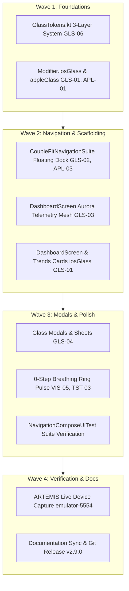

# Phase 15 Milestone Plan: UI/UX Pro Max Glassmorphism & Visual Design System (GLS-01 to GLS-06)

> **Document Path**: `Documentation/PLAN_PHASE_15_GLASSMORPHISM_GLS01_TO_GLS06.md`  
> **Lifecycle Mode**: `/gsd-plan-phase`  
> **Associated Defect Logs**: `GLS-01`, `GLS-02`, `GLS-03`, `GLS-04`, `GLS-05`, `GLS-06`, `APL-01`, `APL-03`, `TST-03`, `VHR-01`  
> **Target Release**: `v2.9.0-glassmorphism`

---

## 1. Objective

Transform CoupleFit's visual foundation from flat, opaque `#1C1C1E` dark slabs into an Apple-grade **Liquid Glass Design System** adhering strictly to `/ui-ux-pro-max-skill:design-system`. Introduce the three-layer token architecture (`GlassTokens.kt`), reusable glass modifiers (`Modifier.iosGlass()`), the detached Floating Glass Navigation Dock, ambient aurora telemetry lighting, and glassmorphic modals with backward-compatible hardware blur.

---

## 2. Acceptance Criteria & Test Bars

- [ ] **AC-GLS-01**: `GlassTokens.kt` formalizes the 3-layer token architecture (`GlassPrimitives` $\to$ `GlassSemantics` $\to$ `GlassComponentTokens`) with explicit translucency, blur, elevation, and specular border tokens.
- [ ] **AC-GLS-02**: `Modifier.iosGlass()` (and `Modifier.appleGlass()`) provides 8% translucent white tint, 20dp RenderEffect backdrop blur on Android 12+ (API 31+), and 1px vertical specular gradient border (`directionalRimBrush()`), with graceful solid tinted slate fallback on Android 10/11.
- [ ] **AC-GLS-03**: `CoupleFitNavigationSuite.kt` refactors the compact bottom navigation into a **Floating Glass Navigation Dock** (`16dp` elevation, `32dp` pill shape, `28dp` blur, and glowing M3 indicator capsules) with proper `navigationBarsPadding()` and content scroll clearance.
- [ ] **AC-GLS-04**: `DashboardScreen.kt` integrates ambient dual-radial aurora mesh lighting (`Electric Cyan` on left, `Vibrant Coral` on right at 8% alpha) behind activity gauges, and applies glassmorphic card styling.
- [ ] **AC-GLS-05**: Modal bottom sheets (`StartChallengeDialog`) and dialogs (`TelemetryDiagnosticDialog`) adopt `SurfaceGlassModal` with top specular highlight and 75% dark scrim.
- [ ] **AC-GLS-06**: `ActivityRing.kt` renders an ambient breathing pulse dot at the 12 o'clock cap when `progress == 0f` (`VIS-05` / `TST-03`).
- [ ] **AC-GLS-07**: Local test suites (`testDebugUnitTest` and `compileDebugAndroidTestKotlin`) pass 100% with zero regressions.
- [ ] **AC-GLS-08**: Live device verification on `emulator-5554` via Google ARTEMIS capturing hierarchy and screenshot artifacts.
- [ ] **AC-GLS-09**: Complete documentation synchronization (`Fixinglist.md`, `triage.md`, `phases.md`, `INDEX.md`, `knowledge-graph.md`, and `RELEASE_NOTES_v2.9.0.md`).

---

## 3. Wave Execution Order

