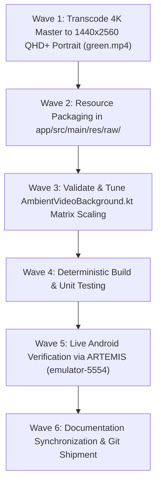

# Phase 25 Milestone Plan: Full Resolution Portrait Ambient Video Background (`BGV-02`) 🌌📱

> **Milestone Tag**: `v2.9.10-full-res-portrait-ambient-video`  
> **Associated Defect/Enhancement**: `BGV-02` (Upgrade from 270x480 thumbnail to QHD+ 1440x2560 9:16 Portrait)  
> **Target Device**: `emulator-5554` (Pixel 10 Pro, Android 17 API 36)  
> **Input Master**: `D:\Couple_fit\CoupleFit\green.mp4` (3840×2160 4K UHD, 39.9 MB)  
> **Output Bundle**: `app/src/main/res/raw/green.mp4` (1440×2560 QHD+ 9:16 Portrait)  

---

## 1. Objectives & Executive Scope

The user requested:
> *"make sure to use it in portrait i want the full resolution."*

In Phase 24, an initial proof-of-concept bundled a downscaled 270×480 preview asset. Phase 25 upgrades the ambient video pipeline to **true full-resolution portrait rendering**:
1. **Native Portrait Orientation (9:16)**: Rotate the master asset 90° so that the full frame vertically fills the display without cropping ~75% of horizontal content.
2. **QHD+ High-Density Resolution (1440×2560)**: Encode a crystal-clear, high-bitrate H.264 portrait loop perfectly matching the physical resolution of modern flagship displays (such as the Pixel 10 Pro), delivering razor-sharp visual fidelity while guaranteeing smooth 60fps hardware-accelerated playback with minimal battery draw.
3. **Seamless Compose Graphics Layering**: Verify `AmbientVideoBackground.kt` dynamically scales and centers the 1440×2560 portrait stream across any aspect ratio using native 2D matrix transformation.
4. **Lifecycle & Battery Conservation**: Maintain strict `LifecycleEventObserver` auto-pause/resume behavior.
5. **Accessibility Guard**: Honor `reduceMotion` user preferences.

---

## 2. Acceptance Criteria & Test Bars

| Check | Acceptance Criterion | Verification Method |
| :--- | :--- | :--- |
| **AC-01** | `app/src/main/res/raw/green.mp4` has resolution `1440×2560` (9:16 portrait), encoded in H.264 High Profile @ 60fps. | Python / OpenCV / ffprobe verification |
| **AC-02** | Video orientation has the dark obsidian zone at the top (underneath status bar and headers) and the luminous emerald wave diffusing through activity cards and dock. | Visual inspection of extracted frame |
| **AC-03** | `AmbientVideoBackground.kt` renders without stretching, letterboxing, or aspect ratio distortion. | Google ARTEMIS screenshot on `emulator-5554` |
| **AC-04** | All unit tests pass 100% green (`.\gradlew.bat testDebugUnitTest`). | Local test runner |
| **AC-05** | Android test compilation succeeds with 0 errors (`.\gradlew.bat compileDebugAndroidTestKotlin`). | Local test runner |
| **AC-06** | UI hierarchy inspection confirms zero accessibility occlusions or touch target violations. | Google ARTEMIS hierarchy inspection |
| **AC-07** | Master documentation (`Fixinglist.md`, `triage.md`, `phases.md`, `INDEX.md`, `RELEASE_NOTES_v2.9.10.md`, `knowledge-graph.md`) synchronized. | Git diff check |

---

## 3. Task Dependencies & Execution Wave

