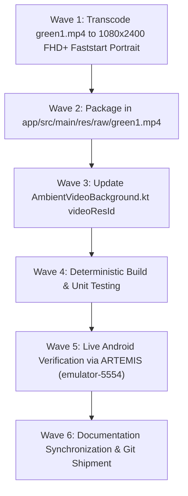

# Phase 26 Milestone Plan: Ambient Video Background Switch to `green1.mp4` (`BGV-03`) 🌌🌿

> **Milestone Tag**: `v2.9.11-ambient-video-green1`  
> **Associated Defect/Enhancement**: `BGV-03` (Transition Ambient Canvas to Native 9:20 Portrait `green1.mp4`)  
> **Target Device**: `emulator-5554` (Pixel 10 Pro, Android 17 API 36)  
> **Input Master**: `D:\Couple_fit\CoupleFit\green1.mp4` (864×1920 9:20 Portrait, 20.02s loop, 19.6 MB)  
> **Output Bundle**: `app/src/main/res/raw/green1.mp4` (1080×2400 Full HD+ 9:20 Portrait, Faststart H.264)  

---

## 1. Objectives & Executive Scope

The user requested:
> *"can you use green1.mp4"*

Phase 26 transitions the atmospheric ambient canvas to the newly provided `green1.mp4` video asset:
1. **Native 9:20 Portrait Aspect Ratio**: Unlike the original landscape master, `green1.mp4` is natively formatted in 9:20 vertical portrait, eliminating the need for rotation.
2. **20-Second Smooth Ambient Motion**: Features a longer 20.02s progressive liquid gradient flow, providing calm, non-distracting atmospheric depth behind the frosted glass cards.
3. **Full HD+ Optimization (`1080×2400`)**: Scales cleanly from 864×1920 to 1080×2400 (exact 1.25x integer ratio) using Lanczos filtering and H.264 High Profile encoding with `-movflags +faststart`, ensuring immediate hardware-accelerated playback with minimal battery draw.
4. **Component Wire-up**: Update `AmbientVideoBackground.kt` to load `R.raw.green1`.
5. **Lifecycle & Accessibility Integrity**: Preserve auto-pausing on background and vestibular respect via `reduceMotion`.

---

## 2. Acceptance Criteria & Test Bars

| Check | Acceptance Criterion | Verification Method |
| :--- | :--- | :--- |
| **AC-01** | `app/src/main/res/raw/green1.mp4` is packaged with resolution `1080×2400` (9:20 portrait), H.264 High Profile, audio-free, and faststart moov header. | OpenCV / FFmpeg verification |
| **AC-02** | `AmbientVideoBackground.kt` defaults to `videoResId = R.raw.green1`. | Kotlin code review |
| **AC-03** | Video renders distortion-free with center-crop fill across the viewport. | Google ARTEMIS screenshot on `emulator-5554` |
| **AC-04** | Unit tests pass 100% green (`.\gradlew.bat testDebugUnitTest`). | Local test runner |
| **AC-05** | Android test compilation succeeds with 0 errors (`.\gradlew.bat compileDebugAndroidTestKotlin`). | Local test runner |
| **AC-06** | UI hierarchy inspection confirms zero accessibility occlusions or touch target violations. | Google ARTEMIS hierarchy inspection |
| **AC-07** | Master documentation (`Fixinglist.md`, `triage.md`, `phases.md`, `INDEX.md`, `RELEASE_NOTES_v2.9.11.md`, `knowledge-graph.md`) synchronized. | Git diff check |

---

## 3. Task Dependencies & Execution Wave

