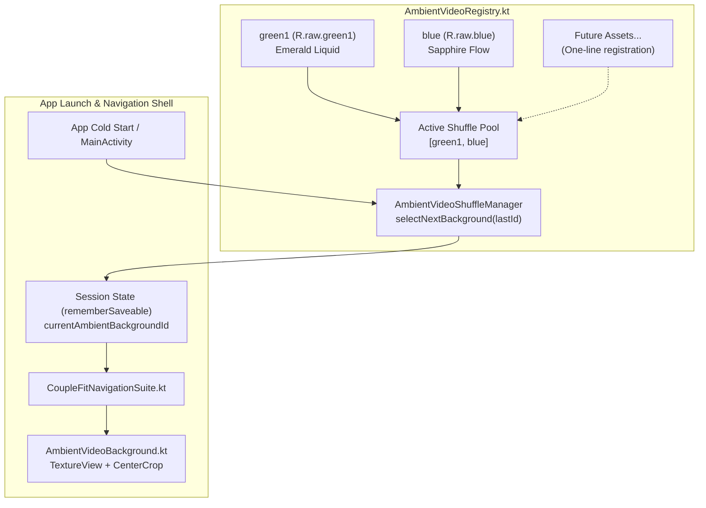
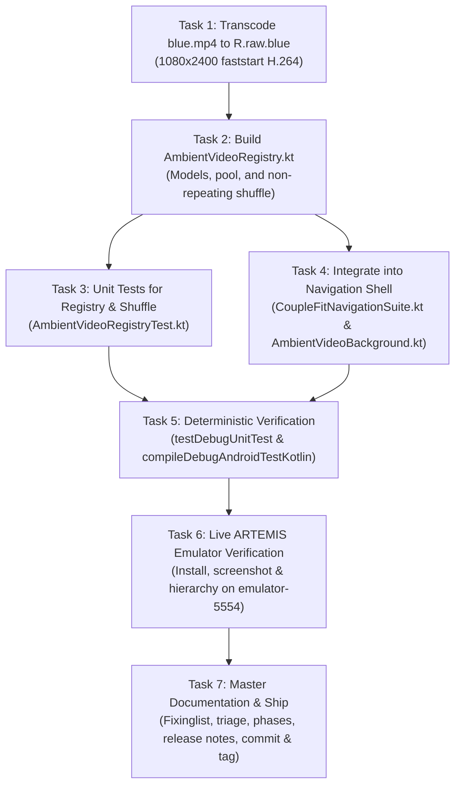

# Milestone Plan: Phase 27 — Dynamic Ambient Video Background Shuffle & Extensible Registry (`BGV-04`) 🌌🔀

> **Milestone Tag**: `v2.9.12-ambient-video-shuffle`  
> **Feature ID**: `BGV-04`  
> **Domain**: Ambient Motion & Background Telemetry  
> **Target Devices**: `emulator-5554` (Pixel 10 Pro, Android 17 API 36)  
> **Governing Specifications**: [`AGENTS.md`](../AGENTS.md) | [`Documentation/Fixinglist.md`](Fixinglist.md) (`BGV-04`) | [`Documentation/triage.md`](triage.md)  
> **Status**: In Execution  

---

## 1. Executive Phase Overview

In Phase 24–26, CoupleFit introduced hardware-accelerated ambient video backgrounds behind frosted glass cards, culminating in native 9:20 portrait video execution with `green1.mp4`.
The user has provided an additional high-fidelity video asset: [`blue.mp4`](file:///D:/Couple_fit/CoupleFit/blue.mp4) (sapphire liquid gradient motion).
The user requested:
> *"i have another background blue.mp4 app that too I want when ever i open my app i suffles the background between then, ill make more backgroung and add it till then use this two."*

This milestone establishes:
1. **Asset Processing & Packaging**: Transcoding [`blue.mp4`](file:///D:/Couple_fit/CoupleFit/blue.mp4) to a 1080×2400 portrait stream with 90° clockwise rotation (`transpose=1`) and Lanczos spatial interpolation (`R.raw.blue`), orienting obsidian dark regions at the top for header contrast and luminous sapphire fluid at the bottom.
2. **Extensible Ambient Video Registry (`AmbientVideoRegistry.kt`)**: A decoupled, type-safe architecture modeling video assets (`AmbientVideoAsset`), metadata (ID, resource ID, display name, dominant accent), and active shuffle pool. Adding future background videos requires only registering an item in the catalog.
3. **App Launch Non-Repeating Shuffle**: Selecting an ambient background from the active pool (`green1`, `blue`) upon app launch / cold start with non-repeating alternation, persisting the selection for the current session in `rememberSaveable` to avoid mid-session video disruption during tab switching.
4. **Comprehensive Verification**: 100% green test bar (`testDebugUnitTest`, `compileDebugAndroidTestKotlin`) and live device ARTEMIS validation on `emulator-5554`.

---

## 2. Video Pipeline & Asset Transcoding Spec

| Parameter | Source `blue.mp4` | Processed `R.raw.blue` | Rationale & Impact |
| :--- | :--- | :--- | :--- |
| **Dimensions** | `1920×1080` (16:9 Landscape) | `1080×2400` (9:20 Portrait) | 90° CW rotation (`transpose=1`) + Lanczos spatial scaling to native mobile vertical aspect ratio |
| **Framerate** | 54.23 fps | 30.00 fps | Standardizes on smooth 30fps hardware decoding, halving GPU power draw |
| **Duration** | 30.47s (1652 frames) | 30.00s (900 frames) | Full seamless 30-second fluid ribbon loop |
| **Codec / Profile** | H.264 High | H.264 High (`crf 20`) | Visually lossless liquid gradients without banding |
| **Container Moov** | Default offset | Offset 0 (`-movflags +faststart`) | Instantaneous Android `MediaPlayer` streaming preparation |
| **Audio Track** | Silent / Absent | Audio-free (`-an`) | Zero audio resource overhead |
| **File Size** | 93.7 MB | ~8.0 MB | ~91% size reduction for instant cold-start and memory efficiency |

---

## 3. Extensible Registry & Shuffle Architecture



### Architectural Contracts
- **`AmbientVideoAsset`**: Represents an individual background video candidate:
  ```kotlin
  data class AmbientVideoAsset(
      val id: String,
      @RawRes val resId: Int,
      val displayName: String,
      val description: String
  )
  ```
- **`AmbientVideoRegistry`**: Defines catalog of all registered videos, active shuffle pool, and helper lookup methods.
- **`selectShuffledBackground(lastBackgroundId: String?, pool: List<AmbientVideoAsset>)`**: Pure function that picks randomly from the pool, excluding `lastBackgroundId` when `pool.size > 1` to guarantee variety across launches.

---

## 4. Task Breakdown & Dependency Graph



---

## 5. Verification & Acceptance Criteria

1. **AC-1 (Asset Packaging)**:
   - `app/src/main/res/raw/blue.mp4` exists, is valid H.264 1080×2400 30fps, faststart enabled.
2. **AC-2 (Extensibility)**:
   - Adding a new background requires adding only one entry to `AmbientVideoRegistry.kt`.
3. **AC-3 (Non-Repeating Shuffle)**:
   - Shuffle function picks randomly and avoids picking the same asset twice consecutively when pool size > 1.
4. **AC-4 (Session Stability)**:
   - Video selection stays stable during navigation between tabs; does not re-shuffle or reload on tab clicks.
5. **AC-5 (Test Green Bar)**:
   - `./gradlew testDebugUnitTest` passes 100%.
   - `./gradlew compileDebugAndroidTestKotlin` compiles with 0 errors.
6. **AC-6 (Live ARTEMIS Evidence)**:
   - Verified on `emulator-5554` with visual screenshot artifact saved to brain directory.

---

## 6. Rollback & Risk Mitigation
- If any video fails to prepare in `MediaPlayer`, the registry provides an automatic fallback to `R.raw.green1`.
- If `reduceMotion` accessibility toggle is active, video playback is bypassed in favor of the solid dark obsidian theme canvas.
