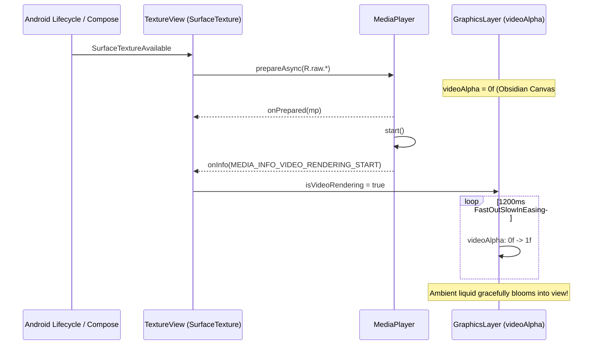

# Milestone Plan: Phase 28 — Natural Ambient Video Background Fade-In Transition (`BGV-05`) 🌌✨

> **Milestone Tag**: `v2.9.13-ambient-video-fade-in`  
> **Feature ID**: `BGV-05`  
> **Domain**: Ambient Motion & Visual Craft Engineering  
> **Target Devices**: `emulator-5554` (Pixel 10 Pro, Android 17 API 36)  
> **Governing Specifications**: [`AGENTS.md`](../AGENTS.md) | [`Documentation/Fixinglist.md`](Fixinglist.md) (`BGV-05`) | [`Documentation/triage.md`](triage.md)  
> **Status**: In Execution  

---

## 1. Executive Phase Overview

In Phase 27, CoupleFit introduced dynamic ambient video shuffling across app launches between `green1.mp4` and `blue.mp4`.
However, on cold start and during video buffer preparation, the `TextureView` surface abruptly snaps from the black canvas into the first video frame as soon as `MediaPlayer.start()` is invoked. This abrupt transition breaks visual fluidity.
The user requested:
> *"can you give fade in effect to the background app so that i looks natural"*

This milestone implements an Emil Kowalski-grade **Natural Fade-In Transition** (`BGV-05`) for the ambient video background:
1. **Precise First-Frame Detection**: Listening to `MediaPlayer.MEDIA_INFO_VIDEO_RENDERING_START` so the animation commences only when the decoder has physically presented the first frame to the surface, backed by a safety fallback on `onPrepared`.
2. **Organic Alpha Bloom (1200ms `FastOutSlowInEasing`)**: Hardware-accelerated alpha interpolation transitioning the ambient video layer from `0f` to `1f` over the `#07080A` obsidian canvas.
3. **Mid-Session & Resume Stability**: Retaining steady-state alpha during tab navigation and lifecycle pause/resumes to prevent flickering.
4. **Accessibility Compliance**: Honoring `reduceMotion` by settling immediately without protracted transition sweeps.

---

## 2. Technical Design & Architecture

---

## 3. Verification & Acceptance Criteria

1. **AC-1 (Zero Snap / Flicker)**:
   - On cold start, the video layer starts at opacity `0f` over the dark obsidian background; no sudden frame pop occurs.
2. **AC-2 (Smooth 1200ms Bloom)**:
   - Upon first frame availability, `videoAlpha` animates smoothly from `0f` to `1f` using `FastOutSlowInEasing`.
3. **AC-3 (Lifecycle & Tab Continuity)**:
   - Once rendered, navigating between tabs or returning from settings maintains `1f` without flashing.
4. **AC-4 (Accessibility Resilience)**:
   - When `reduceMotion = true`, video alpha transitions instantaneously without vestibular strain.
5. **AC-5 (Deterministic Verification)**:
   - Unit tests (`testDebugUnitTest`) pass 100%.
   - Compose Android tests compile with 0 errors (`compileDebugAndroidTestKotlin`).
6. **AC-6 (Live Device Proof)**:
   - Verified on `emulator-5554` via ARTEMIS.
