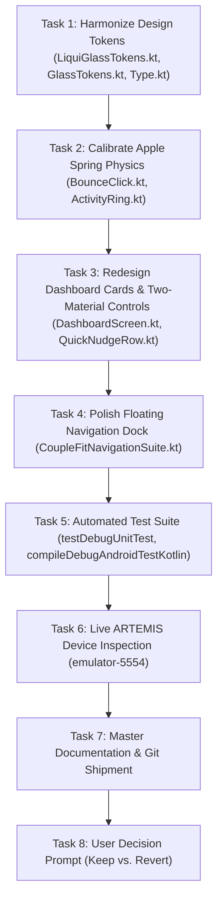

# Phase 29: Apple Design & Liqui Design Comprehensive UI & Animation Redesign (`DSN-06`, `ANM-04`)

> **Author**: Autonomous Pair-Programming Agent (Antigravity)  
> **Status**: In Progress  
> **Target Branch**: `feature/apple-liqui-redesign` (branched from `dev_akash` @ `0c5c934`)  
> **Rollback Anchor**: `v2.9.13-ambient-video-fade-in` (`0c5c9342a01e98c937fab97fe39e30097478e053`)  

---

## 1. Executive Summary & Design Foundations

This milestone executes a comprehensive visual and motion overhaul of the **CoupleFit** application, harmonizing:
1. **Apple Design Principles** (WWDC *Designing Fluid Interfaces* & *Principles of Great Design*):
   - **Zero Latency Feedback**: Immediate pointer-down tactile depression (`scale = 0.975f`, `alpha = 0.88f`), no touch release delays.
   - **Critically Damped Physics**: Default UI spring physics calibrated to `dampingRatio = 1.0f`, `stiffness = 800f` (`response ≈ 0.35s`), eliminating cartoonish wobble while ensuring fluid settling.
   - **Momentum-Specific Bounce**: Subtle under-damped bounce (`dampingRatio = 0.82f`, `stiffness = 380f`) reserved strictly for user gestures that carry momentum (cheers, celebration bursts, pull-to-refresh).
   - **Interruptibility**: Animations animate from current live presentation values rather than fixed hard-stops.
   - **Optical Typography**: Negative letter-tracking on display figures (`-0.02em` / `-0.5sp`) and positive tracking on micro captions/status labels (`+0.04em` / `+0.5sp`).
2. **Liqui Design System** (`https://github.com/leefanv/liqui-design`):
   - **4-Layer Optical Stack**:
     1. Ambient shadow elevation (`8dp` to `16dp`) with deep translucent slate foundation.
     2. Continuous squircle curvature (`22dp` radius).
     3. 2-stop optical tint legibility gradient wash (`--lq-tint` to `--lq-tint-deep`).
     4. Directional diamond-cut specular bevel rim (`--lq-rim-hi` descending to `--lq-rim-lo`).
   - **Two-Material Philosophy**: Interactive controls (nudge pills, buttons, diagnostic chips) use distinct tactile solid/accent materials rather than stacking identical glass on glass.
   - **Zero Container Blurring**: Eliminates child `RenderEffect` blurring to preserve 100% razor-sharp foreground typography, graphs, and icons.

---

## 2. Reversibility & Rollback Strategy

Per user specification, all modifications are developed on an isolated feature branch `feature/apple-liqui-redesign`.
Upon completion and verification with live ARTEMIS device captures, the agent will prompt the user to choose:
- **Option A (Keep Changes)**: Merge `feature/apple-liqui-redesign` into `dev_akash` and tag `v2.9.14-apple-liqui-redesign`.
- **Option B (Revert / Undo)**: Instantly revert to `v2.9.13-ambient-video-fade-in`:
  ```bash
  git checkout dev_akash
  git reset --hard v2.9.13-ambient-video-fade-in
  git branch -D feature/apple-liqui-redesign
  ```

---

## 3. Explicit Acceptance Criteria & Test Bars

| ID | Domain | Requirement | Verification Bar |
|---|---|---|---|
| **AC-01** | Motion Physics | `iosClickable` delivers immediate pointer-down visual depression with Apple critically damped settling (`damping 1.0f`, `stiffness 850f`). | Zero visual lag on touch; test passes. |
| **AC-02** | Optical Glass | Cards use 4-layer Liqui optical stack (`liquiGlass`) with directional specular bevel rim, without child render blur. | Visual inspection on `emulator-5554`; typography remains 100% sharp. |
| **AC-03** | Two-Material UI | Quick nudges, status pills, and interactive chips use tactile accent surfaces with high contrast over the ambient video. | 4.5:1 text contrast ratio; TalkBack 44x44dp touch targets preserved. |
| **AC-04** | Dual Activity Rings | Rings use smooth spring kinematics (`dampingRatio = 1.0f`, `stiffness = 500f`) with fluid arc completion. | No visual stuttering; tests pass. |
| **AC-05** | Heart Rate Graph | Live heart rate card displays crisp baseline curve, pulsating vitals indicator, and sharp metric typography. | Verified via ARTEMIS screenshot. |
| **AC-06** | Navigation Dock | Floating glass dock features calibrated translucency and multi-modal selected indicator. | 68dp dock floating above navigation bar without visual clipping. |
| **AC-07** | Automated Tests | 100% passing unit tests and Android test compilation. | `./gradlew testDebugUnitTest` and `./gradlew compileDebugAndroidTestKotlin` succeed. |
| **AC-08** | Live Proof | ARTEMIS device capture on `emulator-5554` showing redesigned UI. | Screenshot artifact stored in conversation brain. |

---

## 4. Implementation Task Breakdown


