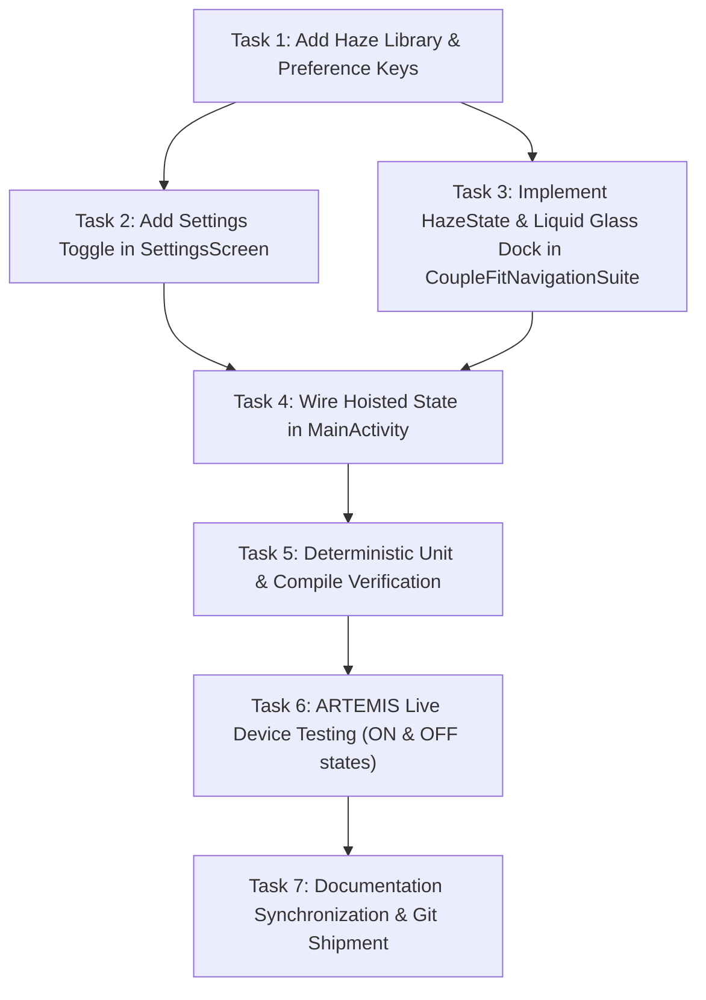

# Milestone Plan — Phase 36: Real-Time Liquid Glass Bottom Navigation Bar Redesign (`LIQ-01`) 🌊✨

> **Phase Identifier**: Phase 36  
> **Target Release Tag**: `v2.9.21-liquid-glass-navbar-liq01`  
> **Target Defect / Feature ID**: `LIQ-01`  
> **Source Blueprint**: [`Documentation/liquideffect.md`](file:///D:/Couple_fit/CoupleFit/Documentation/liquideffect.md)  
> **Operating Standard**: [`AGENTS.md`](file:///D:/Couple_fit/CoupleFit/AGENTS.md)  
> **Status**: 🟡 **IN PROGRESS (Executing Plan)**

---

## 1. Executive Summary & Problem Framing

Following Phase 35's full-bleed floating hover dock architecture (`DCK-01`), the user has provided a comprehensive implementation blueprint in [`Documentation/liquideffect.md`](file:///D:/Couple_fit/CoupleFit/Documentation/liquideffect.md) to elevate the bottom navigation dock to true real-time frosted liquid glass using Chris Banes's **Haze** library.

The implementation introduces:
1. Real-time dynamic sampling and blurring of underlying scrollable cards and ambient video behind the dock via `HazeState`, `.hazeSource()`, and `.hazeEffect()`.
2. Seamless user configurability via a dedicated "Liquid Glass Navigation Bar" switch row in the Settings tab, positioned directly below "Reduce Motion" in the Experience Hub.
3. Accessible fallback: Graceful degradation to a solid surface (`surface.copy(alpha = 0.95f)`) when the toggle is turned off or on devices with reduced transparency.

---

## 2. Explicit Acceptance Criteria & Test Bars

### Criteria 1: Real-Time Liquid Frosted Glass (`LIQ-01`)
- The floating navigation dock samples and blurs underlying scrollable cards and living video in real time using `hazeEffect(state = hazeState, style = HazeMaterials.ultraThin())`.
- The pill shape uses a 50% corner radius (`RoundedCornerShape(percent = 50)` / `34.dp`) with a specular hairline rim (`0.5.dp, Color.White.copy(alpha = 0.18f)`).
- Content container is marked with `.hazeSource(state = hazeState)`.

### Criteria 2: Settings Toggle in Experience Hub
- A `SettingsSwitchRow` titled `"Liquid Glass Navigation Bar"` with subtitle `"Frosted glass effect on the floating bottom navigation bar"` is rendered in [`SettingsScreen.kt`](file:///D:/Couple_fit/CoupleFit/app/src/main/java/com/couplefit/ui/settings/SettingsScreen.kt) directly below `"Reduce Motion"`.
- State is persisted via `CoupleFitPreferencesDataStore` / SharedPreferences across app restarts.
- Toggling the switch instantly updates the bottom navigation bar without restarting the activity.

### Criteria 3: Solid Fallback & Android Version Guard
- When disabled or on devices without Android 12+ (API 31+) hardware RenderEffect, the dock falls back cleanly to a solid surface (`surface.copy(alpha = 0.95f)`) with an outline border.

### Criteria 4: Deterministic Quality & Test Bars
- `./gradlew.bat testDebugUnitTest` must pass with 100% green bar (33/33+ tests).
- `./gradlew.bat compileDebugAndroidTestKotlin` must compile with 0 errors.
- Verified on live Android emulator `emulator-5554` via ARTEMIS with screenshot proof.

---

## 3. Task Breakdown & Dependency Order

- **Task 1**: Verify `dev.chrisbanes.haze:haze:1.3.1` and `dev.chrisbanes.haze:haze-materials:1.3.1` in `app/build.gradle.kts`. Add `KEY_LIQUID_GLASS` in `CoupleFitPreferencesDataStore.kt`.
- **Task 2**: In `SettingsScreen.kt`, add `"Liquid Glass Navigation Bar"` switch in `ExperienceHubContent` below `"Reduce Motion"`.
- **Task 3**: In `CoupleFitNavigationSuite.kt`, introduce `HazeState`, attach `.hazeSource` to content, apply `.hazeEffect` with `HazeMaterials.ultraThin()` and specular border when active, with solid fallback when disabled.
- **Task 4**: Wire hoisted preference state between `MainActivity.kt`, `CoupleFitNavigationSuite.kt`, and `SettingsScreen.kt`.
- **Task 5**: Execute `./gradlew.bat testDebugUnitTest` and `./gradlew.bat compileDebugAndroidTestKotlin`.
- **Task 6**: Install APK on `emulator-5554` and capture live screenshots via ARTEMIS for both Liquid Glass ON and OFF states.
- **Task 7**: Update `Documentation/Fixinglist.md` (add Section 60), `Documentation/triage.md`, `.planning/graphs/knowledge-graph.md`, commit with conventional commit message, and tag `v2.9.21-liquid-glass-navbar-liq01`.
