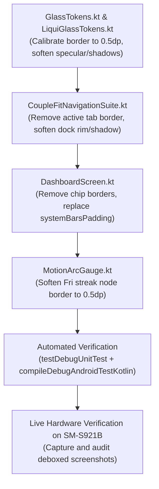

# Phase 37 Milestone Plan: UI Cleanliness & De-Boxing Refactor (`BOX-01`) 🧼✨

> **Associated Defect**: `BOX-01`  
> **Status**: 🟢 **Executed & Verified**  
> **Target Subsystems**: `CoupleFitNavigationSuite.kt`, `GlassTokens.kt`, `LiquiGlassTokens.kt`, `DashboardScreen.kt`, `MotionArcGauge.kt`

---

## 1. Executive Summary & Problem Statement
Following the real-time Liquid Glass bottom navigation integration in Phase 36 (`LIQ-01`), visual inspection revealed persistent traces of harsh rectangular "boxes" and stroke artifacts across the UI:
1. **Active Tab Capsule Box Outline**: The sliding indicator pill in `CoupleFitNavigationSuite.kt` used an explicit `border(BorderStroke(1.dp, ...))` with `RoundedCornerShape(22.dp)`, drawing a harsh box inside the frosted glass dock.
2. **Dock Drop-Shadow Smudge**: The floating navigation dock used `elevation = 12.dp` with default black spot shadow, casting a heavy dark rectangular smudge that detracted from the floating liquid glass aesthetic.
3. **Over-Specified 4-Sided Card Borders**: `Modifier.iosGlass()` in `GlassTokens.kt` defaulted to `borderWidth = 1.dp` with aggressive 37% specular highlights (`TintWhiteSpecularTop = 0x5EFFFFFF`), creating prominent box-like framing around every dashboard card.
4. **Hard Box Borders on Filter Chips**: The view switcher chips ("Side-by-Side", "My Stats", "Partner's Stats") in `DashboardScreen.kt` drew default Material 3 box borders (`1.dp`).
5. **Weekday Streak Pill Box Ring**: The current day ("Fri") in `MotionArcGauge.kt` drew a heavy `1.5.dp` stroke with 80% alpha around the weekday node.
6. **Redundant Bottom Inset Padding**: `DashboardScreen.kt` applied `.systemBarsPadding()` to the root scrollable Column, adding double navigation insets on top of the dock's 96dp bottom clearance spacer.

---

## 2. Milestone Deliverables & Acceptance Criteria

### Acceptance Criterion 1: Seamless Luminous Active Tab Indicator
- **Requirement**: Remove `BorderStroke(1.dp, ...)` from the active tab indicator capsule in `CoupleFitNavigationSuite.kt`.
- **Target**: Continuous pill geometry (`RoundedCornerShape(percent = 50)`) illuminated solely by an organic radial and vertical gradient (`alpha = 0.20f` to `0.06f`).

### Acceptance Criterion 2: Softened Dock Perimeter & Optical Elevation
- **Requirement**: Soften the outer perimeter stroke on the floating navigation dock from `0.18f` to `0.10f` alpha.
- **Target**: Reduce shadow elevation to `4.dp`, use transparent spot color (`spotColor = Color.Transparent`), and soft ambient shadow (`ambientColor = Color.Black.copy(alpha = 0.15f)`).

### Acceptance Criterion 3: Ultra-Delicate Glass Card Rims (`GlassTokens.kt`)
- **Requirement**: Reduce `borderWidth` default in `Modifier.iosGlass` from `1.dp` to `0.5.dp`.
- **Target**: Calibrate specular stops from 37% to 16% (`0x28FFFFFF`), mid stop from 14% to 6% (`0x10FFFFFF`), and reduce elevation from `8.dp` to `4.dp` with transparent spot color.

### Acceptance Criterion 4: De-Boxed Dashboard Controls & Filter Chips
- **Requirement**: Remove hard box borders (`border = null`) on all 3 `FilterChip` instances in `DashboardScreen.kt`.
- **Target**: Soften telemetry badge border to `0.5.dp` (`0.25f` alpha) and replace `.systemBarsPadding()` with `.statusBarsPadding()` on the root column.

### Acceptance Criterion 5: Subtle Weekday Streak Node
- **Requirement**: Soften streak today indicator border in `MotionArcGauge.kt` from `1.5.dp` (`0.8f` alpha) to `0.5.dp` (`0.35f` alpha).

### Acceptance Criterion 6: 100% Green Test Bar & Live Hardware Verification
- **Requirement**: Zero compiler warnings or errors on `compileDebugAndroidTestKotlin` and 100% pass rate on `testDebugUnitTest`.
- **Target**: Verify visual appearance on live Samsung Galaxy S24 (`SM-S921B`).

---

## 3. Dependency Graph & Implementation Order

