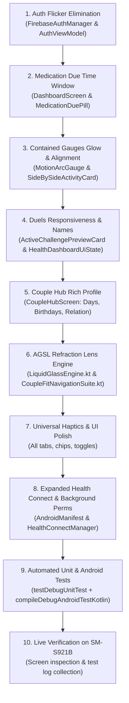

# Phase 38 Milestone Plan: Couple Intimacy, AGSL Refraction Liquid Glass & Telemetry Expansion (`CPX-01`) 🔮💑

> **Associated Defect / Feature Bundle**: `CPX-01` (`CPX-01` to `CPX-11`)  
> **Target Subsystems**: `MainActivity.kt`, `AuthViewModel.kt`, `FirebaseAuthManager.kt`, `DashboardScreen.kt`, `MotionArcGauge.kt`, `ActiveChallengePreviewCard.kt`, `ChallengesScreen.kt`, `ChallengeComponents.kt`, `CoupleHubScreen.kt`, `LiquidGlassEngine.kt`, `CoupleFitNavigationSuite.kt`, `HealthConnectManager.kt`, `AndroidManifest.xml`  
> **Status**: 📋 **Planned & Ready for Execution**

---

## 1. Executive Summary & Problem Scope

This milestone tackles 11 core user experience, visual fidelity, interaction responsiveness, and telemetry permission requirements:

1. **Auth Flicker (`CPX-01`)**: Prevent the split-second `InvitePartnerScreen` flash on app launch when an authenticated linked user starts the app by caching/checking linked status prior to fallback routing.
2. **Medication Window Gating (`CPX-02`)**: Constrain `MedicationDuePill` visibility to a $[-1\text{h}, +1\text{h}]$ window around scheduled medication time.
3. **Step Circle Glow Softening & Card Boundary Containment (`CPX-03`)**: Decrease diffuse glow intensity inside `MotionArcGauge` and clip `AuroraTelemetryMesh` strictly within the `SideBySideActivityCard` container boundary so no color smudges bleed into the background.
4. **Active Duels Responsiveness (`CPX-04`)**: Make the entire `ActiveChallengePreviewCard` and `SideBySideChallengeCard` interactive with responsive click feedback, details preview, and direct duel initiation.
5. **Double-Tap Cheer Removal (`CPX-05`)**: Remove `"Double-tap ring to cheer 💖"` under the Partner gauge in `DashboardScreen.kt` to restore perfect vertical column alignment.
6. **Dynamic User & Partner Names (`CPX-06`)**: Replace generic `"You"` and `"Partner"` with actual connected user and partner profile names across gauges, cards, and headers.
7. **Couple Hub Rich Profiles (`CPX-07`)**: Enrich `CoupleHubScreen.kt` with dual personal detail cards: User & Partner names, total days paired counter, birthdays, and relationship status.
8. **UI Consistency & De-Slop (`CPX-08`)**: Clean up legacy flat borders (`1.dp` outlines) and mismatched container styles across Challenges, Trends, and Couple Hub.
9. **AGSL Runtime Refraction Lens & Enhanced Blur (`CPX-09`)**: Port `REFRACTION_WITH_DISPERSION_AGSL` runtime shader from `liquideffect.md` with chromatic aberration, link with hardware RenderEffect blur (`blurRadius = 32.dp`), and upgrade floating dock.
10. **Universal Tactile Haptics (`CPX-10`)**: Integrate `CoupleFitHaptics` and `LocalHapticFeedback` across all tabs, filter chips, duel format cards, medication pills, and navigation dock items.
11. **Expanded Health Connect & Background Permissions (`CPX-11`)**: Declare and request read permissions for `ActiveCaloriesBurned`, `Distance`, `Exercise`, `Power`, `Speed`, `Steps`, `TotalCaloriesBurned`, `Sleep`, `HeartRate`, `OxygenSaturation`, and battery optimization exemption for uninterrupted background sync.

---

## 2. Milestone Deliverables & Acceptance Criteria

### Acceptance Criterion 1: Zero Auth Screen Flashing
- The initial route must not flash `InvitePartnerScreen` if the user is already authenticated and linked.
- Must remain on splash/dashboard or check local preferences cache before defaulting to `InvitePartner`.

### Acceptance Criterion 2: Precise 2-Hour Medication Gating
- `MedicationDuePill` only renders when `currentTime` is within $[T_{\text{scheduled}} - 60\text{m}, T_{\text{scheduled}} + 60\text{m}]$ and not already logged for today.

### Acceptance Criterion 3: Contained Activity Gauges Fade
- No radial glow bleeds outside the `SideBySideActivityCard` card container.
- Ring sweep glow in `MotionArcGauge` softened to subtle luminescence (`pulseAlpha * 0.15f`).

### Acceptance Criterion 4: Fully Interactive Duels
- Clicking `ActiveChallengePreviewCard` or "Challenge Partner" immediately transitions to `ChallengesScreen` or launches duel creation.
- Tapping duel format cards provides spring feedback and initiates duel flow.

### Acceptance Criterion 5: Symmetrical Gauge Baseline Alignment
- `"Double-tap ring to cheer 💖"` removed from under the Partner column.
- Both columns have matching heights, padding, and baseline alignment.

### Acceptance Criterion 6: Connected Display Names
- Gauge titles display actual user and partner names (e.g., `"Akash"` & `"Partner Name"`).

### Acceptance Criterion 7: Rich Couple Hub Dossier
- Displays: My Name, Partner's Name, Total Days Paired (calculated from link timestamp), Birthdays, and Relationship status in modern liquid glass cards.

### Acceptance Criterion 8: Harmonized UI Styling
- All lingering 1dp outline borders removed; consistent 0.5dp specular highlights across all screens.

### Acceptance Criterion 9: True AGSL Refraction Lens
- Navigation bar utilizes AGSL `REFRACTION_WITH_DISPERSION_AGSL` on Android 13+ (API 33+) with chromatic RGB separation and increased frosted blur (`32.dp`).

### Acceptance Criterion 10: Rich Tactile Feedback
- Haptics on all interactive touches (tab clicks, filter chip selections, duel card clicks).

### Acceptance Criterion 11: Full Health Connect Read-Only Suite
- Declares all 10 requested Health Connect read permissions + `REQUEST_IGNORE_BATTERY_OPTIMIZATIONS`.
- Strictly zero write permissions requested.

---

## 3. Dependency & Execution Order

