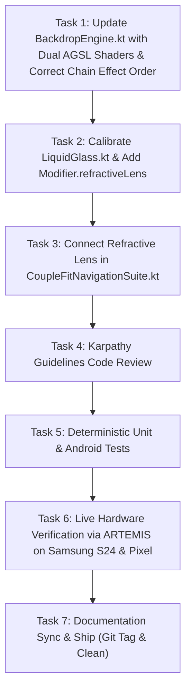

# Milestone Plan: Phase 42 — Physical 3D Lens Refraction & 7-Wavelength Chromatic Dispersion Engine (`REF-01`) 💎🌈

> **Phase**: Phase 42  
> **Defect / Feature Code**: `REF-01`  
> **Source Specification**: [`Documentation/refraction.md`](file:///D:/Couple_fit/CoupleFit/Documentation/refraction.md)  
> **Engineering Standard**: Karpathy Guidelines (Simplicity First, Surgical Changes, Verifiable Goals)  
> **Target Files**:
> - [`app/src/main/java/com/couplefit/ui/glass/BackdropEngine.kt`](file:///D:/Couple_fit/CoupleFit/app/src/main/java/com/couplefit/ui/glass/BackdropEngine.kt)
> - [`app/src/main/java/com/couplefit/ui/glass/LiquidGlass.kt`](file:///D:/Couple_fit/CoupleFit/app/src/main/java/com/couplefit/ui/glass/LiquidGlass.kt)
> - [`app/src/main/java/com/couplefit/ui/navigation/CoupleFitNavigationSuite.kt`](file:///D:/Couple_fit/CoupleFit/app/src/main/java/com/couplefit/ui/navigation/CoupleFitNavigationSuite.kt)

---

## 1. Executive Summary & Problem Formulation

In Phase 41, the consolidated `BackdropEngine` was established. However, an in-depth optical analysis against [`refraction.md`](file:///D:/Couple_fit/CoupleFit/Documentation/refraction.md) reveals four critical optical discrepancies:
1. **Chain Effect Ordering Was Inverted**:
   - `android.graphics.RenderEffect.createChainEffect(outer, inner)` executes `inner` first, then passes the result to `outer`.
   - In Phase 41, `renderEffect = createChainEffect(blur, lensEffect)` was configured, meaning the lens effect was executed first, and then blurred by a heavy Gaussian blur filter afterwards. This blurred away the sharp edge gradients and completely washed out the 7-band rainbow chromatic dispersion!
   - In `refraction.md`, `createChainEffect(lensEffect, blurEffect)` is mandated: the backdrop is blurred first into a frosted baseline, and then the AGSL lens shader bends the rays and separates the 7 spectral wavelengths with razor-sharp prismatic clarity along the pill bevel.
2. **Optical Inversion (Convex vs Concave)**:
   - In physical optics, rays entering a convex lens bend inward toward the optical center.
   - The signed distance field gradient (`gradSdRoundedRect`) points *outward* from the pill center toward the boundary.
   - Passing positive `refractionAmount` caused outward coordinate displacement (concave distortion).
   - `refraction.md` explicitly specifies `shader.setFloatUniform("refractionAmount", -refAmountPx)`, inverting the displacement inward to create true convex physical lens curvature.
3. **Missing Monochromatic Shader Alternative**:
   - When chromatic aberration is disabled (or on power-saver mode), the engine evaluated all 7 color channels with dispersion intensity = 0.
   - `refraction.md` specifies `RoundedRectRefractionShaderString` as an optimized monochromatic fallback that evaluates only 1 sample instead of 7.
4. **Diffusion vs Dispersion Parameter Calibration**:
   - At `blurRadius = 28.dp`, high-frequency edge contrasts in the backdrop are smoothed into a flat field before refraction occurs, preventing chromatic splitting.
   - `refraction.md` specifies calibrated values:
     - `blurRadius`: `8.dp` to `10.dp`
     - `refractionHeight`: `24.dp` (bevel depth)
     - `refractionAmount`: `26.dp` (lens power)
     - `depthEffect`: `true` (radial lens pull)
     - `chromaticAberration`: `true` (7-band rainbow splitting: Red, Orange, Yellow, Green, Cyan, Blue, Purple)
     - `surfaceTint`: `Color(0xFF0E131E).copy(alpha = 0.45f)` (dark mode) / `Color.White.copy(alpha = 0.12f)` (light mode)
     - `border`: `0.5.dp` with `Color.White.copy(alpha = 0.22f)`

---

## 2. Explicit Acceptance Criteria

- [ ] **AC-1 (Monochromatic & Chromatic Shaders)**: `BackdropEngine.kt` declares both `RoundedRectRefractionShaderString` and `RoundedRectRefractionWithDispersionShaderString` matching `refraction.md`.
- [ ] **AC-2 (Correct RenderEffect Chain Ordering)**: `createChainEffect(lensEffect, blurEffect)` chains the lens shader on top of the blurred backdrop, ensuring rainbow chromatic dispersion bands remain razor-sharp.
- [ ] **AC-3 (Physical Convex Optical Inversion)**: `refractionAmount` is passed as negative (`-refractionAmount`) to invert the outward SDF gradient into inward physical convex lens bending.
- [ ] **AC-4 (Calibrated Physical Constants)**: `LiquidGlass.kt` constants are calibrated to `refraction.md`: `BLUR_RADIUS_DP = 10.dp`, `refractionHeight = 24.dp`, `refractionAmount = 26.dp`, `depthEffect = true`, `chromaticAberration = true`.
- [ ] **AC-5 (Refractive Lens Modifier Provided)**: `Modifier.refractiveLens(...)` is exposed and fully compatible with `LocalAppBackdrop`.
- [ ] **AC-6 (Preserve Ambient Video Background)**: `rememberLayerBackdrop()` continues to use default transparent `{ drawContent() }`, preserving the living ambient video background (`AmbientVideoBackground`) without any opaque black floor occlusion.
- [ ] **AC-7 (Decoupled Foreground & Kinetic Kinematics)**: Navigation tabs, active indicator stretch & squash, and labels render with 100% crisp typography and zero shader distortion.
- [ ] **AC-8 (Deterministic Test & Build Green)**: All unit tests pass (`testDebugUnitTest` 100% green), Android test compiles (`compileDebugAndroidTestKotlin` 0 errors), and the app compiles and installs cleanly.
- [ ] **AC-9 (Hardware Verification on Samsung S24 & Pixel Emulator)**: Captured live screenshots on Samsung Galaxy S24 (`SM-S921B`) and emulator (`emulator-5554`) demonstrate clear optical refraction and prismatic dispersion.

---

## 3. Task Dependencies & Execution Wave Order

- **Wave 1**: Tasks 1 & 2 (Optics & Shaders Engine update).
- **Wave 2**: Task 3 (Navigation dock integration).
- **Wave 3**: Task 4 (Karpathy Guidelines code review).
- **Wave 4**: Tasks 5 & 6 (Test suite execution and ARTEMIS live device verification).
- **Wave 5**: Task 7 (Documentation update, git commit, release tag, cleanup, graphify).

---

## 4. Test Bars & Verification Plan

1. **Static Analysis & Compilation**:
   - `.\gradlew.bat compileDebugKotlin` must succeed with 0 warnings/errors.
2. **Automated Unit Testing**:
   - `.\gradlew.bat testDebugUnitTest` must pass with 100% success rate (32/32 tests green).
3. **Android Test Compilation**:
   - `.\gradlew.bat compileDebugAndroidTestKotlin` must compile with 0 errors.
4. **Live Device Verification via ARTEMIS**:
   - Deploy debug APK to connected Samsung Galaxy S24 (`SM-S921B`).
   - Call `mobile_get_device_state(view_type="screenshot")`.
   - Perform macro zoom on the bottom navigation dock to verify:
     - Visible 3D convex optical bending of underlying elements gliding under the pill.
     - Prismatic rainbow chromatic dispersion shimmer along the pill bevel.
     - 100% crisp foreground icons and typography.
     - Uninterrupted living ambient video background.
