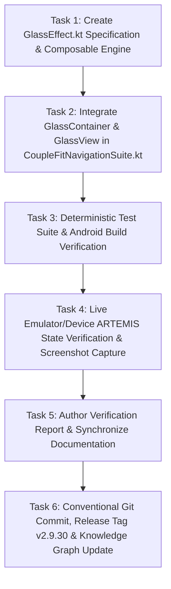

# Milestone Plan: Phase 44 — Expo Glass Effect Architecture for Bottom Navigation Bar (`GLS-07` / `EXP-01`) 💎📱

> **Governing Specifications**: [Expo Glass Effect Documentation](https://docs.expo.dev/versions/latest/sdk/glass-effect/) (`expo-glass-effect`), [`Documentation/refraction.md`](file:///D:/Couple_fit/CoupleFit/Documentation/refraction.md), [`Documentation/liquideffect.md`](file:///D:/Couple_fit/CoupleFit/Documentation/liquideffect.md)  
> **Target Subsystem**: Bottom Navigation Suite & Liquid Glass Engine  
> **Lifecycle Gate**: `/gsd-plan-phase` & `/impeccable`  
> **Release Target**: `v2.9.30-expo-glass-effect-navbar-gls07`

---

## 1. Context & Motivation

The user requested applying the glass effect from [docs.expo.dev/versions/latest/sdk/glass-effect/](https://docs.expo.dev/versions/latest/sdk/glass-effect/) to the bottom bar of CoupleFit.

In the official Expo SDK, `expo-glass-effect` introduces a multi-tier glass architecture:
1. **`GlassContainer`**: A grouping container that merges and blends multiple adjacent or nested glass surfaces into a unified liquid optical system.
2. **`GlassView`**: A high-craft glass component with:
   - `glassEffectStyle`: `'regular'` (frosted glass with ambient light diffusion), `'clear'` (crystalline clear glass with high transmission and vivid specular rim), or `'none'` (flat fallback).
   - `tintColor`: Custom color overlay that tints the glass without muddying underlying backdrop content.
   - `colorScheme`: `'auto'`, `'light'`, or `'dark'` to override system appearance.
   - `isInteractive`: Enables tactile liquid touch feedback with interactive scale, sheen highlight, and spring rebound.
3. **`isGlassEffectAPIAvailable()`**: Runtime availability verification for platform-native hardware glass capabilities with graceful fallback.

In CoupleFit's native Android Jetpack Compose codebase, Phase 44 models and implements this complete Expo Glass Effect architecture:
- Outer bottom dock becomes a `GlassContainer` applying `GlassEffectStyle.Regular`.
- The sliding active indicator capsule becomes a child `GlassView` applying `GlassEffectStyle.Clear` with `isInteractive = true` and dynamic `tintColor = UserPrimary.copy(alpha = 0.22f)`.
- Interactive tab items receive `isInteractive` liquid press mechanics.
- Decoupled foreground rendering guarantees 100% crisp typography, while living ambient video flows underneath.

---

## 2. Explicit Acceptance Criteria

1. **`GlassEffect.kt` Engine Implementation**:
   - Define `GlassEffectStyle`: `Regular`, `Clear`, `None`.
   - Define `GlassColorScheme`: `Auto`, `Light`, `Dark`.
   - Implement `isGlassEffectAPIAvailable()` returning `true` on Android 12+ (API 31+ for RenderEffect) and Android 13+ (API 33+ for AGSL runtime shaders).
   - Implement `GlassContainer` composable providing composition locals for coordinated multi-glass rendering.
   - Implement `GlassView` composable and `Modifier.glassEffect(...)` modifier supporting `style`, `tintColor`, `colorScheme`, `isInteractive`, `borderWidth`, and `borderColor`.
2. **Bottom Navigation Dock Integration (`CoupleFitNavigationSuite.kt`)**:
   - Wrap the compact bottom navigation bar with `GlassContainer`.
   - Apply `Modifier.glassEffect(style = GlassEffectStyle.Regular, tintColor = glassBarTint(), colorScheme = GlassColorScheme.Auto)` to the dock plate.
   - Render the sliding active indicator capsule as a child `GlassView` with `style = GlassEffectStyle.Clear`, `tintColor = CoupleFitIdentityTokens.UserPrimary.copy(alpha = 0.22f)`, and `isInteractive = true`.
   - Wire `isInteractive` touch down feedback with fluid spring depression (`pressedScale = 0.94f`) and haptic tick on tab selection.
3. **Decoupled Optical Quality**:
   - Background video and dashboard content blur and refract smoothly behind the dock without color clipping or blackouts.
   - Foreground icons and tab labels ("Today", "Challenges", "Trends", "Couple Hub") remain 100% crisp with zero chromatic distortion or text melting.
4. **Accessibility & Graceful Degradation**:
   - When `reduceMotion = true`, spring elongation and stretch/squash snap cleanly without oscillation.
   - When `liquidGlassEnabled = false` or on unsupported Android versions (`< API 31`), gracefully fall back to clean elevated M3 surface with specular borders.
5. **Deterministic Test Bars**:
   - `./gradlew testDebugUnitTest` must pass 100% green (32/32 unit tests).
   - `./gradlew compileDebugAndroidTestKotlin` must compile with 0 errors.
   - Live hardware/emulator verification via ARTEMIS capturing screenshots and verifying touch response.

---

## 3. Task Breakdown & Dependency Order

---

## 4. Test Bars & Verification Plan

1. **Unit Test Pass**: Run `./gradlew.bat testDebugUnitTest`.
2. **Android Test Compilation**: Run `./gradlew.bat compileDebugAndroidTestKotlin`.
3. **Live ARTEMIS Inspection**:
   - Capture live screenshot of the bottom navigation bar in default state.
   - Switch tabs (e.g. from Today to Challenges, Trends, Couple Hub) and verify smooth active capsule glide and crystal clear glass effect.
   - Verify logcat for zero runtime exceptions.
