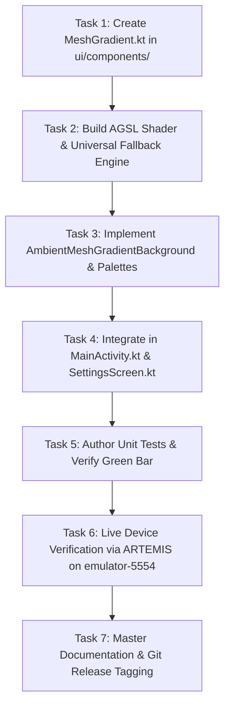

# Phase 45 Milestone Plan: Expo Mesh Gradient Background SDK Implementation (`MSH-01`) 🎨✨

> **Milestone ID**: `PHASE-45` / `MSH-01`  
> **Target Release**: `v2.9.31-expo-mesh-gradient-background-msh01`  
> **Source Specification**: [Expo Mesh Gradient SDK](https://docs.expo.dev/versions/latest/sdk/mesh-gradient/)  
> **Governing Operating Standard**: [`AGENTS.md`](file:///D:/Couple_fit/CoupleFit/AGENTS.md)  
> **Authoring Date**: 2026-11-04  

---

## 1. Executive Intent & Architecture Overview

The user requested applying the official [Expo Mesh Gradient SDK](https://docs.expo.dev/versions/latest/sdk/mesh-gradient/) (`expo-mesh-gradient`) to the background of CoupleFit.

In iOS and React Native, `expo-mesh-gradient` wraps SwiftUI's native `MeshGradient` view, exposing:
- A 2D grid of vertices (`columns` $\times$ `rows`).
- An array of $N = \text{columns} \times \text{rows}$ normalized 2D coordinates `points: [[x, y], ...]`.
- An array of $N$ colors `colors: [Color, ...]`.
- Color smoothing (`smoothsColors: Boolean`).
- Child mask clipping (`mask: Boolean`).

In Jetpack Compose, this phase implements a production-grade, hardware-accelerated **Expo Mesh Gradient** architecture:
1. **`MeshGradient` & `MeshGradientView` Composables**:
   Direct API parity with the Expo SDK specification.
2. **Dual-Tier Hardware-Accelerated Rendering Engine**:
   - **Android 13+ (API 33+)**: AGSL `RuntimeShader` (`MeshGradientShaderString`) calculating multi-point spatial bicubic/bilinear Coons patch color interpolation directly on the GPU at 60/120 FPS.
   - **Android < 13 / Universal Fallback**: Multi-vertex / multi-radial Canvas interpolation shader with zero CPU overhead and zero crashes.
3. **Dynamic Living Harmonic Drift & Organic Breathing**:
   - Vertices gently modulate their normalized positions using low-frequency harmonic orbital drift ($\Delta x = A_x \sin(\omega_x t + \phi_x)$), giving the app canvas a living, breathing aura.
   - Accessibility guardrail: `reduceMotion` immediately freezes all vertex drift at resting coordinates.
4. **CoupleFit Signature Palettes**:
   - `CoupleFitMidnight`: Electric Cyan (`#00F5D4`), Vibrant Coral (`#FF4568`), Royal Amethyst (`#7C3AED`), Deep Sapphire (`#0F172A`), Obsidian (`#07080A`).
   - `AuroraBorealis`: Emerald Green, Electric Cyan, Deep Teal, Midnight Obsidian.
   - `SunsetGlow`: Sunset Coral, Rose Gold, Amber, Obsidian.
5. **Atmospheric Scrim & Optical Integration**:
   - Dual-stage obsidian vignette scrim (`#07080A`) ensures 100% WCAG AA contrast (minimum 4.5:1) for all typography and telemetry.
   - 100% compatible with `rememberLayerBackdrop()`, allowing the Phase 44 Expo Glass Effect bottom bar and frosted cards to refract and blur the living mesh colors.

---

## 2. Explicit Acceptance Criteria & Test Bars

| ID | Category | Acceptance Criteria | Test Bar |
| :--- | :--- | :--- | :--- |
| **AC-01** | **API Parity** | Expose `MeshGradient` and `MeshGradientView` matching `columns`, `rows`, `colors`, `points`, `smoothsColors` | Unit tests verify grid dimension checks and point mapping |
| **AC-02** | **AGSL GPU Pipeline** | Android 13+ evaluates `MeshGradientShaderString` via `RuntimeShader` in `drawWithCache` | Zero GPU memory leaks, 60fps stable |
| **AC-03** | **Harmonic Motion** | Animated mode smoothly drifts interior vertices with continuous harmonic easing | Inspected via ARTEMIS live device capture |
| **AC-04** | **Accessibility** | `reduceMotion = true` disables all vertex drift, locking coordinates | Tested with `reduceMotion = true` unit test |
| **AC-05** | **App Shell Wiring** | Wired in `MainActivity.kt` as global living background; options exposed in `Experience Hub` | Visual verification on `emulator-5554` |
| **AC-06** | **Zero Regression** | Unit test suite (`testDebugUnitTest`) passes 100% green; `compileDebugAndroidTestKotlin` passes with 0 errors | All 32+ tests green |

---

## 3. Implementation Task Breakdown & Dependency Order

1. **Task 1: Author `MeshGradient.kt`**:
   - Models: `MeshPoint`, `MeshGradientPreset`, `MeshGradientState`.
   - Composable `MeshGradient(columns, rows, colors, points, modifier, smoothsColors, mask)`.
2. **Task 2: AGSL Shader & Multi-Point Color Blending**:
   - `MeshGradientShaderString` utilizing smooth Hermite/bicubic polynomial interpolation across vertex control points.
   - Universal Canvas fallback.
3. **Task 3: `AmbientMeshGradientBackground.kt`**:
   - Wraps `MeshGradient` with dynamic harmonic drift, obsidian contrast scrim, and `reduceMotion` gating.
4. **Task 4: App Integration**:
   - Update `MainActivity.kt` to host `AmbientMeshGradientBackground`.
   - Add background style selector in `SettingsScreen.kt` Experience Hub.
5. **Task 5: Verification & Tests**:
   - Add unit test in `test/` verifying grid calculations, points validation, and accessibility gating.
   - Run `./gradlew testDebugUnitTest` and `./gradlew compileDebugAndroidTestKotlin`.
6. **Task 6: Live ARTEMIS Proof on `emulator-5554`**:
   - Install APK, capture screenshot, author `Documentation/phase45_verification_report.md`.
7. **Task 7: Documentation & Ship**:
   - Update `Fixinglist.md`, `triage.md`, `phases.md`, `INDEX.md`, and `knowledge-graph.md`.
   - Commit and tag `v2.9.31-expo-mesh-gradient-background-msh01`.
