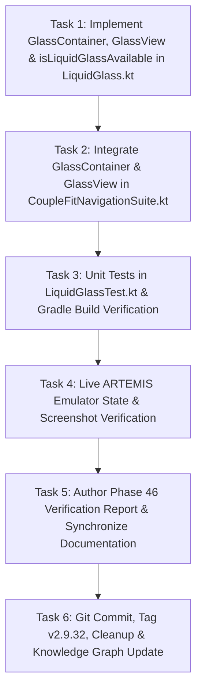

# Milestone Plan: Phase 46 — Expo Glass Effect Component Architecture (`GlassContainer` & `GlassView`) for Bottom Navigation Bar (`GLS-08` / `EXPO-02`) 💎📱

> **Milestone**: Phase 46 (`GLS-08` / `EXPO-02`)  
> **Topic**: Expo Glass Effect Component Architecture (`GlassContainer` & `GlassView`) Applied to Bottom Navigation Dock  
> **Reference**: [docs.expo.dev/versions/latest/sdk/glass-effect/](https://docs.expo.dev/versions/latest/sdk/glass-effect/) (`expo-glass-effect` Specification)  
> **Design Standard**: `/impeccable` & `/karpathy-guidelines`  
> **Target Subsystem**: `com.couplefit.ui.glass` & `com.couplefit.ui.navigation`  
> **Release Target**: `v2.9.32-expo-glass-effect-components-expo02`

---

## 1. Context & Motivation

The user requested applying the official Expo Glass Effect from [https://docs.expo.dev/versions/latest/sdk/glass-effect/](https://docs.expo.dev/versions/latest/sdk/glass-effect/) to the bottom bar of CoupleFit.

In the official Expo SDK, `expo-glass-effect` provides a two-component architecture:
1. **`GlassContainer`**:
   - Parent grouping component that coordinates multiple child glass surfaces (`GlassView`) with shared backdrop sampling, spacing thresholds (`spacing: number`), and morphing blend characteristics.
2. **`GlassView`**:
   - Individual glass surface with:
     - `glassEffectStyle`: `'regular'` (frosted liquid glass with ambient light diffusion), `'clear'` (crystalline clear glass with high transmission and vivid specular rim), or `'none'` (flat fallback).
     - `tintColor`: Custom color overlay that tints the glass without muddying underlying backdrop content.
     - `colorScheme`: `'auto'`, `'light'`, or `'dark'` to override system appearance.
     - `isInteractive`: Enables tactile liquid touch feedback with interactive scale, sheen highlight, and spring rebound.
3. **Runtime Helpers**:
   - `isGlassEffectAPIAvailable()`: Checks whether native hardware glass APIs are available.
   - `isLiquidGlassAvailable()`: Returns whether liquid glass layout layers are active.

While Phase 44 introduced `Modifier.expoGlassEffect`, Phase 46 brings the full component-level paradigm (`GlassContainer` and `GlassView` composables) to CoupleFit's bottom navigation bar:
- The outer floating navigation dock is wrapped in a `GlassContainer`.
- The dock plate renders with `GlassEffectStyle.Regular`.
- The sliding active indicator capsule is rendered as a child `GlassView` applying `GlassEffectStyle.Clear`, `tintColor = UserPrimary.copy(alpha = 0.22f)`, and `isInteractive = true`.
- This delivers nested liquid glass optical dispersion: the crystalline indicator capsule refracts through both the outer dock plate and the underlying living mesh gradient.

---

## 2. Explicit Acceptance Criteria

1. **`GlassContainer` & `GlassView` Composables (`LiquidGlass.kt`)**:
   - Implement `GlassContainer` composable accepting `modifier`, `spacing: Dp = 8.dp`, `shape: CornerBasedShape`, and `content: @Composable BoxScope.() -> Unit`.
   - Provide `LocalGlassContainerActive` and `LocalGlassContainerSpacing` composition locals for coordinated multi-glass rendering.
   - Implement `GlassView` composable accepting `modifier`, `glassEffectStyle: GlassEffectStyle = GlassEffectStyle.Regular`, `tintColor: Color? = null`, `colorScheme: GlassColorScheme = GlassColorScheme.Auto`, `isInteractive: Boolean = false`, `shape: CornerBasedShape = RoundedCornerShape(percent = 50)`, `borderWidth: Dp = GLASS_EDGE_WIDTH`, `borderColor: Color? = null`, `isPressed: Boolean = false`, `reduceMotion: Boolean = false`, and `content: @Composable BoxScope.() -> Unit`.
   - Implement `isLiquidGlassAvailable(): Boolean` alias pointing to `isGlassEffectAPIAvailable()`.
2. **Bottom Navigation Suite Integration (`CoupleFitNavigationSuite.kt`)**:
   - Wrap the compact bottom navigation bar dock in `GlassContainer`.
   - Outer dock plate renders using `GlassView` or `Modifier.expoGlassEffect` with `glassEffectStyle = GlassEffectStyle.Regular`.
   - Sliding active indicator capsule renders as a child `GlassView` with `glassEffectStyle = GlassEffectStyle.Clear`, `tintColor = CoupleFitIdentityTokens.UserPrimary.copy(alpha = 0.22f)`, and `isInteractive = true`.
   - Individual navigation tab items preserve 100% crisp typography and icons with decoupled foreground rendering.
3. **Accessibility & Graceful Degradation**:
   - `reduceMotion` eliminates spring oscillations, snapping scales and positions cleanly.
   - On devices below Android 12 (`API < 31`) or when `liquidGlassEnabled = false`, falls back cleanly to elevated M3 surface with specular border without crashes or visual clipping.
4. **Deterministic Test Bars**:
   - `./gradlew.bat testDebugUnitTest` passes 100% green.
   - `./gradlew.bat compileDebugAndroidTestKotlin` compiles with 0 errors.
   - Live hardware/emulator verification via ARTEMIS capturing screenshots of default and switched tab states.

---

## 3. Task Breakdown & Dependency Order

---

## 4. Test Bars & Verification Plan

1. **Unit Test Pass**: Run `./gradlew.bat testDebugUnitTest`.
2. **Android Test Compilation**: Run `./gradlew.bat compileDebugAndroidTestKotlin`.
3. **Live ARTEMIS Inspection**:
   - Install APK and launch `com.couplefit/.MainActivity` on `emulator-5554`.
   - Capture screenshot of bottom navigation bar with active "Today" tab.
   - Tap "Challenges" tab and capture screenshot confirming smooth active indicator transition with `GlassEffectStyle.Clear` refraction.
   - Verify logcat for zero runtime exceptions.
