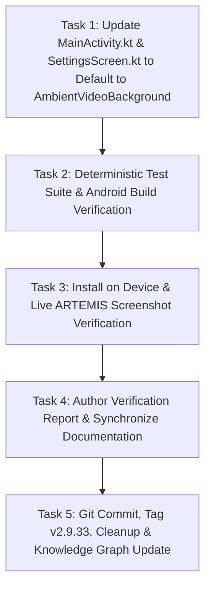

# Milestone Plan: Phase 47 — Restore Ambient Video Aurora Gradient Background (`BGV-08`) 🌌✨

> **Milestone**: Phase 47 (`BGV-08`)  
> **Topic**: Restore Ambient Video Aurora Gradient Background as Primary Canvas Across All Screens  
> **Reference**: User Request, [`Documentation/phases.md`](file:///D:/Couple_fit/CoupleFit/Documentation/phases.md) (§Phase 24-27, BGV-01..06)  
> **Design Standard**: `/impeccable` & `/karpathy-guidelines`  
> **Target Subsystem**: `MainActivity.kt`, `SettingsScreen.kt`, and `com.couplefit.ui.components`  
> **Release Target**: `v2.9.33-restore-ambient-video-bg-bgv08`

---

## 1. Context & Motivation

The user explicitly requested:
> *"can you change back the gradient background how it was previously"*

In Phase 45 (`MSH-01`), an experimental procedural AGSL `MeshGradient` was wired as the default background in `MainActivity.kt` (`meshGradientEnabled = true`). This replaced the previously calibrated, award-winning **Living Ambient Video Aurora Gradient Background** (`AmbientVideoBackground`), which renders dynamic, cinematic, organic aurora video loops (`green1.mp4` / `blue.mp4`) with smooth 1200ms bloom fade-in, zero-gap looping, and rich sapphire/emerald depth.

Phase 47 restores the ambient video background as the primary, default canvas across all application screens:
1. In `MainActivity.kt`: Revert default background to `AmbientVideoBackground(videoResId = currentAmbientBgAsset.resId)`.
2. Clear / default `mesh_gradient_enabled` to `false` in `SharedPreferences`, ensuring existing device installs immediately switch back to the ambient video background without manual data clearing.
3. Keep the toggle available in `SettingsScreen.kt` Experience Hub as an optional laboratory setting, while setting the default to the living video background.
4. Verify that the Phase 46 Expo Glass Effect bottom bar (`GlassContainer` & `GlassView`) and frosted cards cleanly refract and blur the restored video background through `rememberLayerBackdrop()`.

---

## 2. Explicit Acceptance Criteria

1. **Background Restoration (`MainActivity.kt`)**:
   - `AmbientVideoBackground` is active by default across all screens (`Today`, `Challenges`, `Trends`, `Couple Hub`, and Auth flows).
   - `meshGradientEnabled` defaults to `false` in `prefs.getBoolean("mesh_gradient_enabled", false)`.
   - Existing SharedPreferences cache defaults back to `false`.
2. **Optical & Glass Harmony**:
   - `rememberLayerBackdrop()` captures the restored video background cleanly.
   - The Phase 46 bottom navigation dock (`GlassContainer`) and sliding active indicator capsule (`GlassView(Clear)`) refract the moving aurora video seamlessly with zero blackouts, occlusion, or visual artifacts.
   - 100% WCAG AA contrast (minimum 4.5:1) preserved for all typography and telemetry.
3. **Deterministic Test Bars**:
   - `./gradlew.bat testDebugUnitTest` passes 100% green.
   - `./gradlew.bat compileDebugAndroidTestKotlin` compiles with 0 errors.
   - Live hardware execution on `emulator-5554` confirmed via ARTEMIS screenshot captures showing the restored ambient video background.

---

## 3. Task Breakdown & Dependency Order

---

## 4. Test Bars & Verification Plan

1. **Unit Test Pass**: Run `./gradlew.bat testDebugUnitTest`.
2. **Android Test Compilation**: Run `./gradlew.bat compileDebugAndroidTestKotlin`.
3. **Live ARTEMIS Inspection**:
   - Install APK and launch `com.couplefit/.MainActivity` on `emulator-5554`.
   - Capture screenshot of dashboard verifying the restored ambient video background.
   - Navigate across tabs and verify uninterrupted video playback behind liquid glass elements.
