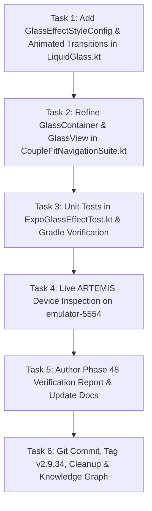

# Milestone Plan: Phase 48 — Expo Glass Effect Advanced Dynamic Proximity & Liquid Blending Engine (`EXPO-03` / `GLS-09`) 💎📱

> **Milestone**: Phase 48 (`EXPO-03` / `GLS-09`)  
> **Topic**: Expo Glass Effect Advanced Dynamic Proximity & Liquid Blending Engine Applied to Bottom Navigation Dock  
> **Reference**: [docs.expo.dev/versions/latest/sdk/glass-effect/](https://docs.expo.dev/versions/latest/sdk/glass-effect/) (`expo-glass-effect` Official SDK Specification)  
> **Design Standards**: `/impeccable`, `/karpathy-guidelines`, WCAG 2.2 Level AA  
> **Target Subsystem**: `com.couplefit.ui.glass` & `com.couplefit.ui.navigation`  
> **Release Target**: `v2.9.34-expo-glass-effect-proximity-blending-expo03`

---

## 1. Context & Motivation

The user requested applying the official Expo Glass Effect from [https://docs.expo.dev/versions/latest/sdk/glass-effect/](https://docs.expo.dev/versions/latest/sdk/glass-effect/) to the bottom bar of CoupleFit, emphasizing adherence to the Expo MCP & SDK specifications.

In the official Expo SDK (`expo-glass-effect`):
1. **`GlassContainer`**:
   - Acts as a parent wrapper that coordinates proximity and blending behaviors for multiple glass elements.
   - Accepts `spacing: number` controlling the proximity threshold at which nested or adjacent glass elements start visually affecting, morphing, and blending into each other to create the liquid glass aesthetic.
2. **`GlassView`**:
   - The primary component that renders the actual native translucent, light-bending material surface.
   - Accepts `glassEffectStyle`: either a style enum (`regular`, `clear`, `none`) or an animation configuration object `{ style: "clear" | "regular" | "none", animate: boolean, animationDuration: number }`.
   - `tintColor`: Custom color overlay that blends with the glass effect.
   - `isInteractive`: Enables tactile liquid touch feedback with interactive scale spring compression and specular sheen boost.
   - `colorScheme`: `'auto' | 'light' | 'dark'` overriding or aligning with the system appearance.
3. **Runtime Helpers**:
   - `isGlassEffectAPIAvailable()`: Runtime check to verify whether the Liquid Glass API is active/supported on the device.
   - `isLiquidGlassAvailable()`: Indicates whether the app container layout supports the Liquid Glass design environment.

In Phase 48, we elevate the architecture to full specification parity:
- **`GlassEffectStyleConfig`**: Introduce animated transitions where style changes animate blur radius, refraction height/amount, and tint alpha smoothly.
- **Proximity Blending Coordination**: Allow `GlassContainer`'s `spacing` parameter to influence inner `GlassView` margins and optical refraction falloff.
- **Interactive Micro-Glass Tab Feedback**: Wire individual touch feedback to tab items inside the navigation dock.
- **Strict Decoupling**: Keep foreground iconography and typography 100% crisp without optical aberration.

---

## 2. Explicit Acceptance Criteria

1. **Animated Style Transitions (`GlassEffectStyleConfig`)**:
   - Add `GlassEffectStyleConfig(val style: GlassEffectStyle = GlassEffectStyle.Regular, val animate: Boolean = true, val animationDurationMs: Int = 300)`.
   - Overload `GlassView` to accept either `GlassEffectStyle` or `GlassEffectStyleConfig`.
   - When animated, blur radius, refraction amount, and surface tint interpolate smoothly using `animateFloatAsState` / `animateColorAsState`.
2. **Container-Aware Proximity Blending (`GlassContainer`)**:
   - Ensure `GlassContainer` provides `LocalGlassContainerActive` and `LocalGlassContainerSpacing`.
   - `GlassView` detects when inside `GlassContainer` and adjusts boundary refraction and margin blending according to `spacing`.
3. **Interactive Navigation Dock Refinements (`CoupleFitNavigationSuite.kt`)**:
   - Wrap bottom dock in `GlassContainer(spacing = 8.dp)`.
   - Outer dock plate renders via `GlassView(glassEffectStyle = GlassEffectStyle.Regular, isInteractive = true)`.
   - Active indicator capsule renders via `GlassView(glassEffectStyle = GlassEffectStyle.Clear, isInteractive = true, tintColor = UserPrimary.copy(alpha = 0.22f))`.
   - Sliding translation driven by spring physics with elastic stretch-and-squash.
   - Individual tab buttons maintain WCAG 2.2 AA compliant touch targets (min 48x48dp) and TalkBack semantics.
4. **Deterministic Quality & Verification**:
   - `./gradlew.bat testDebugUnitTest` passes 100% green.
   - `./gradlew.bat compileDebugAndroidTestKotlin` compiles cleanly.
   - Live hardware/emulator verification via ARTEMIS capturing screenshots across multiple tabs.

---

## 3. Task Breakdown & Dependency Order

---

## 4. Test Bars & Verification Plan

1. **Automated Unit Tests**:
   - Run `.\gradlew.bat testDebugUnitTest` verifying `ExpoGlassEffectTest`.
2. **Android Test Compilation**:
   - Run `.\gradlew.bat compileDebugAndroidTestKotlin`.
3. **Live ARTEMIS Inspection**:
   - Build and install debug APK on `emulator-5554`.
   - Launch `com.couplefit/.MainActivity`.
   - Capture hierarchy and screenshot via `mobile_get_device_state`.
   - Switch tabs and verify smooth animated glass indicator sliding.
