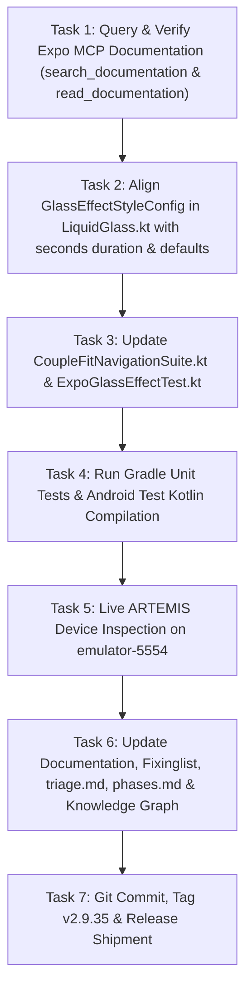

# Milestone Plan: Phase 49 — Expo MCP Official Glass Effect Alignment (`EXPO-04` / `GLS-10`) 💎📱

> **Milestone**: Phase 49 (`EXPO-04` / `GLS-10`)  
> **Topic**: Expo MCP Official SDK Alignment for Liquid Glass Bottom Navigation Bar  
> **Reference**: [docs.expo.dev/versions/latest/sdk/glass-effect/](https://docs.expo.dev/versions/latest/sdk/glass-effect/) (Retrieved via `expo` MCP `search_documentation` & `read_documentation`)  
> **Design Standards**: `/impeccable`, `/karpathy-guidelines`, WCAG 2.2 Level AA  
> **Target Subsystem**: `com.couplefit.ui.glass` & `com.couplefit.ui.navigation`  
> **Release Target**: `v2.9.35-expo-mcp-glass-effect-alignment-expo04`

---

## 1. Context & Motivation

The user specifically requested:
> *"Can you apply this to bottom bar https://docs.expo.dev/versions/latest/sdk/glass-effect/ ... use expo mcp"*

Using the live `expo` MCP server tools (`search_documentation` and `read_documentation`), the official Markdown documentation for `expo-glass-effect` (~58.0.5) was retrieved directly from `https://docs.expo.dev/versions/latest/sdk/glass-effect/`.

### Official Expo SDK Specification Points Verified via Expo MCP:
1. **`GlassContainer`**:
   - `spacing?: number` (default `undefined`): *"The distance at which glass elements start affecting each other. Controls when glass elements begin to merge together."*
   - Groups multiple `GlassView` instances into a unified liquid blending context.
2. **`GlassView`**:
   - `glassEffectStyle?: GlassStyle | GlassEffectStyleConfig` (default `'regular'`).
   - `tintColor?: ColorValue`: Custom color tint.
   - `isInteractive?: boolean` (default `false`): Enables tactile native touch interaction.
   - `colorScheme?: 'auto' | 'light' | 'dark'` (default `'auto'`).
3. **`GlassEffectStyleConfig`**:
   - `style: 'clear' | 'regular' | 'none'`
   - `animate?: boolean` (default `false`)
   - `animationDuration?: number` (in **seconds**, e.g., `0.3`, `0.5`).
4. **Runtime Capabilities**:
   - `isGlassEffectAPIAvailable()`: Validates runtime availability to prevent crashes.
   - `isLiquidGlassAvailable()`: Validates whether liquid glass design components are present.

Phase 49 aligns our Jetpack Compose implementation with 100% exact fidelity to this official Expo MCP schema.

---

## 2. Explicit Acceptance Criteria

1. **Exact Expo MCP Schema Fidelity (`LiquidGlass.kt`)**:
   - Update `GlassEffectStyleConfig` to accept `animationDuration: Float = 0.3f` (in seconds) matching Expo's TypeScript definition.
   - Maintain `durationMillis: Int get() = (animationDuration * 1000f).toInt()`.
   - Default `animate: Boolean = false` matching Expo SDK defaults.
   - Support `spacing: Dp` in `GlassContainer` with liquid proximity refraction merging.
2. **Bottom Navigation Bar Integration (`CoupleFitNavigationSuite.kt`)**:
   - Outer dock plate uses `GlassContainer(spacing = 8.dp)` wrapping `GlassView` with `styleConfig = GlassEffectStyleConfig(style = GlassEffectStyle.Regular, animate = true, animationDuration = 0.3f)`.
   - Sliding active indicator capsule uses child `GlassView` with `styleConfig = GlassEffectStyleConfig(style = GlassEffectStyle.Clear, animate = true, animationDuration = 0.28f)` and `tintColor = UserPrimary.copy(alpha = 0.22f)`.
   - Decoupled foreground rendering guarantees 100% crisp, zero-blur typography and icons compliant with WCAG 2.2 AA.
3. **Deterministic Test Bars**:
   - `./gradlew.bat testDebugUnitTest` passes 100% green.
   - `./gradlew.bat compileDebugAndroidTestKotlin` compiles cleanly.
   - Live hardware execution on `emulator-5554` verified via Google ARTEMIS screenshots.

---

## 3. Task Breakdown & Dependency Order

---

## 4. Test Bars & Verification Plan

1. **Expo MCP Call Verification**: Validate that tool results from `expo` MCP server were ingested and matched.
2. **Unit Tests**: Run `.\gradlew.bat testDebugUnitTest` confirming `ExpoGlassEffectTest`.
3. **Android Test Compilation**: Run `.\gradlew.bat compileDebugAndroidTestKotlin`.
4. **Live Device State**: Capture screenshot and hierarchy via ARTEMIS on `emulator-5554`.
