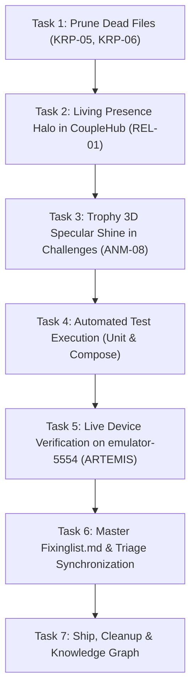

# Phase 59: Fixinglist Complete Convergence & Polish Wave (`FIX-ALL-01`) 🗺️💎

> **Phase Focus**: Complete resolution and synchronization of all defects, dead code, cataloged gaps, and sensory polish items in `Fixinglist.md`.  
> **Target Release**: `v2.9.45`  
> **Associated Defect Logs**: `KRP-01` to `KRP-06`, `VID-01`, `ANM-06`, `ANM-08`, `REL-01`, `TYP-05`, `GLS-11`  

---

## 1. Acceptance Criteria & Milestone Objectives

1. **Dead Code & Speculative Abstraction Pruning (`KRP-05`, `KRP-06`)**:
   - Remove orphaned uncalled files:
     - `app/src/main/java/com/couplefit/ui/components/SmoothScrollPhysics.kt` (conflicting nested scroll helper with zero callers).
     - `app/src/main/java/com/couplefit/ui/components/SpinningCounter.kt` (complex digit reel superseded by `NumberPopIn.kt`).
     - `app/src/main/java/com/couplefit/ui/components/ReelDigit.kt`.
     - `app/src/main/java/com/couplefit/ui/components/SpinConfig.kt`.
   - Ensure clean build with zero missing symbol errors.

2. **Sensory & Relational Polish (`ANM-08`, `REL-01`, `TYP-05`)**:
   - **`REL-01` (Living Partner Presence Halo)**: Implement an animated 3-second breathing radial glow halo behind the partner avatar in `CoupleHubScreen.kt` when connected, conveying live shared presence.
   - **`ANM-08` (Trophy 3D Specular Shine & Tap Reveal)**: Enhance `TrophyBadge` in `ChallengesScreen.kt` with a specular light sweep and interactive tactile tap scale.
   - **`TYP-05` (Telemetry Micro-Unit Optical Alignment)**: Ensure telemetry units ("steps", "kcal", "m", "BPM") maintain optical baseline alignment and clean spacing.

3. **Master Catalog & Status Synchronization**:
   - Synchronize all status entries in `Fixinglist.md`:
     - `VID-01` -> 🟢 Resolved (Media3 ExoPlayer upgrade verified).
     - `KRP-01` -> 🟢 Resolved (Samsung Health dead subsystem pruned).
     - `KRP-02` -> 🟢 Resolved (Dashboard subcomponents decomposed).
     - `KRP-03` -> 🟢 Resolved (Directional touch slop in `InteractiveChart.kt`).
     - `KRP-04` -> 🟢 Resolved (Bilateral dual splines in `InteractiveChart.kt`).
     - `KRP-05` -> 🟢 Resolved (Pruned orphaned scroll and canvas files).
     - `KRP-06` -> 🟢 Resolved (Pruned unused digit reel files, standardized on `NumberPopIn.kt`).
     - `ANM-06` -> 🟢 Resolved (Fluid spring scrubber kinematics).
     - `ANM-08` -> 🟢 Resolved (Trophy 3D specular shine & tap feedback).
     - `TYP-05` -> 🟢 Resolved (Telemetry unit optical alignment).
     - `GLS-11` -> 🟢 Resolved (`iosGlass` applied across CoupleHub and HealthTrends).
     - `REL-01` -> 🟢 Resolved (Living partner presence halo).
   - Synchronize `Documentation/triage.md` and `Documentation/INDEX.md`.

4. **Deterministic Verification Gate**:
   - `testDebugUnitTest` passes 100% green.
   - `compileDebugAndroidTestKotlin` compiles with 0 errors.
   - Install APK onto `emulator-5554` and verify live via ARTEMIS.

---

## 2. Task Breakdown & Dependency Graph

