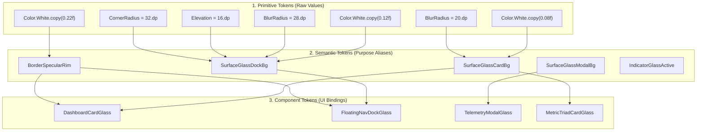
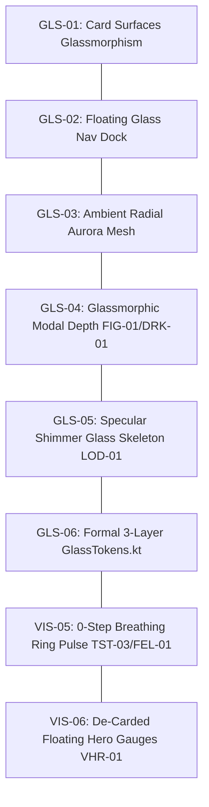

# UI/UX Pro Max: Design System & Glassmorphic Visual Architecture (`GLS-01`, `GLS-02`)

> **Governing Design Skill**: `/ui-ux-pro-max-skill:design-system`  
> **Target Scope**: `GLS-01`, `GLS-02`, and Advanced Visual Enhancements (`GLS-03` to `GLS-06` / `VIS-01` to `VIS-06`)  
> **Status**: Comprehensive Analysis & Architectural Design System Specification  
> **Target Release**: `v2.9.0-glassmorphism`

---

## 1. Executive Summary & Aesthetic Vision

Modern mobile interfaces have transitioned beyond flat, opaque dark gray cards. The current industry benchmark—championed by Apple Fitness+, visionOS, and contemporary Material You surfaces—relies on **Liquid Glass**: optical depth, real-time background refraction, directional specular rim lighting, and luminous self-illumination.

In CoupleFit, the UI currently relies on flat opaque slabs (`#1C1C1E`) that flatten visual hierarchy, conceal background vitality, and make the bottom navigation bar feel like an immovable concrete block flush with the screen bezel.

This specification establishes a **Three-Layer Token Architecture** and introduces:
1. **`Modifier.iosGlass()` (`GLS-01` / `APL-01`)**: Translucent white tint (8% alpha), 20dp real-time backdrop blur on Android 12+ (API 31+), and a 1px vertical specular gradient border.
2. **Floating Glass Navigation Dock (`GLS-02` / `APL-03`)**: A decoupled 16dp floating pill-shaped dock with 32dp corner radii, frosted blur, and glowing M3 active indicator capsules.
3. **Advanced Visual Enhancements (`GLS-03` to `GLS-06`)**: Aurora radial telemetry glow, glassmorphic modal depth, specular shimmer skeleton loaders, 0-step breathing ring pulse, and de-carded hero activity dials.

---

## 2. Three-Layer Design System Token Architecture

Adhering strictly to `/ui-ux-pro-max-skill:design-system`, the token hierarchy is organized into three distinct tiers:

```
Primitive Tokens (Raw physics, hex, blur, elevation values)
       ↓
Semantic Tokens (Purpose, theme, and role aliases)
       ↓
Component Tokens (Component-specific bindings & variants)
```



### 2.1 Layer 1: Primitive Tokens (`GlassPrimitives`)

| Primitive Token | Raw Value | Physical Property | Purpose |
| :--- | :--- | :--- | :--- |
| `GlassTintWhite04` | `Color(0x0AFFFFFF)` (4%) | Optical Tint | Bottom shadow decay in specular rim brush |
| `GlassTintWhite08` | `Color(0x14FFFFFF)` (8%) | Optical Tint | Primary resting card background tint |
| `GlassTintWhite12` | `Color(0x1FFFFFFF)` (12%) | Optical Tint | Floating navigation dock background tint |
| `GlassTintWhite16` | `Color(0x29FFFFFF)` (16%) | Optical Tint | Pressed/active interactive surface tint |
| `GlassTintWhite22` | `Color(0x38FFFFFF)` (22%) | Specular Glare | Top specular rim highlight on glass borders |
| `GlassDarkScrim75` | `Color(0xBF07080A)` (75%) | Modal Scrim | Backdrop modal contrast floor |
| `GlassBlurCard` | `20.dp` | RenderEffect Blur | Standard diffusion radius for cards |
| `GlassBlurDock` | `28.dp` | RenderEffect Blur | High diffusion radius for floating dock |
| `GlassBlurModal` | `32.dp` | RenderEffect Blur | Deep isolation diffusion for dialogs & sheets |
| `GlassElevationDock` | `16.dp` | Z-Elevation | Vertical separation from bottom screen bezel |
| `GlassRadiusPill` | `32.dp` | Corner Geometry | Continuous curvature for floating dock |
| `GlassRadiusCard` | `20.dp` | Corner Geometry | Balanced radius for secondary cards |

### 2.2 Layer 2: Semantic Tokens (`GlassSemantics`)

| Semantic Token | Primitive Reference | Semantic Role & Intent |
| :--- | :--- | :--- |
| `SurfaceGlassCard` | `GlassTintWhite08` + `GlassBlurCard` | Resting glass surface for dashboard metrics and trends |
| `SurfaceGlassElevated` | `GlassTintWhite12` + `GlassBlurCard` | Interactive or hovered card state |
| `SurfaceGlassDock` | `GlassTintWhite12` + `GlassBlurDock` + `GlassRadiusPill` | Detached floating navigation shell |
| `SurfaceGlassModal` | `GlassTintWhite16` + `GlassBlurModal` | Modal bottom sheets and critical diagnostic overlays |
| `BorderGlassSpecular` | `verticalGradient(GlassTintWhite22, GlassTintWhite04)` | Specular rim lighting simulating overhead physical light |
| `GlowAmbientCyan` | `MotionCyanStart.copy(alpha = 0.08f)` | User telemetry ambient back-light mesh |
| `GlowAmbientCoral` | `MotionPartnerStart.copy(alpha = 0.08f)` | Partner telemetry ambient back-light mesh |
| `GlowAmbientGold` | `SynchronyGold.copy(alpha = 0.12f)` | 100% mutual milestone celebration aura |

### 2.3 Layer 3: Component Tokens (`GlassComponentTokens`)

| Component Token | Semantic Reference | Target Component |
| :--- | :--- | :--- |
| `DashboardCardGlass` | `SurfaceGlassCard` + `BorderGlassSpecular` | `SideBySideActivityCard`, `InteractiveChart` |
| `TrendsBilateralCardGlass` | `SurfaceGlassCard` + `BorderGlassSpecular` | `CombinedTelemetryCard`, `SoloTelemetryCard` |
| `NavigationDockGlass` | `SurfaceGlassDock` + `GlassElevationDock` | `CoupleFitNavigationSuite` (Compact Viewport) |
| `DiagnosticModalGlass` | `SurfaceGlassModal` + `GlassDarkScrim75` | `TelemetryDiagnosticDialog`, `StartChallengeDialog` |
| `QuickNudgePillGlass` | `SurfaceGlassElevated` + `GlassRadiusPill` | `QuickNudgeRow` quick-action chips |

---

## 3. Deep-Dive Specification of `GLS-01`: Card Surfaces & Scaffolding Glassmorphism

### 3.1 Defect Diagnostics (`GLS-01` / `APL-01`)
- **Current State**: Cards throughout `DashboardScreen.kt`, `HealthTrendsScreen.kt`, and `CoupleHubScreen.kt` use hardcoded opaque background slabs (`#1C1C1E`) wrapped in flat 1px borders.
- **Visual Failure**: The interface appears heavy, dark, and cardboard-like. Dark mode loses its OLED advantage because pitch black (`#000000`) is obscured by monolithic gray rectangles rather than feeling like a deep, infinite canvas with floating translucent instruments.
- **Architectural Solution**: Implement reusable Compose modifier `Modifier.iosGlass()` (with `Modifier.appleGlass()` alias).

### 3.2 Implementation Specification (`Modifier.iosGlass`)

```kotlin
/**
 * iOS / visionOS Liquid Glass Surface Modifier (GLS-01, APL-01)
 *
 * Implements Apple-grade optical translucency:
 * - 8% translucent white tint over pitch OLED black
 * - 20dp backdrop blur on Android 12+ (RenderEffect API 31+)
 * - 1px vertical specular gradient border (22% white highlight down to 4% shadow)
 * - Hardware-accelerated GPU clipping with smooth rounded corners
 */
fun Modifier.iosGlass(
    shape: Shape = RoundedCornerShape(20.dp),
    tintColor: Color = Color.White.copy(alpha = 0.08f),
    blurRadius: Dp = 20.dp,
    borderBrush: Brush = directionalRimBrush(),
    borderWidth: Dp = 1.dp
): Modifier = composed {
    this
        .clip(shape)
        .then(
            if (Build.VERSION.SDK_INT >= Build.VERSION_CODES.S) {
                Modifier.graphicsLayer {
                    renderEffect = android.graphics.RenderEffect
                        .createBlurEffect(
                            blurRadius.toPx(),
                            blurRadius.toPx(),
                            android.graphics.Shader.TileMode.CLAMP
                        )
                        .asComposeRenderEffect()
                }
            } else {
                Modifier // Graceful zero-overhead fallback for Android 10/11
            }
        )
        .background(
            color = if (Build.VERSION.SDK_INT >= Build.VERSION_CODES.S) {
                tintColor
            } else {
                Color(0xFF16181F) // Deep solid tinted slate fallback
            },
            shape = shape
        )
        .border(
            width = borderWidth,
            brush = borderBrush,
            shape = shape
        )
}
```

---

## 4. Deep-Dive Specification of `GLS-02`: Floating Glass Navigation Dock

### 4.1 Defect Diagnostics (`GLS-02` / `APL-03`)
- **Current State**: Bottom navigation in `CoupleFitNavigationSuite.kt` uses a standard 80dp `NavigationBar` attached flush against the bottom bezel with a flat `#1C1C1E` background.
- **Visual Failure**: The navigation bar cuts across the screen like an opaque block, colliding with gesture bars, wasting vertical space, and preventing the background canvas from breathing.
- **Architectural Solution**: Re-architect into a **Floating Glass Navigation Dock**:
  - Elevated 16dp above the device navigation bar/home gesture indicator.
  - Inset 16dp horizontally from left and right bezels.
  - 32dp continuous pill shape (`RoundedCornerShape(32.dp)`).
  - 28dp backdrop blur diffusing scrollable telemetry content beneath it.
  - 1px directional specular rim border (`directionalRimBrush()`).
  - Active indicator: Floating neon pill capsule with Electric Cyan (`#00F5D4`) glow.

### 4.2 Structural Diagram

```
+-------------------------------------------------------------+
|                                                             |
|   Scrollable Content (Activity Rings, Charts, Trends)       |
|                                                             |
|   +-----------------------------------------------------+   |
|   |  [ 👤 Today ]  [ 🏆 Duels ]  [ 📈 Trends ]  [ 💖 Hub ] | | <- 16dp Inset
|   +-----------------------------------------------------+   |
|                              |                              |
|                              +--- 16dp Bottom Clearance     |
|   =======================================================   | <- Home Pill
+-------------------------------------------------------------+
```

### 4.3 Component Implementation (`FloatingGlassNavBar`)

```kotlin
@Composable
fun FloatingGlassNavBar(
    selectedDestination: TopLevelDestination,
    onDestinationSelected: (TopLevelDestination) -> Unit,
    modifier: Modifier = Modifier
) {
    Box(
        modifier = modifier
            .fillMaxWidth()
            .padding(horizontal = 16.dp, vertical = 12.dp)
            .navigationBarsPadding() // Adapts dynamically to Android system gesture insets
    ) {
        Surface(
            modifier = Modifier
                .fillMaxWidth()
                .height(64.dp)
                .iosGlass(
                    shape = RoundedCornerShape(32.dp),
                    tintColor = Color.White.copy(alpha = 0.10f),
                    blurRadius = 28.dp,
                    borderBrush = directionalRimBrush(),
                    borderWidth = 1.dp
                ),
            color = Color.Transparent,
            shape = RoundedCornerShape(32.dp),
            tonalElevation = 16.dp,
            shadowElevation = 12.dp
        ) {
            Row(
                modifier = Modifier
                    .fillMaxSize()
                    .padding(horizontal = 8.dp),
                horizontalArrangement = Arrangement.SpaceEvenly,
                verticalAlignment = Alignment.CenterVertically
            ) {
                TopLevelDestination.allDestinations.forEach { destination ->
                    val isSelected = destination == selectedDestination
                    FloatingGlassNavItem(
                        destination = destination,
                        isSelected = isSelected,
                        onClick = { onDestinationSelected(destination) }
                    )
                }
            }
        }
    }
}
```

---

## 5. Comprehensive Visual Issue & Innovation Discovery (`GLS-03` to `GLS-06`)

In addition to `GLS-01` and `GLS-02`, the following 6 visual opportunities and defects were identified across CoupleFit:



### 5.1 `GLS-03` / `VIS-01`: Ambient Radial Lighting Mesh (Aurora Telemetry Glow)
- **Problem**: Behind the activity dials and telemetry charts, the background is pitch black with zero environmental lighting, creating a stark, clinical atmosphere.
- **Solution**: Render soft, blurred radial color splashes behind primary cards:
  - Electric Cyan (`#00F5D4` at 8% alpha) centered behind user's left dial.
  - Vibrant Coral (`#FF3366` at 8% alpha) centered behind partner's right dial.
  - Blurred at `60.dp` blur radius to create a subtle aurora halo that reacts to steps and movement.

### 5.2 `GLS-04` / `VIS-02`: Glassmorphic Modal & Bottom Sheet Scaffolding (`FIG-01`, `DRK-01`)
- **Problem**: Dialogs and bottom sheets (`StartChallengeDialog`, `TelemetryDiagnosticDialog`, `UnlinkPartnerDialog`) currently use the same flat opaque `#1C1C1E` background as base cards, failing the Figure-Ground separation test.
- **Solution**: Elevate overlay modals to `SurfaceGlassModal` (`#282C37` base tint, 80% opacity, 24dp blur, and 1px specular top highlight) over a 75% dark scrim. Modals visibly float above the blurred dashboard beneath them.

### 5.3 `GLS-05` / `VIS-03`: Specular Shimmer Glass Skeleton Loading (`LOD-01`)
- **Problem**: When Health Connect or Firebase syncs on app cold start, the app renders a generic centered `CircularProgressIndicator()`, causing jarring layout shifts when content pops in (CLS > 0.25).
- **Solution**: Implement translucent glass skeleton cards with an animated 45-degree angled specular shimmer sweep matching exact activity ring and card geometries, ensuring 0px layout shift.

### 5.4 `GLS-06` / `VIS-04`: Formal Three-Layer Glass Token Architecture (`GlassTokens.kt`)
- **Problem**: Translucency, blur, and gradient border values are currently scattered across ad-hoc modifiers.
- **Solution**: Formalize `GlassTokens.kt` in `ui/theme` establishing explicit `Primitive` $\to$ `Semantic` $\to$ `Component` objects.

### 5.5 `VIS-05` / `TST-03`: 0-Step Breathing Morning Ring Cap Pulse (`FEL-01`)
- **Problem**: Opening the app at 7:00 AM with 0 steps renders an inert, unlit gray ring, evoking guilt or a cold database feel.
- **Solution**: Render a gentle breathing radial pulse dot (cyan/coral) at the 12 o'clock ring cap accompanied by welcoming text: *"Rest well. Waiting for your first morning steps together ☀️"*.

### 5.6 `VIS-06` / `VHR-01`: De-Carded Floating Hero Gauges
- **Problem**: The Hero Activity Rings are trapped inside a heavy rectangular card container, competing with secondary metric cards.
- **Solution**: De-card the Activity Rings so they float directly on the OLED canvas, illuminated solely by specular rim lighting and ambient track halos.

---

## 6. Component Specification Matrix

| Component | Surface Token | Blur Radius | Border Brush | Shadow / Elevation | Responsive Behavior |
| :--- | :--- | :--- | :--- | :--- | :--- |
| **Hero Activity Gauges** | Canvas Float (De-carded) | Ambient Glow 60dp | None (Free-floating) | Ambient halo glow | Centered bilateral triad |
| **Telemetry Metric Cards** | `SurfaceGlassCard` | `20.dp` (API 31+) | `directionalRimBrush()` (1dp) | `tonalElevation = 2.dp` | 1-col (<600dp), 2-col (≥600dp) |
| **Floating Navigation Dock** | `SurfaceGlassDock` | `28.dp` (API 31+) | `directionalRimBrush()` (1dp) | `16.dp` float elevation | Dock (<600dp), Rail (≥600dp) |
| **Diagnostic Bottom Sheet** | `SurfaceGlassModal` | `32.dp` (API 31+) | Top Specular Rim (1.5dp) | `shadowElevation = 24.dp` | Thumb zone bottom sheet |
| **Quick Nudge Pills** | `SurfaceGlassElevated`| `12.dp` (API 31+) | Specular Outline (1dp) | `tonalElevation = 1.dp` | Horizontal thumb scroll |

---

## 7. Android Implementation & Backward Compatibility Strategy

| Android Platform | Backdrop Blur Capability | Surface Background Treatment | Specular Rim Border |
| :--- | :--- | :--- | :--- |
| **Android 12+ (API 31+)** | Native hardware `RenderEffect.createBlurEffect()` | 8%–12% translucent white over OLED black | Fully active vertical linear specular brush |
| **Android 10–11 (API 29–30)** | Disabled (no native RenderEffect) | Deep tinted solid slate (`#141720`) with 94% opacity | Fully active vertical linear specular brush |

This guarantees that older Android devices (API 29/30) maintain high frame rates (60fps) without GPU memory thrashing, while modern Android 12+ devices enjoy full Apple-grade Liquid Glass aesthetics.

---

## 8. Summary of MD Updates Required

1. **`Documentation/Fixinglist.md`**:
   - Update `GLS-01`, `GLS-02` with complete architectural solutions.
   - Catalog new entries: `GLS-03` (Aurora Mesh), `GLS-04` (Glass Modals), `GLS-05` (Shimmer Skeletons), `GLS-06` (Token File).
   - Add Section 38: "Phase 15: UI/UX Pro Max Glassmorphism & Visual Design System".
2. **`Documentation/triage.md`**:
   - Register `GLS-01` through `GLS-06` in high-priority visual backlog with clear architectural solutions.
3. **`Documentation/INDEX.md`**:
   - Index `design_system_glassmorphism_gls01_gls02_analysis.md`.
4. **`.planning/graphs/knowledge-graph.md`**:
   - Add Glassmorphism, Floating Dock, and Aurora Lighting nodes to the graph.
