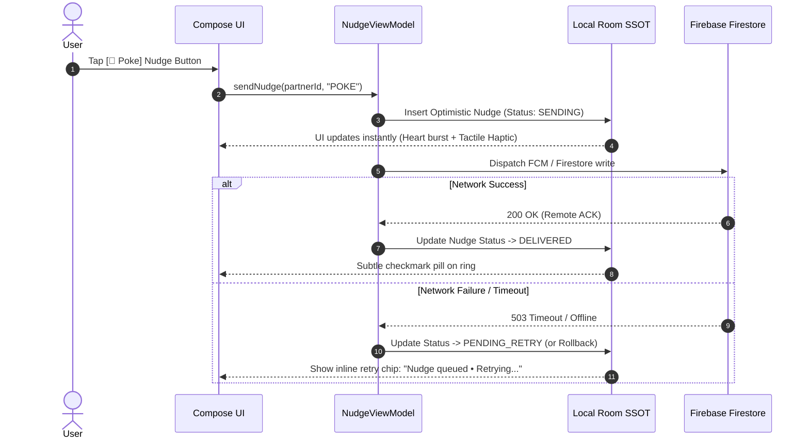

# CoupleFit — Error Handling & Waiting Experience Architecture Specification 🛡️⏳

> **Command Trigger**: `/designer-skills:error-handling-ux` & `/designer-skills:loading-states`  
> **Associated Defect Logs in Fixinglist.md**: `ERR-01`, `ERR-02`, `LOD-01`, `LOD-02`


> **Engineering & UX Systems Design Guide**  
> **Target Framework**: Jetpack Compose / Material 3 / Kotlin Coroutines / Health Connect SDK / Firebase  
> **Audited Standards**: Nielsen Norman Group Usability Heuristics, Doherty Threshold (<400ms), WCAG 2.2 Level AA  
> **Companion Document**: [`Fixinglist.md`](file:///D:/Couple_fit/CoupleFit/Documentation/Fixinglist.md)

---

## 1. Executive Summary & Problem Space

In a **bilateral, real-time fitness companion** like CoupleFit, waiting and failure modes are constant realities rather than edge cases:
- Bluetooth Low Energy (BLE) and watch sensors experience packet drops and intermittent disconnections.
- Android Health Connect can delay batch aggregation or revoke background sync permissions.
- Cellular signal drops out while jogging or gym-going, stalling Firebase Firestore telemetry synchronization.
- Partner phone battery depletion or Do-Not-Disturb modes pause cross-device handshakes.

Historically, apps handle these states with **abrupt modal spinners, generic "Something went wrong" toasts, or silent freezing**. This specification establishes an **offline-first, confidence-preserving waiting and recovery architecture** that guarantees zero visual layout shifts, non-blocking background synchronization, optimistic interactions, and clear, human recovery paths.

---

## 2. Waiting Experience Matrix & Duration Budgets (Doherty Threshold)

| Time Window | Latency Budget | Perceived System Behavior | Allowed UI Pattern | Prohibited Patterns |
| :--- | :--- | :--- | :--- | :--- |
| **Micro-Lag** | `0ms – 100ms` | Instantaneous | Direct physical response (e.g., button spring deflection, ripple). | ❌ Zero spinners, zero skeletons (causes flickering strobe). |
| **Short Wait** | `100ms – 1,000ms` | Transient fetch | Skeleton shimmer matching exact element geometries, subtle opacity wash. | ❌ Full-screen modal blockers, blocking overlays. |
| **Medium Wait** | `1,000ms – 5,000ms` | Network / Health API pull | Determinate progress or contextual status chip with pull-to-refresh spinner. | ❌ Indeterminate generic dialogs that freeze user input. |
| **Extended Wait** | `> 5,000ms` | Stalled Sync / Cold Boot | Graceful degraded state: show cached Room data with "Syncing..." banner + Cancel/Offline option. | ❌ Freezing the app or showing blank empty cards. |

---

## 3. Loading Patterns Specification

### 3.1 Skeleton Shimmer Architecture (`CoupleFitSkeleton`)
Skeletons must match the **exact aspect ratio and typography heights** of the resolved content to prevent layout shifts (CLS < 0.05).

```kotlin
package com.couplefit.ui.components

import androidx.compose.animation.core.*
import androidx.compose.foundation.background
import androidx.compose.runtime.Composable
import androidx.compose.runtime.getValue
import androidx.compose.ui.Modifier
import androidx.compose.ui.geometry.Offset
import androidx.compose.ui.graphics.Brush
import androidx.compose.ui.graphics.Color
import androidx.compose.ui.graphics.Shape
import androidx.compose.ui.unit.Dp
import com.couplefit.ui.theme.AppSpacing
import com.couplefit.ui.theme.ShapeTokens

/**
 * High-performance, anti-glare shimmer modifier for dark mode.
 * Respects reduce-motion settings by falling back to static 12% alpha fill.
 */
@Composable
fun Modifier.shimmerPlaceholder(
    shape: Shape = ShapeTokens.cardMedium,
    reduceMotion: Boolean = false
): Modifier {
    if (reduceMotion) {
        return this.background(Color(0xFF1E2129), shape)
    }

    val transition = rememberInfiniteTransition(label = "shimmerTransition")
    val translateAnim by transition.animateFloat(
        initialValue = 0f,
        targetValue = 1000f,
        animationSpec = infiniteRepeatable(
            animation = tween(durationMillis = 1200, easing = LinearEasing),
            repeatMode = RepeatMode.Restart
        ),
        label = "shimmerTranslate"
    )

    val shimmerColors = listOf(
        Color(0xFF14161C),
        Color(0xFF222631),
        Color(0xFF14161C)
    )

    val brush = Brush.linearGradient(
        colors = shimmerColors,
        start = Offset(x = translateAnim - 300f, y = translateAnim - 300f),
        end = Offset(x = translateAnim, y = translateAnim)
    )

    return this.background(brush, shape)
}
```

#### Skeleton Layout for Dashboard Hero Rings & Cards
- **Dual Rings Skeleton**: Renders a circular 220dp track in `#14161C` with dual concentric 12% alpha rings.
- **Metric Card Skeleton**: Renders a 16dp rounded card with a 14dp header bar, 44dp metric rectangle, and 12dp subtitle line.
- **Chart Card Skeleton**: Renders a 180dp card with 5 vertical pill columns pulsing at staggered 40ms offsets.

---

### 3.2 Optimistic UI with Compensating Rollbacks
All interpersonal actions (e.g., Sending Nudges, Toggling Privacy Sharing, Claiming Challenge Trophies) execute **optimistically in the local Room database** before Firebase network dispatch:



---

## 4. Error Handling Hierarchy & Recovery Playbooks

CoupleFit categorizes errors into **4 operational domains**:

```
               ┌────────────────────────────────────────────────────────┐
               │           CoupleFit Error Architecture                 │
               └────────────────────────────────────────────────────────┘
                                           │
         ┌───────────────────┬─────────────┴───────┬────────────────────┐
         ▼                   ▼                     ▼                    ▼
   [Connectivity]      [Health Sensor]       [Partner Pairing]     [Auth / Token]
   - Airplane Mode     - Health Connect Deny - Invalid 6-Digit     - Google Auth Cancel
   - Cellular Drop     - Missing Wearable    - Code Expired        - Expired Refresh
   - Firestore Disconn - Low Accuracy GPS    - Unlinked Remote     - Re-auth Required
```

---

### 4.1 Connectivity & Sync Failures (Network Layer)

- **UX Principle**: **Never show a modal alert for a background sync drop.** The user is exercising; blocking the dashboard destroys workout momentum.
- **Visual Pattern**: Contextual floating offline pill anchored to the App Bar:
  ```
  ┌─────────────────────────────────────────────────────────────────┐
  │ [🟡 Offline Mode • Showing cached vitals (Synced 14m ago)] [↺] │
  └─────────────────────────────────────────────────────────────────┘
  ```
- **Error Copy Formula**:
  - **What Happened**: "You're offline."
  - **Why**: "No cellular or Wi-Fi connection detected."
  - **What to Do**: "Your steps are recording locally and will sync automatically when back online."
  - **Action**: Optional `[Retry Now]` pill.

---

### 4.2 Health Hardware & Sensor Errors (Health Connect Layer)

| Error Scenario | Root Cause | User-Facing Copy | Recovery Action |
| :--- | :--- | :--- | :--- |
| **Permissions Denied** | User clicked "Don't allow" in Health Connect dialog. | *"CoupleFit needs Health Connect read access to display your daily steps and calories."* | Prominent CTA: `[Grant Permissions in Settings]` which triggers `PermissionController.createRequestPermissionResultContract()`. |
| **Health Connect Unavailable** | Device is running Android <9 or app not installed. | *"Health Connect is required to read telemetry on Android."* | Direct deep-link button: `[Install Health Connect via Play Store]`. |
| **Sensor Data Stale (>60m)** | Wearable disconnected or OEM battery saver killed sensor background polling. | *"Watch disconnected 1h ago. Phone pedometer active as fallback."* | Inline informational banner with Bluetooth shortcut. |

---

### 4.3 Partner Pairing & Invite Failures

- **Scenario 1: Invalid 6-Digit Code**
  - **Detection**: Inline instant regex + Firestore lookup error.
  - **Error Copy**: *"Code not found. Please double-check the 6-digit code shared by your partner."*
  - **Input Preservation**: **Never clear the user's entered digits.** Keep the input populated and highlight the 6-pin box with a high-contrast coral border (`#FF4568`).
- **Scenario 2: Code Expired (>15 minutes)**
  - **Error Copy**: *"This invite code expired. Ask your partner to tap 'Regenerate Code'."*
  - **Recovery Action**: `[Request New Code]` or `[Share Fresh Invite]`.
- **Scenario 3: Self-Pairing Attempt**
  - **Error Copy**: *"You entered your own invite code. Share this code with your partner to link accounts."*

---

### 4.4 Form & Input Validation (Inline Prevention)

- **Constraint-Based Enforcement**: 6-digit pin boxes automatically filter non-digit characters and advance focus automatically across boxes.
- **Real-Time Guidance**: Submit buttons remain disabled until constraints are satisfied, with clear helper text indicating remaining requirements.
- **Destructive Action Safety (Danger Zone)**:
  - Irreversible action: **Unlinking Partner**.
  - **Prevention**: Require a 2-step verification modal requiring typing `"UNLINK"` or performing a 3-second hold action (`HoldToConfirmButton`).

---

## 5. Architectural Implementation Blueprint

### 5.1 Reusable UI State Wrapper (`CoupleFitAsyncContainer`)

```kotlin
package com.couplefit.ui.components

import androidx.compose.animation.*
import androidx.compose.foundation.layout.*
import androidx.compose.material3.*
import androidx.compose.runtime.Composable
import androidx.compose.ui.Alignment
import androidx.compose.ui.Modifier
import androidx.compose.ui.text.font.FontWeight
import androidx.compose.ui.unit.dp
import com.couplefit.ui.theme.AppSpacing

sealed interface AsyncState<out T> {
    data object Loading : AsyncState<Nothing>
    data class Success<T>(val data: T) : AsyncState<T>
    data class Error(val title: String, val message: String, val canRetry: Boolean = true) : AsyncState<Nothing>
    data object Empty : AsyncState<Nothing>
}

/**
 * Universal async content orchestrator ensuring smooth crossfades between
 * skeletons, loaded content, empty screens, and graceful error states.
 */
@Composable
fun <T> CoupleFitAsyncContainer(
    state: AsyncState<T>,
    modifier: Modifier = Modifier,
    skeletonContent: @Composable () -> Unit,
    emptyContent: @Composable () -> Unit = { DefaultEmptyView() },
    onRetry: () -> Unit,
    content: @Composable (T) -> Unit
) {
    AnimatedContent(
        targetState = state,
        transitionSpec = { fadeIn() togetherWith fadeOut() },
        label = "AsyncStateTransition",
        modifier = modifier
    ) { targetState ->
        when (targetState) {
            is AsyncState.Loading -> skeletonContent()
            is AsyncState.Success -> content(targetState.data)
            is AsyncState.Empty -> emptyContent()
            is AsyncState.Error -> {
                Column(
                    modifier = Modifier
                        .fillMaxWidth()
                        .padding(AppSpacing.lg),
                    horizontalAlignment = Alignment.CenterHorizontally,
                    verticalArrangement = Arrangement.spacedBy(AppSpacing.sm)
                ) {
                    Text(
                        text = targetState.title,
                        style = MaterialTheme.typography.titleMedium.copy(fontWeight = FontWeight.Bold),
                        color = MaterialTheme.colorScheme.onSurface
                    )
                    Text(
                        text = targetState.message,
                        style = MaterialTheme.typography.bodyMedium,
                        color = MaterialTheme.colorScheme.onSurfaceVariant
                    )
                    if (targetState.canRetry) {
                        Button(
                            onClick = onRetry,
                            colors = ButtonDefaults.buttonColors(
                                containerColor = MaterialTheme.colorScheme.primaryContainer,
                                contentColor = MaterialTheme.colorScheme.onPrimaryContainer
                            )
                        ) {
                            Text("Try Again")
                        }
                    }
                }
            }
        }
    }
}
```

---

## 6. Implementation Checklist & Verification Gates

- [ ] **Skeleton Screens**: Build `DashboardSkeleton.kt` matching hero dual rings and metric cards.
- [ ] **Zero Layout Shifts**: Skeletons enforce exact dimensions so content replaces placeholder with 0px shift.
- [ ] **Offline Banner**: Add non-blocking status banner on `DashboardScreen.kt` indicating cached Room vitals.
- [ ] **Optimistic Nudges**: Implement instant UI feedback for cheers/nudges with background Firebase dispatch.
- [ ] **Preserve Form Inputs**: `EnterCodeScreen.kt` preserves digits on network failure and highlights error inline.
- [ ] **Health Connect Rationale Dialog**: Friendly onboarding sheet explaining why read permissions are required.
- [ ] **2-Step Danger Zone**: Refactor Unlink Partner in `SettingsScreen.kt` to a typed or 3-second hold confirmation.
