# CoupleFit — Motion System & Animation Token Architecture 🌊🎬

> **Command Trigger**: `/designer-skills:motion-system`  
> **Associated Defect Logs in Fixinglist.md**: `MOT-01`, `MOT-02`, `MOT-03`


> **Product-Wide Motion Design System**  
> **Target Framework**: Jetpack Compose Animation (`AnimationSpec`, `Easing`, `CubicBezierEasing`, `spring`, `tween`)  
> **Audited Standards**: Material Design 3 Motion Tokens, WCAG 2.2 Success Criterion 2.3.3 (Animation from Interactions), Emil Kowalski Motion Craft  
> **Companion Documents**: [`Fixinglist.md`](file:///D:/Couple_fit/CoupleFit/Documentation/Fixinglist.md), [`micro_interaction_specifications.md`](file:///D:/Couple_fit/CoupleFit/Documentation/micro_interaction_specifications.md)

---

## 1. Executive Summary & Problem Diagnosis

### 1.1 The Existing Motion Audit: 6.2 / 10 (Ad-Hoc Fragmentation)
A codebase scan of `CoupleFit` revealed severe animation drift:
- Over **18 distinct hardcoded millisecond values** (`150ms`, `200ms`, `300ms`, `400ms`, `500ms`, `900ms`, `1200ms`, `8000ms`, `40000ms`) scattered across UI composables.
- Inconsistent easings: Standard transitions mix `FastOutSlowInEasing`, `LinearEasing`, and raw `spring(0.6f, 400f)` without semantic alignment.
- Localized `reduceMotion` handling: Motion reduction is handled manually in some screens via `SharedPreferences`, but completely bypassed in `InteractiveChart.kt` and `ActivityRing.kt`.

### 1.2 Motion Principles
Every animation in CoupleFit must adhere to four core principles:
1. **Purposeful**: Motion communicates a change in relationship or telemetry state; nothing moves merely to decorate.
2. **Mechanical & Weighted**: Physical interactions (buttons, drags, toggles) follow spring physics with high damping (`0.82f`) to prevent rubbery wobble.
3. **Glance-Respectful**: Telemetry and navigation transitions never exceed **300ms**, preserving user speed during active workouts.
4. **Universal Accessibility**: System-level `prefers-reduced-motion` and OS animation scale ($0\times$) automatically flatten sliding/scaling into instant transitions or opacity crossfades.

---

## 2. Motion Token Architecture (`MotionTokens.kt`)

Rather than letting developers choose arbitrary durations and easings, CoupleFit defines a **formal motion token layer** alongside colors and typography:

```
┌────────────────────────────────────────────────────────┐
│               CoupleFit Motion Token Stack             │
├────────────────────────────────────────────────────────┤
│ 1. Duration Tokens: Instant (50ms) to Slow (400ms)     │
│ 2. Easing Tokens: Standard, Decelerate, Accelerate     │
│ 3. Spring Tokens: Tactile, Expressive, Gentle          │
│ 4. Stagger Delays: Item entrance rhythm (35ms)         │
└────────────────────────────────────────────────────────┘
```

---

### 2.1 Duration Tokens
| Token Name | Value | Semantic Use Case | Example UI Component |
| :--- | :--- | :--- | :--- |
| `DurationInstant` | `50ms` | Instant visual confirmation; micro-state switch. | Checkbox tick, toggle thumb snap. |
| `DurationFast` | `120ms` | Small contextual transitions; tooltip exits. | Scrubber tooltip fade, chip dismiss. |
| `DurationNormal` | `220ms` | Default for UI state shifts and component sizing. | Dropdown open, accordion expand, card fold. |
| `DurationModerate`| `320ms` | Medium viewport elements and modal sheets. | Bottom sheet slide-up, dialog entrance. |
| `DurationSlow` | `450ms` | High-emphasis page transitions and deep navigation. | Top-level screen swap (`Today` $\leftrightarrow$ `Trends`). |
| `DurationCelebration`| `700ms` | Shared couple milestone rewards. | Confetti sweep, dual ring goal closure. |

---

### 2.2 Easing Curves (Cubic Bézier Tokens)

```
       EaseStandard                   EaseDecelerate                  EaseAccelerate
  CubicBezier(0.2, 0, 0, 1)      CubicBezier(0, 0, 0.2, 1)       CubicBezier(0.3, 0, 1, 0.3)
      [Internal State]                [Entering Viewport]             [Exiting Viewport]
```

- **`EaseStandard`** — `CubicBezierEasing(0.2f, 0.0f, 0.0f, 1.0f)`: Used when an element is already on screen and transitions to a new state or size (e.g. card expanding, button hover).
- **`EaseDecelerate`** — `CubicBezierEasing(0.0f, 0.0f, 0.2f, 1.0f)`: Used when elements **enter the screen** (e.g. bottom sheet sliding in, snackbar entry). Starts fast and gently rests.
- **`EaseAccelerate`** — `CubicBezierEasing(0.3f, 0.0f, 1.0f, 0.3f)`: Used when elements **leave the screen** (e.g. modal dismiss, dialog fade-out). Starts slow and exits briskly.
- **`EaseLinear`** — `LinearEasing`: Reserved strictly for continuous loops (e.g. skeleton shimmer gradient translation).

---

### 2.3 Spring Physics Tokens (Mechanical Fidelity)

Springs govern physical manipulation and tactile touch responses:

| Spring Token | Damping Ratio | Stiffness | Use Case |
| :--- | :--- | :--- | :--- |
| `SpringTactile` | `0.82f` (High damping) | `750f` (Brisk) | Button click scale, toggle switch, chip tap. Prevents layout wobble. |
| `SpringExpressive`| `0.72f` (Moderate) | `350f` (Medium) | Bottom sheet release, swipeable card snap, ring progress retargeting. |
| `SpringGentle` | `0.85f` (Smooth) | `140f` (Soft) | Dual ring progress fill upon screen load, smooth overscroll return. |

---

## 3. Choreography & Orchestration Rules

When multiple items animate on the screen at once, they must move with **staggered rhythmic hierarchy**, never simultaneously in an uncoordinated stampede:

```mermaid
gantt
    title Dashboard Card Stagger Entrance Sequence (Max 420ms Total)
    dateFormat X
    axisFormat %s
    section Elements
    Hero Dual Rings (Lead)    :active, 0, 220
    Quick Nudge Row (T+35ms)  :crit, 35, 255
    Duels & Standings (T+70ms): 70, 290
    Health Telemetry (T+105ms): 105, 325
    Historical Chart (T+140ms): 140, 360
```



### Choreography Rules
1. **Lead with Hero Focus**: The primary figure (`ActivityRing.kt`) initiates animation first (`T = 0ms`).
2. **Stagger Interval (35ms)**: Subsequent dashboard cards enter staggered by exactly **35ms**.
3. **Total Sequence Ceiling**: The entire entrance choreography must resolve within **420ms**, respecting user time.
4. **Directional Continuity**: Incoming views slide in from the trailing edge (`Offset { it }`); departing views slide out to the leading edge (`Offset { -it / 3 }`), preserving spatial mental models.

---

## 4. System-Level Reduced-Motion Architecture

CoupleFit enforces **zero-tolerance vestibular discomfort handling** (WCAG 2.3.3):
- Under `reduceMotion = true` or Android OS animation scale `0.0x`, **all durations collapse to 0ms**, and spring deflections are eliminated.
- Sliding and scaling animations are globally replaced by instantaneous alpha crossfades.

```kotlin
package com.couplefit.ui.theme

import androidx.compose.animation.core.*
import androidx.compose.runtime.Composable
import androidx.compose.runtime.ReadOnlyComposable
import androidx.compose.runtime.staticCompositionLocalOf

/**
 * Global Motion Design Tokens for CoupleFit.
 */
object MotionTokens {
    // Duration Tokens
    const val DurationInstant = 50
    const val DurationFast = 120
    const val DurationNormal = 220
    const val DurationModerate = 320
    const val DurationSlow = 450
    const val DurationCelebration = 700

    // Easing Tokens
    val EaseStandard = CubicBezierEasing(0.2f, 0.0f, 0.0f, 1.0f)
    val EaseDecelerate = CubicBezierEasing(0.0f, 0.0f, 0.2f, 1.0f)
    val EaseAccelerate = CubicBezierEasing(0.3f, 0.0f, 1.0f, 0.3f)
    val EaseLinear = LinearEasing

    // Spring Tokens
    val SpringTactile = spring<Float>(dampingRatio = 0.82f, stiffness = 750f)
    val SpringExpressive = spring<Float>(dampingRatio = 0.72f, stiffness = 350f)
    val SpringGentle = spring<Float>(dampingRatio = 0.85f, stiffness = 140f)

    // Stagger Interval
    const val StaggerIntervalMillis = 35
}

/**
 * Motion Provider that automatically adapts tokens when reduceMotion is active.
 */
class MotionProvider(val reduceMotion: Boolean) {

    fun <T> duration(durationMillis: Int, easing: Easing = MotionTokens.EaseStandard): TweenSpec<T> {
        return if (reduceMotion) {
            tween(durationMillis = 0, easing = LinearEasing)
        } else {
            tween(durationMillis = durationMillis, easing = easing)
        }
    }

    val enterAnimation: TweenSpec<Float>
        get() = duration(MotionTokens.DurationModerate, MotionTokens.EaseDecelerate)

    val exitAnimation: TweenSpec<Float>
        get() = duration(MotionTokens.DurationFast, MotionTokens.EaseAccelerate)
}

val LocalMotion = staticCompositionLocalOf { MotionProvider(reduceMotion = false) }
```

---

## 5. Implementation Roadmap & QA Verification Checklist

- [ ] **Create `MotionTokens.kt`**: Place tokens inside `com.couplefit.ui.theme`.
- [ ] **Audit & Refactor Ad-Hoc Calls**: Replace 18 hardcoded `tween(...)` and `spring(...)` calls across `MainActivity.kt`, `ActivityRing.kt`, and `DashboardScreen.kt` with `MotionTokens`.
- [ ] **Enforce 35ms Stagger on Dashboard**: Use `LaunchedEffect` or Compose transition modifiers to choreograph card entrances.
- [ ] **Automated Test Gate**: Verify all animations resolve within 450ms and complete without frame jitter (>60fps).
