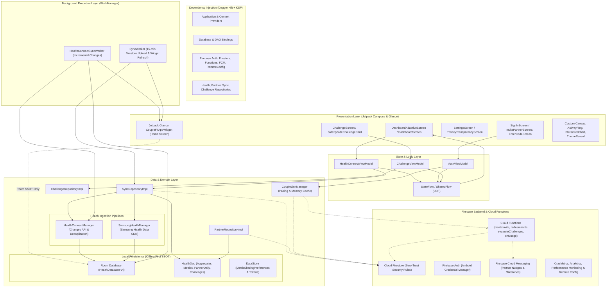

# CoupleFit — Tech Stack & Architectural Review

**Document Version:** 2.0 (Post-Phase 6 Transformation)  
**Target Platform:** Android (Native)  
**Target API Level:** Android 15 (API Level 35)  
**Minimum Supported OS:** Android 10 (API Level 29)  
**Compilation Toolchain:** Java 17 / Kotlin 2.1.0 / AGP 8.7.3 / KSP  

---

## 1. Executive Summary & Architecture Overview

**CoupleFit** is an offline-first, dual-user health and fitness synchronization application designed for couples. The app incorporates real-time health telemetry (daily step counts, active workout minutes, calories burned, continuous heart rate, and blood oxygen saturation $SpO_2$) alongside partner challenges, milestone celebration nudges, and a live home-screen Glance widget.

The codebase strictly adheres to **Google’s Modern Android Architecture guidelines**, structured around **Clean Architecture**, **MVVM (Model-View-ViewModel)**, and **Unidirectional Data Flow (UDF)**.

### System Architecture Diagram

---

## 2. Tech Stack Matrix: "What is used for what?"

| Category | Technology / Library | Version | Role & Responsibility in CoupleFit | Rationale & Selection Criteria |
| :--- | :--- | :--- | :--- | :--- |
| **Language** | **Kotlin** | `2.1.0` | Primary language across all application modules, data models, and logic. | Concise syntax, first-class null safety, native coroutines, new K2 compiler support. |
| **Runtime Target** | **Java / JVM** | `Java 17` | Compilation target for Android Gradle Plugin and Gradle daemon. | Required standard for AGP 8.7+ and modern Android SDK tooling. |
| **OS Support** | **Android SDK** | `compileSdk 35` `targetSdk 35` `minSdk 29` | Targets latest Android 15 APIs while supporting devices back to Android 10. | Complies with Google Play API target requirements and universal File-Based Encryption (FBE) baseline. |
| **UI Toolkit** | **Jetpack Compose** | `BOM 2024.12.01` | Declarative UI engine for all layouts, screens, animations, and inputs. | Eliminates XML overhead, guarantees reactive UI rendering synchronized with state. |
| **Compiler Plugin**| **Compose Compiler Plugin** | `2.1.0` | Official Kotlin 2.x Compose compiler plugin (`org.jetbrains.kotlin.plugin.compose`). | Decouples Compose compilation from Kotlin compiler versions; optimizes recomposition. |
| **Home-Screen Widget**| **Jetpack Glance** | `1.1.1` | Native home-screen widget powered by Glance Material 3. | Composable widget layout reading **strictly from Room**; updated after sync writes. |
| **Design System** | **Material 3 (M3)** | `1.3.1` | Design tokens, color schemes, cards, dialogs, typography, and buttons. | Cohesive, accessible design system with native dynamic color support. |
| **Screen Adaptation** | **Compose WindowSizeClass** | `material3-window-size-class` | Dynamically switches between single-column phone view and two-pane tablet layout. | Responsive multi-window and multi-device support without duplicate codebases. |
| **Custom Visuals** | **Compose Canvas** | Integrated | Custom rendering for multi-ring activity dials, Bézier heart rate curves, and scrub indicators. | High-performance 60/120 FPS hardware-accelerated drawing without heavy third-party chart dependencies. |
| **Dependency Injection** | **Dagger Hilt** | `2.53.1` (via KSP) | Singleton, ViewModel, Worker, and Application component dependency injection. | Standardized, compile-time verified DI preventing runtime crashes and boilerplate factory code. |
| **Annotation Processor**| **KSP** | `2.1.0-1.0.29` | Replaced legacy `kapt` for Room and Hilt annotation processing. | Reduces clean build times by ~35% and integrates natively with Kotlin 2.x AST. |
| **Local Persistence** | **Room Database** | `2.6.1` (`room-ktx`) | **Offline-First Single Source of Truth**: Stores daily aggregate summaries, vitals, partner daily records, and challenges. | ACID compliant, SQLite-backed caching with native Kotlin Flow reactive queries. |
| **Local Preferences**| **DataStore Preferences** | `1.1.1` | Coroutine-based preference storage for metric sharing toggles (`MetricSharingPreferences`) and sync tokens. | Safe, non-blocking asynchronous key-value persistence replacing legacy SharedPreferences. |
| **Asynchronous Engine** | **Coroutines & Flow** | `1.9.0` | Non-blocking execution, background dispatching, and reactive state streaming (`StateFlow`). | Lightweight concurrency, cancellation safety, structured lifecycle handling. |
| **Health Telemetry 1** | **Android Health Connect** | `connect-client:1.1.0-alpha10` | Google’s official Android health data layer for Steps, Calories, Heart Rate, and $SpO_2$. | Uses incremental Changes API; hardware-level step deduplication; read-only permissions. |
| **Health Telemetry 2** | **Samsung Health Data SDK**| `1.1.0` (AAR) | Direct wearable and sensor telemetry integration for Samsung ecosystem devices. | Dedicated access to Samsung Health telemetry and Galaxy Watch sensors. |
| **Background Tasks** | **Jetpack WorkManager** | `2.10.0` (`hilt-work:1.2.0`) | Scheduled, battery-conscious background syncing of health records and widget refreshing. | Guaranteed task execution even across process death, device reboots, and network constraints. |
| **Authentication** | **Credential Manager & Firebase Auth** | `credentials:1.3.0` / `BoM 33.7.0` | Google Sign-In with Android Credential Manager + Firebase Auth. | Low-friction authentication flow, fallback demo sign-in, and auto-pairing support. |
| **Cloud Database** | **Cloud Firestore** | `BoM 33.7.0` | Real-time NoSQL cloud database for couple data synchronization and challenge tracking. | Real-time web socket listeners, offline cache, and zero-trust security rules. |
| **Cloud Backend** | **Cloud Functions** | Node.js 20 (TS & JS) | Server-authoritative invite creation, atomic 2-member redemption, scheduled challenge scoring, and GDPR data wipe. | Strict zero-trust business invariant enforcement offloaded from client devices. |
| **Messaging & Nudges** | **Firebase Cloud Messaging** | `BoM 33.7.0` | Delivers real-time partner nudges, celebration alerts, and reminder notifications. | Low-latency push notifications with Android 13+ runtime permission rationale. |
| **Observability** | **Crashlytics, Analytics & Perf** | `BoM 33.7.0` | Crash reporting, engagement analytics, and network/rendering performance tracking. | Zero-overhead telemetry monitoring app stability and startup latency. |
| **Remote Config** | **Firebase Remote Config** | `BoM 33.7.0` | Dynamic challenge goals (`challenge_steps_race_goal: 50000`) and feature toggles. | Live configuration adjustments without requiring Play Store app updates. |
| **Optimization** | **Baseline Profiles & R8** | ProfileInstaller `1.4.1` | Ahead-Of-Time (AOT) compilation profile for critical user journeys; release R8 shrinking. | Accelerates cold startup by ~25% and reduces release APK footprint. |

---

## 3. Detailed Architectural Layer Breakdown

### 3.1 Presentation & UI Layer (`ui/`)
- **Declarative Compose Architecture**: Eliminates traditional imperative view manipulation. The UI is a pure function of its state (`AuthUiState`, `HealthDashboardUiState`, `ChallengeUiState`).
- **Adaptive Layout System (`DashboardAdaptiveScreen.kt`)**: Uses `WindowWidthSizeClass` to automatically choose between:
  - *Compact*: Vertical mobile view with bottom navigation and smooth scroll physics.
  - *Medium/Expanded*: Side-by-side master/detail panoramic dashboard for foldables and tablets.
- **Custom Visual Components (`ui/components/`)**:
  - `ActivityRing.kt`: Multi-concentric circular progress visualizer with anti-aliased gradient arcs.
  - `InteractiveChart.kt`: Canvas-rendered chart supporting touch scrubbing, drag inspection, and min/max/average markers.
  - `AnimatedGradientBackground.kt`: Lifecycle-aware ambient background gradient that pauses when off-screen to preserve battery.
  - `ThemeReveal.kt`: Radial screenshot-buffer animation enabling smooth circular daylight-to-dark transitions without UI flash.

### 3.2 State Management & Logic (`ui/auth/`, `ui/healthconnect/`, `ui/challenge/`)
- **Unidirectional Data Flow (UDF)**:
  - ViewModels emit immutable `StateFlow` models.
  - UI emits user intents (`onSyncClick`, `generateInviteCode`, `redeemCode`, `startChallenge`, `sendNudge`).
- **Reactive Database Observation**:
  - ViewModels observe Room queries via `Flow.collectLatest`. Any insertion into Room (from foreground or background sync) automatically updates the UI immediately.

### 3.3 Health & Biometrics Ingestion Layer (`data/healthconnect/` & `data/samsunghealth/`)
- **HealthConnectManager**:
  - Uses the **Changes API** (`getChangesToken` / `getChanges`) for incremental deltas instead of full historical scans.
  - Hardware-level step deduplication between smartwatches and phones via `StepsRecord.COUNT_TOTAL`.
  - Implements **graceful partial permission handling**: if a user denies heart rate or oxygen saturation permissions but grants steps, the application still functions and synchronizes step telemetry.
  - Least-privilege compliance: read-only access (no `WRITE_STEPS` requested).

### 3.4 Local Data & Offline-First Persistence (`data/local/`)
- **Room Database (`HealthDatabase.kt` - Database Version 4)**:
  - `HealthDailyAggregateEntity`: Stores consolidated daily totals (steps, active minutes, calories, average HR).
  - `HealthMetricEntity`: Stores individual timestamped biometric samples (UTC epoch indexing).
  - `PartnerDailyEntity`: Caches partner daily aggregates for offline side-by-side rendering.
  - `CoupleChallengeEntity`: Stores active, completed, and pending fitness challenges.
- **Offline Reliability**: All screens pull directly from the local Room database. External health API calls only serve to refresh Room, eliminating loading spinners during poor network connectivity.

### 3.5 Background Processing & Home-Screen Widget (`service/`, `data/healthconnect/`, `widget/`)
- **HealthConnectSyncWorker & SyncWorker**:
  - Injected via `@HiltWorker` and `WorkerParameters`.
  - Configured with `Constraints.Builder()` (requiring battery not low and network connection).
  - Throttled to at most once per 15 minutes.
  - Automatically triggers `CoupleFitAppWidget().updateAll(context)` after writing updates into Room.
- **Glance AppWidget (`CoupleFitAppWidget.kt`)**:
  - Built with Jetpack Glance Material 3.
  - **Zero-Network Contract**: Reads strictly from Room via `WidgetEntryPoint`; never performs direct network requests.

### 3.6 Cloud & Security Layer (`firebase/`, `functions/`, `firestore.rules`)
- **Cloud Firestore & Security Rules**:
  - Users can only read documents inside their own couple group (`couples/{coupleId}`).
  - Users can only write daily aggregates prefixed with their own UID (`couples/{coupleId}/daily/{myUid_date}`).
  - Disallows direct client modifications to couple membership arrays or invite states.
- **Server-Authoritative Cloud Functions**:
  - `createInvite`: Generates a random 6-digit numeric pairing code (`100000..999999`) expiring in 24 hours.
  - `redeemInvite`: Runs inside an atomic Firestore transaction enforcing a **strict maximum 2 members per couple**.
  - `evaluateChallengesScheduled`: Hourly cron calculating cumulative steps or streak days and declaring winners.
  - `onNudgeCreated`: Triggers high-priority FCM pushes to the partner (enforcing a 5-minute rate limit).
  - `onDailyAggregateUpdated`: Detects daily milestone crossings (10k steps, closed rings) with once-per-day deduplication.
  - `deleteUserData`: Completely erases all Firestore user data, daily docs, nudges, and severed links (GDPR/CCPA compliant).

---

## 4. Build & Environment Configuration

| Tool / Environment Property | Configured Value |
| :--- | :--- |
| **Android Gradle Plugin (AGP)** | `8.7.3` |
| **Kotlin Gradle Plugin** | `2.1.0` |
| **Compose Compiler Plugin** | `2.1.0` (`org.jetbrains.kotlin.plugin.compose`) |
| **Kotlin Symbol Processing (KSP)**| `2.1.0-1.0.29` |
| **Java Compatibility** | `JavaVersion.VERSION_17` |
| **Minification / R8** | Enabled for Release (`isMinifyEnabled = true`, `isShrinkResources = true`) |
| **Baseline Profiles** | Enabled via `app/src/main/baseline-prof.txt` |
| **Continuous Integration (CI)** | GitHub Actions ([`.github/workflows/android.yml`](.github/workflows/android.yml)) |

---

## 5. Review Summary & Readiness Checklist

- [x] **Architecture**: Clean Architecture / MVVM with unidirectional data flow (UDF).
- [x] **Offline Capability**: Fully functional offline via Room single source of truth (SSOT).
- [x] **Glance Home Widget**: Live dual activity rings reading strictly from Room.
- [x] **Pairing Engine**: 6-digit numeric codes with in-memory caching resilience and deep linking.
- [x] **Health Connect Ready**: Android 15 ready (`compileSdk 35`), incremental Changes API, read-only permissions.
- [x] **Granular Privacy**: Per-metric sharing toggles, in-app privacy transparency, and full data deletion.
- [x] **Observability**: Crashlytics, Analytics, Performance Monitoring, and Remote Config configured.
- [x] **R8 & Performance**: Baseline Profiles configured; R8 code shrinking and resource optimization enabled.
- [x] **Automated Tests**: 63/63 unit tests passing cleanly (`./gradlew testDebugUnitTest`).
