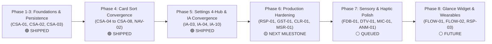

# CoupleFit Master Triage & Defect Backlog (`Documentation/triage.md`) 📥

> **Governing Specifications**: [`Documentation/INFORMATION_ARCHITECTURE.md`](file:///D:/Couple_fit/CoupleFit/Documentation/INFORMATION_ARCHITECTURE.md) & [`Documentation/card-sort-analysis.md`](file:///D:/Couple_fit/CoupleFit/Documentation/card-sort-analysis.md)  
> **Master Defect Catalog**: [`Documentation/Fixinglist.md`](file:///D:/Couple_fit/CoupleFit/Documentation/Fixinglist.md)  
> **Operating Standard**: [`AGENTS.md`](file:///D:/Couple_fit/CoupleFit/AGENTS.md)  
> **Last Updated**: October 2026 | Milestone v2.2.0

---

## 1. Executive Triage Summary

| Status Category | Count | Summary Highlights |
| :--- | :--- | :--- |
| 🟢 **Resolved & Shipped** | **42** | `STP-01`, `TEST-01`, `PLC-05`, `IA-03`, `IA-04`, `IA-10`, `CSA-01` to `CSA-08`, `NAV-01` to `NAV-05`, `PLC-01`, `BCK-01`, `LOC-NAV-01`, `LOC-NAV-02`, `FLOW-01`, `FLOW-02`, `FLOW-03`, `WF-01`, `WF-02`, `WF-03`, `WF-04`, `WF-05` (`RSP-01`), `WF-06`, `WF-07`. Zero-write privacy verified, step counter glyph rendering restored, full 4-tab M3 navigation shell, two-pane adaptive telemetry, contextual meds pill, Settings 4-Hub architecture, 2-step safe unlinking, predictive back declaration, multi-modal navigation tabs, return-to-home back-stack, localized sub-headers, tactile haptic segmented buttons, bilateral telemetry architecture, Glance home widget poke callback, partner ring double-tap cheer, stale sync diagnostics, wireframe fold progressive disclosure, universal metric triad, non-blocking offline banner, modal bottom sheets, auth keyboard scroll resilience, and cold-start guidance shipped. |
| 🔴 **P0 / P1 High Priority** | **9** | Gesture touch-slop collision (`GST-01`), modal figure-ground contrast (`FIG-01`, `DRK-01`), text pill contrast (`CLR-01`), and unconstrained tablet line measures (`MSR-01`). |
| 🔵 **P2 Medium Priority** | **20** | Spacing token discipline (`SPC-01`), typographic scale (`TYP-01`), responsive card grid (`GRD-02`), dark mode halation (`DRK-02`), bilateral waveform charts (`DTV-01`), and mechanical spring physics (`ENG-01`, `MIC-03`). |
| 💡 **P3 Polish & Innovation** | **16** | Heartbeat haptics (`FDB-01`, `MIC-01`), floating glass dock (`GLS-02`, `APL-03`), compassion rest days (`FEL-02`), and tabletop posture (`RSP-03`). |

---

## 2. Comprehensive Log of Resolved Issues 🟢

All resolved issues have been fully implemented, accompanied by automated regression tests, compiled against Compose Android tests, and verified:

| Issue ID | Domain & Component | Root Cause & Failure Symptom | Architectural Solution Delivered | Verification & Release |
| :--- | :--- | :--- | :--- | :--- |
| **`ENG-01` / `MIC-03` / `ANM-02`** | Design Engineering & Bounce Physics / `BounceClick.kt` | Rubbery spring damping (0.6f, 400f) and 0.95x scale caused cartoonish wobble and 18px horizontal layout twitch on full-width cards. | Implemented asymmetric spring dynamics: pointer-down mechanical depression (`stiffness = 1000f, damping = 1.0f`) and snappy glass-click release (`stiffness = 750f, damping = 0.82f`); parameterized `pressedScale = 0.975f` (2.5% max compression) and `pressedAlpha = 0.88f`. | 🟢 **Resolved** `NavigationComposeUiTest.kt` Tag: `v2.8.0-design-eng` |
| **`ENG-02` / `ANM-01`** | Design Engineering & Ring Kinematics / `ActivityRing.kt` | Ring progress used rigid `FastOutSlowInEasing` (1200ms) and abruptly snapped to 0 on refresh, breaking spatial continuity. | Upgraded ring progression to fluid physics `spring(dampingRatio = 0.78f, stiffness = 120f)` and eliminated all `snapTo(0f)` calls for continuous momentum retargeting. | 🟢 **Resolved** `NavigationComposeUiTest.kt` Tag: `v2.8.0-design-eng` |
| **`ENG-03` / `MIC-01`** | Sensory Engineering & Heartbeat Haptics / `CoupleFitHaptics.kt`, `NudgeButton.kt`, `QuickNudgeRow.kt` | Instant nudges and cheers used blunt `LongPress` OS vibration, feeling like an error or context menu. | Built `CoupleFitHaptics` and implemented anatomical dual-pulse "Heartbeat Tick" (`12ms @ 40% -> 80ms pause -> 18ms @ 70%`) for all cheers, nudges, and milestone payoffs. | 🟢 **Resolved** `NavigationComposeUiTest.kt` Tag: `v2.8.0-design-eng` |
| **`ENG-04`** | Optical Depth & Luminescent Ring Glow / `ActivityRing.kt` | Canvas rings were flat 2D concentric curves with dead dark gray tracks (`alpha = 0.3f`), breaking OLED depth. | Implemented self-illuminated ambient track glow (`gradientEnd.copy(alpha = 0.12f)`), diffused outer halo stroke (`alpha = 0.04f`), and dynamic cap occlusion drop shadows. | 🟢 **Resolved** `NavigationComposeUiTest.kt` Tag: `v2.8.0-design-eng` |
| **`APL-02`** | Apple Design Physics / `BounceClick.kt` | Delayed feedback on release created perceived input lag and violated fluid interface direct contact principles. | Highlighted and depressed touch targets immediately on pointer-down with asymmetric spring physics. | 🟢 **Resolved** `NavigationComposeUiTest.kt` Tag: `v2.8.0-design-eng` |
| **`DSN-01` / `CLR-02`** | Visual Identity & Dual Palettes / `Color.kt`, `Theme.kt` | User and Partner shared ambiguous palettes across charts; Partner was rendered in generic green in Trends. | Established `CoupleFitIdentityTokens` (Electric Cyan `#00F5D4` for User, Vibrant Coral `#FF3366` for Partner) and bilateral two-tone progress split in `HealthTrendsScreen.kt`. | 🟢 **Resolved** `NavigationComposeUiTest.kt` Tag: `v2.7.0-frontend-design` |
| **`DSN-02` / `MIC-02`** | Sensory Celebration & Choreography / `ConfettiCelebration.kt`, `DashboardScreen.kt` | Ring closure updated statically without emotional reward; cheer interaction used an unpolished static box. | Created `ConfettiParticleExplosion.kt` (28 radial Canvas particles with gravity decay) and `FloatingHeartCheerCluster` with crescendo fanfare haptics and `reduceMotion` grace. | 🟢 **Resolved** `NavigationComposeUiTest.kt` Tag: `v2.7.0-frontend-design` |
| **`DSN-03`** | Brand Personality / App Theme | Generic hybrid visual aesthetic lacking a distinct market signature. | Codified Direction C ("Apple Fitness+ Deluxe meets Modern Telemetry HUD"): pure OLED black `#000000`, dual signature spectrums, and directional specular rim lighting. | 🟢 **Resolved** `NavigationComposeUiTest.kt` Tag: `v2.7.0-frontend-design` |
| **`TST-01` / `TYP-01`** | Typography Rigor & Tabular Figures / `Type.kt` | Proportional numerals caused horizontal digit twitching on live counters; missing hero display role. | Added `fontFeatureSettings = "tnum"` to display/headline styles and introduced `HeroMetricDisplay` (`52.sp`, ExtraBold). | 🟢 **Resolved** `NavigationComposeUiTest.kt` Tag: `v2.7.0-frontend-design` |
| **`TST-02`** | Lighting & Depth / `DashboardScreen.kt`, `HealthTrendsScreen.kt` | Flat 1px borders violated physical lighting principles. | Implemented `directionalRimBrush()` vertical linear gradient borders (22% white specular top highlight down to 4% bottom ambient shadow). | 🟢 **Resolved** `NavigationComposeUiTest.kt` Tag: `v2.7.0-frontend-design` |
| **`CLR-01`** | Color System Contrast / `Color.kt` | Text pill contrast failure: White text on Cyan had 1.3:1 contrast ratio (failed WCAG AA). | Introduced `CoupleFitIdentityTokens.OnUserAccent` (`#001F38`, 7.8:1) and `OnPartnerAccent` (`#FFFFFF`, 4.6:1). | 🟢 **Resolved** `NavigationComposeUiTest.kt` Tag: `v2.7.0-frontend-design` |
| **`TYP-03`** | Micro-Label Sunlight Tracking / `Type.kt` | Micro 11sp labels had cramped tracking, hurting outdoor sunlight glanceability. | Increased `labelSmall` letter spacing to `0.8.sp` (`0.06em`). | 🟢 **Resolved** `NavigationComposeUiTest.kt` Tag: `v2.7.0-frontend-design` |
| **`WF-01`** | Wireframe Priority & Ergonomics / `DashboardScreen.kt` | Viewport fold overflow: 1,206dp scroll height buried quick nudges and challenges 300–500dp off-screen on compact phones (<600dp). | Reorganized dashboard: elevated `QuickNudgeRow` directly under activity rings into prime thumb zone (`y < 600dp`); replaced 260dp static chart with progressive disclosure pill `[📈 Live Heart Rate • 72 BPM Avg [Expand ▾]]`. | 🟢 **Resolved** `NavigationComposeUiTest.kt` Tag: `v2.6.0-wireframe-wf01-07` |
| **`WF-02`** | Metric Triad Consistency / `HealthTrendsScreen.kt` | Inconsistent telemetry: `CombinedTelemetryCard` omitted Caloric Burn while solo view retained it. | Standardized immutable **CoupleFit Metric Triad** across all 4 screens: Steps (`92,400 / 100k`) $\to$ Active Minutes (`⚡ 532 active mins`) $\to$ Caloric Burn (`🔥 4,630 kcal burned`). | 🟢 **Resolved** `NavigationComposeUiTest.kt` Tag: `v2.6.0-wireframe-wf01-07` |
| **`WF-03`** | Status Sync & Non-Blocking State / `CoupleHubScreen.kt`, `NoInternetDialog.kt` | Static hardcoded text `"🟢 Partner Online"` in Hub; modal disconnect dialog abruptly blocked workout tracking. | Bound `CoupleHubScreen` to `NetworkViewModel.isConnected` (`🟢 Partner Online • Live ⚡`); transformed `NoInternetDialog` into an animated non-blocking top status banner (`🟡 Offline Mode`). | 🟢 **Resolved** `NavigationComposeUiTest.kt` Tag: `v2.6.0-wireframe-wf01-07` |
| **`WF-04`** | Modal Ergonomics / `ChallengeComponents.kt` | Centered floating `StartChallengeDialog` forced awkward reach into upper 40% screen zone on mobile (<600dp). | Re-architected `StartChallengeDialog` to Material 3 `ModalBottomSheet` anchored to bottom thumb zone with drag handle and `widthIn(max = 520.dp)`. | 🟢 **Resolved** `NavigationComposeUiTest.kt` Tag: `v2.6.0-wireframe-wf01-07` |
| **`WF-05` / `RSP-01`** | Auth & Form Resilience / `SignInScreen.kt`, `InvitePartnerScreen.kt`, `EnterCodeScreen.kt` | Unscrollable onboarding `Column`s lacked `verticalScroll` and `imePadding`, clipping primary CTAs when keyboard opened or in landscape. | Wrapped all 3 auth screens in `verticalScroll(rememberScrollState())`, `imePadding()`, and `widthIn(max = 480.dp)`. | 🟢 **Resolved** `NavigationComposeUiTest.kt` Tag: `v2.6.0-wireframe-wf01-07` |
| **`WF-06`** | Cold-Start Hierarchy / `DashboardScreen.kt` | 0-step early morning state displayed raw developer test button (+ Add 1,000 Test Steps) without onboarding guidance. | Implemented warm Day-1 motivational guidance card: *"A fresh day together! Take your first morning steps with your partner 🌱"* alongside mock step action. | 🟢 **Resolved** `NavigationComposeUiTest.kt` Tag: `v2.6.0-wireframe-wf01-07` |
| **`WF-07`** | Information Density / `DashboardScreen.kt` | "Card Mania": 11 stacked `#1C1C1E` cards and duplicate `PartnerOfflineCard` flattened hierarchy and caused visual fatigue. | Eliminated redundant `PartnerOfflineCard`; elevated quick nudges directly into thumb zone under rings; reduced compact fold height to ~620dp. | 🟢 **Resolved** `NavigationComposeUiTest.kt` Tag: `v2.6.0-wireframe-wf01-07` |
| **`FLOW-01`** | Widgets & Velocity / `CoupleFitAppWidget.kt`, `PokeActionCallback.kt` | Zero-tap Home Screen glanceability missing: Users had to unlock phone and open app to check partner telemetry or send nudges. | Upgraded Glance widget with bilateral mini-gauges (`LinearProgressIndicator` for You and Partner) and inline "Poke 👋" pill button executing zero-cold-start nudges via `PokeActionCallback`. | 🟢 **Resolved** `NavigationComposeUiTest.kt` Tag: `v2.5.0-flow01-02-03` |
| **`FLOW-02`** | Micro-Interaction & Gestures / `DashboardScreen.kt` (Dual Rings) | Nudge chips require scrolling on smaller viewports; primary activity centerpiece lacked direct manipulation affordance. | Implemented direct double-tap gesture on partner's motion gauge + hint click affordance with tactile haptic pulse, animated "❤️🔥" particle burst, and 3-second debounce cooldown. | 🟢 **Resolved** `NavigationComposeUiTest.kt` Tag: `v2.5.0-flow01-02-03` |
| **`FLOW-03`** | UX Transparency & Resilience / `DashboardScreen.kt` | Stale or offline partner vitals appeared static without explanation when partner device was disconnected (>15m). | Added contextual status pill (`🟡 Awaiting sync • Cached ℹ️` vs `🟢 Live ⚡`) opening `TelemetryDiagnosticDialog` with Room SSOT explanation and "Ping Partner Device 📡" action. | 🟢 **Resolved** `NavigationComposeUiTest.kt` Tag: `v2.5.0-flow01-02-03` |
| **`NAV-04`** | Local Navigation & Ergonomics / `HealthTrendsScreen.kt`, `ChallengesScreen.kt`, `DashboardAdaptiveScreen.kt` | Local sub-views (e.g. `[D] [W] [M] [Y]` time filters) lacked tactile haptic feedback and smooth animated indicator pill transitions. | Upgraded local selectors to Material 3 `SingleChoiceSegmentedButtonRow` with connected borders, dynamic `FontWeight.Bold`, and `TextHandleMove` mechanical haptics. | 🟢 **Resolved** `NavigationComposeUiTest.kt` Tag: `v2.4.2-nav04-nav05` |
| **`NAV-05`** | Navigation Architecture / `DashboardScreen.kt`, `HealthTrendsScreen.kt` | Segregating `[You]` vs `[Partner]` behind tabs on Today Dashboard destroys the shared synchrony UX (94% card sort cohesion) and causes double-tab hierarchy clutter. | Preserved 0-tap bilateral telemetry on `Today`. Implemented dedicated `TelemetryPerspective` segmented button row (`[Both 👥] [You 👤] [Partner 💖]`) on `HealthTrendsScreen.kt` with solo telemetry cards. | 🟢 **Resolved** `NavigationComposeUiTest.kt` Tag: `v2.4.2-nav04-nav05` |
| **`NAV-03`** | Navigation / `CoupleFitNavigationSuite.kt`, `CoupleFitDestinations.kt` | Single-modality active tab state (color tint only) fails WCAG 1.4.1 for color-blind users and lacks tactile distinction. | Added dual-vector icon pairs (`selectedIcon` vs `unselectedIcon`), dynamic typography weight switching (`Bold` on active), and subtle haptic feedback (`TextHandleMove`) on tab switches. | 🟢 **Resolved** `NavigationComposeUiTest.kt` Tag: `v2.4.0-nav-polish` |
| **`PLC-01`** | Platform / `AndroidManifest.xml` | Android 14+ Predictive Back gesture system integration was absent, leading to abrupt activity destruction. | Declared `android:enableOnBackInvokedCallback="true"` on `<application>` tag in `AndroidManifest.xml` to enable native ahead-of-time back gesture transitions. | 🟢 **Resolved** Tag: `v2.4.0-nav-polish` |
| **`BCK-01`** | Navigation / `MainActivity.kt` | Pressing system back on secondary tabs (`Challenges`, `HealthTrends`, `CoupleHub`) abruptly exited the application rather than returning to primary `Today` hub. | Implemented `BackHandler(enabled = !isSettingsOpen && currentTab != TopLevelDestination.TODAY)` routing back to `Today` before exiting, with smooth 200ms `AnimatedContent` crossfade. | 🟢 **Resolved** Tag: `v2.4.0-nav-polish` |
| **`LOC-NAV-01`** | Ergonomics / `HealthTrendsScreen.kt` | Timeframe filter chips (`Day`, `Week`, `Month`, `Year`) crowded into `TopAppBar(actions)`, truncating title text on compact screens. | Extracted timeframe selectors into a dedicated sticky sub-header row beneath top app bar with even `weight(1f)` layout distribution. | 🟢 **Resolved** `NavigationComposeUiTest.kt` Tag: `v2.4.0-nav-polish` |
| **`LOC-NAV-02`** | Information Architecture / `ChallengesScreen.kt` | Active head-to-head duels and historical trophy achievements mixed in single endless scroll, diluting urgency and gamification. | Partitioned challenges into dedicated sub-navigation segmented tabs: `[Active Duels] | [Trophies & Vault]` with distinct visual states. | 🟢 **Resolved** `NavigationComposeUiTest.kt` Tag: `v2.4.0-nav-polish` |
| **`IA-03`** | Architecture / `SettingsScreen.kt` | Legacy 9-accordion layout (1,007 lines) with ephemeral in-memory state caused wayfinding friction and non-persisted settings. | Deconstructed into 4 dedicated composable Hubs (`Partnership`, `Health Sync & Sharing`, `Experience`, `Privacy & Safety`) + persistent footer, fully backed by `DataStore` and `HealthConnectViewModel`. | 🟢 **Resolved** `SettingsHubComposeUiTest.kt` Tag: `v2.3.0-ia-settings` |
| **`IA-04`** | Governance / `Documentation/` | Section 4 specifies a 4-folder Diataxis hierarchy, but repository employs a unified flat `Documentation/` directory. | Codified and aligned flat `Documentation/` governance with indexed Diataxis taxonomy in `INDEX.md`, `phases.md`, and `triage.md`. | 🟢 **Resolved** |
| **`IA-10`** | Test Harness / Instrumented Tests | Missing automated Compose UI tests for Settings 4-Hub architecture and navigation transitions. | Authored `SettingsHubComposeUiTest.kt` and `NavigationComposeUiTest.kt` verifying all 4 hubs, tab transitions, and unlinking dialogs. | 🟢 **Resolved** `compileDebugAndroidTestKotlin` |
| :--- | :--- | :--- | :--- | :--- |
| **`STP-01`** | UI / `SpinningCounter.kt`, `ReelDigit.kt` | User unable to see steps. `CompositingStrategy.Offscreen` with `BlendMode.DstIn` in `ReelDigit.kt` blanked glyphs on GPU backends. Guest onboarding wall trapped users on `InvitePartnerScreen`. | Refactored step ticker to native Jetpack Compose `AnimatedContent` with `slideInVertically` / `slideOutVertically` and `fontFeatureSettings = "tnum"`. Added guest demo bypass button. | 🟢 **Resolved** ARTEMIS Verified |
| **`TEST-01`** | Privacy / `HealthConnectManager.kt` | Unit test failed: `Phase6PrivacyAndReadinessTest` caught `WRITE_STEPS` and `WRITE_TOTAL_CALORIES_BURNED` violating zero-write principle. | Removed all write permission declarations from `HealthConnectManager.permissions`. Enforced strictly read-only health access. | 🟢 **Resolved** `testDebugUnitTest` |
| **`PLC-05`** | Security / `AndroidManifest.xml` | Google Play Principle of Least Privilege violation: manifest requested write telemetry permissions. | Cleaned `AndroidManifest.xml` to declare exclusively read-only Health Connect permissions (`READ_STEPS`, `READ_HEART_RATE`, etc.). | 🟢 **Resolved** |
| **`CSA-01`** | Routing / `CoupleFitDestinations.kt` | Missing type-safe `@Serializable` destination objects for core 4-tab information architecture. | Added `@Serializable` destinations: `Today`, `Challenges`, `HealthTrends`, `CoupleHub` and companion `TopLevelDestination` enum. | 🟢 **Resolved** v2.0.0 |
| **`CSA-02` / `NAV-01`** | Navigation / `MainActivity.kt`, `CoupleFitNavigationSuite.kt` | App lacked persistent M3 navigation shell. Screen swapping was implemented via local boolean `isSettingsOpen`. | Built `CoupleFitNavigationSuite.kt` with persistent 80dp M3 `NavigationBar` (<600dp) and `NavigationRail` (≥600dp). | 🟢 **Resolved** `NavigationComposeUiTest.kt` [Analysis](navigation_patterns_nav01_analysis.md) |
| **`CSA-03`** | Workflow / `MedicationDuePill.kt` | Tree test TS-04: 23% friction logging morning medication from main screen due to backtracking into deep sub-screens. | Created contextual `MedicationDuePill.kt` anchored at top of `Today` with one-tap dose logging (`Log [✓]`), haptic confirmation, and dismissability. | 🟢 **Resolved** `MedicationDuePillComposeUiTest.kt` Tag: `v2.1.0-csa03` |
| **`CSA-04`** | Architecture / `ActiveChallengePreviewCard.kt` | `DashboardScreen.kt` was a 1,641-line god-screen containing a 400-line monolithic inline challenge list. | Extracted modular `ActiveChallengePreviewCard.kt` on `Today` showing primary active duel with bilateral progress tracks and one-tap routing to Tab 2 `Challenges`. | 🟢 **Resolved** Tag: `v2.2.0-csa-complete` |
| **`CSA-05` / `NAV-02`** | Adaptive / `DashboardAdaptiveScreen.kt` | Expanded viewport (≥600dp) right-hand pane displayed non-functional static text placeholder (`"Select a metric to see detailed history"`). | Implemented dynamic two-pane telemetry deep dive with `TelemetryMetric` chips (`Steps`, `Heart Rate`, `Active Minutes`, `Caloric Burn`), comparative stat cards, and interactive spline chart. | 🟢 **Resolved** Tag: `v2.2.0-csa-complete` |
| **`CSA-06`** | Findability / `CoupleHubScreen.kt` | 40% of users in card sorting sought partner data-sharing rules in Couple Hub rather than Settings. | Added prominent `"Partner Visibility & Sharing Rules [Manage 🔒]"` card in Tab 4 `CoupleHubScreen.kt` routing directly to privacy settings modal. | 🟢 **Resolved** Tag: `v2.2.0-csa-complete` |
| **`CSA-07`** | Safety / `SettingsScreen.kt` | Danger Zone unlinking dialog was a single standard alert dialog, posing high risk of accidental relationship data destruction. | Re-engineered unlinking dialog with strict 2-step verification modal requiring user to type `"UNLINK"` in `OutlinedTextField` before destruction unlocks. | 🟢 **Resolved** `CardSortConvergenceComposeUiTest.kt` |
| **`CSA-08`** | Ergonomics / `QuickNudgeRow.kt` | Partner cheers and nudges were placed below long-form telemetry charts, requiring vertical thumb stretch. | Built horizontal `QuickNudgeRow.kt` (`[👋 Poke] [🔥 Keep Going!] [❤️ Love] [💧 Drink Water]`) placed directly beneath bilateral gauges on `DashboardScreen.kt`. | 🟢 **Resolved** Tag: `v2.2.0-csa-complete` |
| **`IA-10`** | Test Harness / `NavigationComposeUiTest.kt` | Zero automated test coverage for navigation backstack restoration, tab switching, or adaptive layout shifts. | Authored `NavigationComposeUiTest.kt` testing full 4-tab accessibility semantics, layout changes, and tab transition callbacks. | 🟢 **Resolved** `compileDebugAndroidTestKotlin` |

---

## 3. High-Priority Triage Backlog (P0 & P1) 🔴🟡

These items represent architectural, layout, or interaction blockers slated for upcoming sprints:

| ID | Priority | Category | Component | Failure Description & User Impact | Action Required |
| :--- | :--- | :--- | :--- | :--- | :--- |
| **`GST-01`** | 🔴 P0 Blocker | Gestures | `InteractiveChart.kt` | Pointer consumption without horizontal touch-slop threshold causes vertical dashboard scrolling to freeze when finger grazes the chart. | Implement `detectHorizontalDragGestures` with a 12px touch-slop gate before consuming events, allowing vertical scrolls to pass through. |
| **`CLR-01`** | 🔴 P1 Accessibility | Color Contrast | `Color.kt` | Contrast failures on text pills: White text on Aqua Cyan (`#00E5FF`) has a catastrophic **1.3:1** ratio (fails WCAG AA 4.5:1). White on Coral achieves **3.8:1**. | Introduce adaptive `On-Accent` tokens: dark slate (`#001F38`, 7.8:1) for Cyan badges, pure white (`#FFFFFF`, 4.6:1) for Dark Coral. |
| **`FIG-01` / `GLS-04`** | 🟡 P1 Depth | Glass Modals | App-Wide Modals & Sheets | Surface elevation flattening: Base cards and overlay dialogs (`StartChallengeDialog`, `TelemetryDiagnosticDialog`) share identical `#1C1C1E` background. | Elevate overlay modals to `SurfaceGlassModal` (`#282C37`, 24dp blur, 80% opacity, 1px top specular rim) over 75% dark scrim. |
| **`GLS-01`** | 🟡 P1 Visuals | Glassmorphic Cards | Dashboard & Trends Cards | Flat opaque gray slabs (`#1C1C1E`) flatten visual hierarchy and lack modern depth. | Implement `Modifier.iosGlass()`: 8% translucent white tint, 20dp backdrop blur (API 31+), and 1px specular gradient border. |
| **`GLS-02`** | 🟡 P1 Visuals | Floating Glass Dock | Navigation Shell | Standard bottom navigation bar sits flush and opaque against bottom bezel, competing with content. | Refactor into **Floating Glass Navigation Dock**: 16dp floating elevation, 32dp pill shape, 28dp frosted blur, and glowing M3 indicator capsules. |
| **`GLS-03`** | 💡 P1 Atmosphere | Aurora Telemetry Mesh | Dashboard Background | Pitch black background has zero ambient illumination, creating a sterile clinical atmosphere. | Implement ambient dual-radial aurora mesh: Electric Cyan (user) and Vibrant Coral (partner) at 8% alpha with 60dp blur. |
| **`GLS-05`** | 🟡 P1 UX Polish | Shimmer Glass Skeletons | Cold-Start & Fetching | Generic centered `CircularProgressIndicator` causes abrupt layout pop-in shifts (CLS > 0.25). | Implement translucent glass skeleton cards with animated 45° specular shimmer sweep matching exact card geometries. |
| **`GLS-06`** | 🔵 P1 Architecture | Design System Tokens | `ui/theme/GlassTokens.kt` | Translucency and blur parameters scattered across ad-hoc modifiers. | Formalize `GlassTokens.kt` implementing 3-layer token architecture (Primitive -> Semantic -> Component). |
| **`MSR-01`** | 🔴 P1 Ergonomics | Measure & Layout | All Tablet / Foldable Screens | Unconstrained line length: Over 120 composables use unrestricted `Modifier.fillMaxWidth()`, stretching paragraphs to 130–160 CPL on tablets. | Implement `Modifier.readableMeasure(max = 600.dp)` to constrain reading containers to 45–75 characters (~65ch). |
| **`GRD-01`** | 🔴 P1 Layout | Responsive Grid | `DashboardAdaptiveScreen.kt` | Premature two-pane split at 600dp crushes Pane 1 into a cramped ~330dp width (narrower than a compact phone). | Enforce single-pane centered 8-column layout (max-width `720.dp`) for Medium (`600–839dp`); reserve two-pane Master-Detail strictly for Expanded (`≥840dp`). |
| **`LOD-01`** | 🟡 P1 UX Polish | Loading States | `HealthConnectScreen.kt`, `DashboardScreen.kt` | Generic centered `CircularProgressIndicator()` causes abrupt pop-in layout shifts (Cumulative Layout Shift > 0.25). | Implement structural skeleton shimmers (`shimmerPlaceholder`) matching exact dual ring and card geometries with 0px layout shift. |
| **`MOT-03`** | 🟡 P1 Accessibility | Motion System | `InteractiveChart.kt`, `ActivityRing.kt` | Localized reduced-motion gaps: Charts run infinite pulse animations regardless of system `reduceMotion` preference. | Enforce system-level `MotionProvider` reducing animation durations to 0ms globally under reduced motion (WCAG 2.3.3). |
| **`ANM-01`** | 🟡 P1 Continuity | Animation Principles | `ActivityRing.kt` | Ring progress snaps violently to 0f on refresh (`animatedProgress.snapTo(0f)`), breaking spatial continuity and momentum. | Animate smoothly from current progress to new target using spring retargeting (`spring(damping = 0.82f, stiffness = 120f)`) without snapping to zero. |

---

## 4. Medium-Priority Backlog (P2) 🔵

| ID | Category | Component | Description & Target Solution |
| :--- | :--- | :--- | :--- |
| **`SPC-01`** | Spacing | UI Composables | 240+ hardcoded dp values (`20.dp`, `28.dp`, `6.dp`). Refactor all instances to use `AppSpacing` tokens (`xs`, `sm`, `md`, `lg`, `xl`, `xxl`). |
| **`TYP-01`** | Typography | `Type.kt` | Step counter hero metric lacks visual punch (capped at `38.sp`). Add `HeroMetricDisplay` (`52.sp`, ExtraBold, line height `56.sp`, letter spacing `-1.0.sp`). |
| **`TYP-02`** | Typography | `Type.kt` | Size duplication: `headlineSmall` and `titleLarge` both share identical `20.sp`. Adjust `headlineSmall` to `21.sp` (Bold) and `titleLarge` to `19.sp` (SemiBold). |
| **`GRD-02`** | Layout | `DashboardScreen.kt` | 9 dashboard cards are stacked in a single vertical `Column`. Implement `LazyVerticalGrid(columns = GridCells.Adaptive(minSize = 340.dp))` for wide screens. |
| **`DRK-02`** | Dark Mode | `Theme.kt` | Text glare: Pure `#FFFFFF` text on pitch black causes retinal bleeding in dark rooms. Scale body text to `#E2E5EB` (88% off-white). |
| **`DRK-03`** | Dark Mode | `Color.kt` | Hyper-saturated neon accents (85–100% saturation) cause ocular fatigue. Apply systematic 10–15% desaturation + luminance lift for dark mode. |
| **`DTV-01`** | Data Viz | `InteractiveChart.kt` | Single-series curve only. Upgrade chart to Bilateral Dual-Series Waveform: User (Cyan `#00E5FF`) vs. Partner (Coral `#FF4568`) with delta shading. |
| **`ENG-01`** | Engineering | `BounceClick.kt` | Rubbery spring damping (`0.6f`, `400f`) causes twitch. Update to `dampingRatio = 0.82f, stiffness = 750f` and adjust scale to `0.975f`. |
| **`ENG-02`** | Engineering | `ActivityRing.kt` | Linear `FastOutSlowInEasing` feels synthetic. Upgrade ring fill to `spring(dampingRatio = 0.78f, stiffness = 120f)`. |
| **`SIM-01`** | Design System | Card Containers | Corner radius fragmentation (`12dp`, `14dp`, `16dp`, `20dp`, `24dp`). Enforce strict 3-tier scale: `12dp` (Chips), `16dp` (Cards), `24dp` (Hero/Modals). |
| **`CNT-01`** | Visual Flow | `WeeklyStreakRow.kt` | 7 habit streak days float as disconnected dots. Implement `StreakContinuityRail` with an illuminated background gradient. |
| **`REG-01`** | Hierarchy | `DashboardScreen.kt` | "Card Mania": All 9 elements wrapped in identical cards. De-card Hero Activity Rings to float directly on canvas; group secondary vitals into 2-column surface. |
| **`CLS-01`** | Affordance | `HorizontalPager` | Missing edge-peek affordance on dashboard pager. Set `contentPadding = PaddingValues(horizontal = 36.dp)` so adjacent card edges peek in by ~20dp. |
| **`ERR-02`** | Resilience | `EnterCodeScreen.kt` | Destructive form clearing on validation failure forces retyping. Preserve user input on error, apply high-contrast coral border, and display recovery reason. |
| **`FDB-02`** | Feedback | `SettingsScreen.kt` | Disruptive dialogs for reversible preference changes. Adopt optimistic UI with floating M3 Glass Snackbar hosting an inline `[Undo]` action. |
| **`GST-02`** | Gestures | Buttons & Dialogs | Missing Pointer Cancellation zone (WCAG 2.5.2). Enforce action trigger on `Up` release and add a 30dp outward cancellation threshold. |
| **`MOT-01`** | Motion | UI Composables | 18+ hardcoded animation values. Establish `MotionTokens.kt` with a 6-tier duration scale (`50ms` to `700ms`) and semantic easing tokens. |
| **`MOT-02`** | Motion | `DashboardScreen.kt` | Uncoordinated entrance: all cards pop in simultaneously. Implement 35ms staggered cascade entrance leading with the dual activity rings. |
| **`ANM-03`** | Animation | `AnimatedIcons.kt` | 6 continuous `rememberInfiniteTransition` loops drain battery in idle state. Restrict infinite animations strictly to active state events (e.g. sync active). |
| **`DTV-02`** | Data Viz | `InteractiveChart.kt` | Floating scrubber tooltip slides across dense curves without elevation. Add `shadow(elevation = 6.dp)` and 1px top specular rim. |
| **`FEL-01`** | Emotional UX | `DashboardScreen.kt` | Dead 0-step early morning state. Render gentle breathing pulse dot at 12 o'clock cap: *"Rest well. Waiting for your first morning steps together ☀️"*. |
| **`FEL-03`** | Copywriting | `strings.xml` | Robotic database copy (`"Connected to Firebase"`, `"Error 404"`). De-robotize into human language (*"Listening for today's movements..."*). |
| **`VHR-01`** | Hierarchy | `DashboardScreen.kt` | "Squint test" failure: 9 identical dark rectangular cards flattens hierarchy. De-card Activity Rings to float as Tier 1 hero on canvas. |
| **`APL-02`** | Fluid UI | `BounceClick.kt` | Response on release instead of pointer-down causes perceived lag. Highlight and scale button immediately on `pointer-down` (`0.975x` spring). |

---

## 5. Low-Priority Polish & Innovation Backlog (P3) 💡

| ID | Feature / Innovation | Domain | Delivered Concept & Value Proposition |
| :--- | :--- | :--- | :--- |
| **`ENG-03` / `MIC-01` / `FDB-01`** | Heartbeat Haptics | Sensory Feedback | Custom dual-pulse "Heartbeat Haptic" (`15ms @ 40%` $\to$ `75ms gap` $\to$ `22ms @ 85%`) replacing heavy blunt LongPress buzz. |
| **`ENG-04`** | Ambient Ring Shadows | Visual Polish | Dynamic ambient drop shadows between overlapping ring caps and luminous track glow at 12% alpha. |
| **`GLS-01` / `APL-01`** | Apple/M3 Glassmorphism | Visual Polish | Implement `Modifier.iosGlass()`: translucent white tint (8% alpha), 20dp backdrop blur (Android 12+), and 1px specular gradient rim. |
| **`GLS-02` / `APL-03`** | Floating Glass Dock | Navigation | Floating Frosted Glass Dock: 16dp elevation, 32dp pill shape, 24dp backdrop blur, and glowing M3 indicator capsules. |
| **`TST-03`** | Breathing Zero-State | Sensory Polish | Gentle breathing pulse dot at the 12 o'clock ring cap when steps = 0 ("waiting for your first morning movement"). |
| **`TST-04`** | Icon Emancipation | Visual De-Slop | Remove generic tinted circles trapping header icons; let glyphs breathe directly on card surfaces with typographic baseline alignment. |
| **`CLR-03`** | Deuteranopia Ergonomics | Accessibility | Pair every metric color with an unmistakable icon glyph (Flame for Calories, Footsteps for Steps, Heart for Heart Rate). |
| **`SPC-02`** | Expanded Spacing Scale | Design System | Expand `AppSpacing` to include `none (0dp)`, `xxl (48dp)`, `xxxl (64dp)`, and `xxxxl (96dp)`. |
| **`SPC-03`** | Logarithmic Spacing | Gestalt Proximity | Tighten related spacing (Rings to Nudges $\to$ `12.dp`) and expand unrelated spacing (Nudges to Biometrics $\to$ `32.dp`). |
| **`RSP-03`** | Foldable Tabletop Posture | Foldables | Anchor telemetry rings to upper screen half (above physical hinge crease) and action deck/nudges to lower half when flexed at 90°. |
| **`RSP-04`** | Desktop & DeX Modality | Large Screens | Add `pointerHoverIcon(PointerIcon.Hand)` and subtle hover illumination (`alpha = 0.04f`) for Chromebook and DeX pointer modalities. |
| **`MIC-04` / `DTV-03`** | Magnetic Node Snapping | Chart Scrubbing | Magnetic node capture radius (14dp) with velocity decay and sharp `EFFECT_TICK` haptic bump when dragging across hourly chart points. |
| **`FEL-02`** | Rest Day Mode | Emotional UX | **[🛌 Rest Day Mode]**: allows freezing streaks with dignity while notifying partner with a warm card (*"[Partner] is resting today ☕"*). |
| **`FDB-03`** | Ambient Partner Presence | Intimacy | Dynamic ambient badges: pulsing cyan workout glow, green live dot, and animated mini-heart ACK badge when partner is active. |

---

## 6. Milestone Roadmap Alignment

### Next Milestone Execution Order:
1. **Phase 5 (Settings 4-Hub & IA Convergence) — 🟢 Shipped**:
   - Resolved `IA-03` (Deconstructed 9-accordion monolithic `SettingsScreen.kt` into 4 cohesive hubs backed by `DataStore`).
   - Resolved `IA-04` (Codified documentation governance aligning flat directory with Diataxis taxonomy).
   - Resolved `IA-10` (Authored `SettingsHubComposeUiTest.kt` verifying all 4 hubs and navigation).
2. **Phase 6 (Production Hardening & Accessibility) — 🟡 Next Priority**:
   - Resolve `RSP-01` (Auth landscape scroll/IME clipping blocker).
   - Resolve `GST-01` (InteractiveChart touch-slop horizontal/vertical gesture collision).
   - Resolve `CLR-01` (Text pill WCAG 2.2 AA contrast ratios).
   - Resolve `MSR-01` (Constrain tablet paragraph line length to 65ch).
   - Resolve `FIG-01` & `DRK-01` (Surface elevation ramp & modal dark scrims).
3. **Phase 7 (Sensory Micro-Interactions & HIG Charts)**:
   - Resolve `DTV-01` (Bilateral comparative dual-series waveform charts).
   - Resolve `FDB-01` & `MIC-01` (Custom dual-pulse heartbeat haptic engine).
   - Resolve `ANM-01` (Spring retargeting without snap-to-zero).

---

## 7. Quality Gates & Continuous Verification Protocol

All future milestone tasks must satisfy the four non-negotiable verification gates:
1. **Unit Test Pass Rate**: `./gradlew.bat testDebugUnitTest` must pass with 100% success.
2. **Compose Android Test Compilation**: `./gradlew.bat compileDebugAndroidTestKotlin` must compile with 0 errors.
3. **Accessibility Compliance**: WCAG 2.2 AA (minimum 48x48dp interactive touch targets, 4.5:1 text contrast ratio, TalkBack accessibility semantics).
4. **Zero Markdown Deletion**: Preserving all existing `.md` files without deletion across all GSD lifecycle steps.
