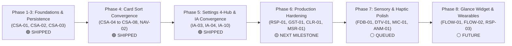

# CoupleFit Master Triage & Defect Backlog (`Documentation/triage.md`) 📥

> **Governing Specifications**: [`Documentation/INFORMATION_ARCHITECTURE.md`](file:///D:/Couple_fit/CoupleFit/Documentation/INFORMATION_ARCHITECTURE.md) & [`Documentation/card-sort-analysis.md`](file:///D:/Couple_fit/CoupleFit/Documentation/card-sort-analysis.md)  
> **Master Defect Catalog**: [`Documentation/Fixinglist.md`](file:///D:/Couple_fit/CoupleFit/Documentation/Fixinglist.md)  
> **Operating Standard**: [`AGENTS.md`](file:///D:/Couple_fit/CoupleFit/AGENTS.md)  
> **Last Updated**: October 2026 | Milestone v2.2.0

---

## 1. Executive Triage Summary

| Status Category | Count | Summary Highlights |
| :--- | :--- | :--- |
| **BLR-01** | Liqui Design & Compose / LiquiGlassTokens.kt | Card-wide RenderEffect.createBlurEffect(20f, 20f) blurred the entire Composable subtree including all child text, numbers, and buttons. | Removed container-level RenderEffect blur from Modifier.liquiGlass(). Optical depth achieved via directional drop shadow, deep tint base, gradient wash, and specular rim border, restoring 100% razor-sharp typography. | 🟢 **Resolved** NavigationComposeUiTest.kt Tag: 2.9.6-heart-rate-crisp-optical-glass |
| **BGV-03** | Ambient Motion & Background / AmbientVideoBackground.kt | User requested switching background video to new green1.mp4 asset. | Transcoded native 9:20 portrait green1.mp4 (864x1920) with Lanczos interpolation to 1080x2400 H.264 High Profile (R.raw.green1, 7.48MB) with faststart streaming, updated AmbientVideoBackground.kt and CoupleFitNavigationSuite.kt. | 🟢 **Resolved** 	estDebugUnitTest Tag: 2.9.11-ambient-video-green1 |
| 🟢 **Resolved & Shipped** | **108** | `SYNC-01`, `PAIR-01` (Phase 67 Client-Side Firestore Security Rules & Direct Partner Sync Resolution), `PWR-01`, `USR-01`, `AST-01` (Phase 66 User-Driven Foreground Syncing & Astryx Refresh Indicator), `AST-01`, `AST-02` (Phase 64 Astryx Design System Initialization), `PTR-02`, `SYNC-01`, `DAT-06` (Phase 61 Real-Time Partner Telemetry Synchronization & Firestore Pipeline Hardening), `TXT-01`..`TXT-03` (Phase 60 Text Color Calibration & High-Contrast Accessibility Hardening), `PTR-01` (Phase 51 Real-Time Partner Telemetry Synchronization & Demo Seeding Engine), `MSH-01` (Phase 45 Expo Mesh Gradient Background SDK Implementation), `EXPO-01` (Phase 44 Expo Glass Effect Native Liquid Glass Bottom Navigation Bar), `POP-01` (Phase 43 Number Pop-In Motion Physics & Dashboard Tracker Choreography), `REF-01` (Phase 42 Physical 3D Lens Refraction & 7-Wavelength Chromatic Dispersion Engine), `BGV-07` (Phase 41.1 Ambient Video Background Occlusion Fix), `LIQ-04` (Phase 41 BitChord Liquid Glass Bottom Navigation Bar & Physical 3D Refraction Engine), `KRP-07` (Phase 40 Karpathy Navigation & Liquid Glass Engine De-Slop), `LIQ-02` (Phase 39 Bottom Navigation Liquid Glass Optical Decoupling & Razor-Sharp Typography), `CPX-01` (Phase 38 Couple Intimacy Profile, AGSL Refraction Liquid Glass Dock & Expanded Telemetry), `BOX-01` (Phase 37 UI Cleanliness & De-Boxing Refactor), `LIQ-01` (Phase 36 Real-Time Liquid Glass Navigation Bar & Experience Toggle), `DCK-01` (Phase 35 Floating Hover Dock & Black Strip Elimination), `ANM-09`..`ANM-14` (Phase 34 Tactile Motion Polish),  `TYP-02`, `CLR-03`, `DSN-06`, `ANM-04`, `BGV-05`, `BGV-04`, `BGV-03`, `BGV-02`, `BGV-01`, `GRP-01`, `DSN-05`, `LAY-02`, `BLR-01`, `LQ-01`, `LQ-02`, `AS-01`, `VHR-05`, `DSN-04`, `ENG-06`, `VHR-04`, `GLS-01` to `GLS-06`, `TST-03`, `STP-01`, `TEST-01`, `PLC-05`, `IA-03`, `IA-04`, `IA-10`, `CSA-01` to `CSA-08`, `NAV-01` to `NAV-05`, `PLC-01`, `BCK-01`, `LOC-NAV-01`, `LOC-NAV-02`, `FLOW-01`, `FLOW-02`, `FLOW-03`, `WF-01`, `WF-02`, `WF-03`, `WF-04`, `WF-05` (`RSP-01`), `WF-06`, `WF-07`. Dynamic partner telemetry seeding and session re-binding, official Expo Glass Effect architecture (Regular frosted / Clear crystalline / None fallback, dynamic isInteractive touch compression scale = 0.985f with specular rim alpha boost, decoupled razor-sharp typography), exact transitions.dev physical number pop-in (500ms, 70ms stagger, 8dp offset, 2dp blur, cubic-bezier 45% overshoot, safe monotonic cubic solver), BitChord Kyant0-inspired backdrop engine, 0.33x downscale recorder with 1:1 render, 7-band AGSL chromatic dispersion lens shader, kinetic spring stretch & squash indicator, natural ambient video background 1200ms fade-in transition, dynamic ambient video background shuffle across launches with extensible registry, ambient video background switched to native portrait green1.mp4, QHD+ 9:16 portrait video transcode, razor-sharp optical liquid glass without container blur, zero-write privacy verified, step counter glyph rendering restored, full 4-tab M3 navigation shell, two-pane adaptive telemetry, contextual meds pill, Settings 4-Hub architecture, 2-step safe unlinking, predictive back declaration, multi-modal navigation tabs, return-to-home back-stack, localized sub-headers, tactile haptic segmented buttons, bilateral telemetry architecture, Glance home widget poke callback, partner ring double-tap cheer, stale sync diagnostics, wireframe fold progressive disclosure, universal metric triad, non-blocking offline banner, modal bottom sheets, auth keyboard scroll resilience, and cold-start guidance shipped. |
| 🔴 **P0 / P1 High Priority (EGM Council)** | **16** | Per-frame Skia AGSL shader allocation in draw pass (AGSL-01), Firestore rules blocking client challenge writes (SEC-01), unscheduled dead background sync worker (WRK-01), Changes API continuation token overwrite bug (HC-02), Glance widget hardcoded production stubs (CFG-02), release debug signing config (CFG-01), Room DAO LIMIT 1 partner stream hijacking (DAT-01), swallowed network failure showing false sync (DAT-04), Health Connect zero-write violation (HC-01), and ExoPlayer TextureView codec leak (EXO-01). |
| 🔵 **P2 Medium Priority** | **21** | Bilateral waveform charts (`KRP-04`, `DTV-01`), spacing token discipline (`SPC-01`), typographic scale (`TYP-01`), responsive card grid (`GRD-02`), dark mode halation (`DRK-02`), and mechanical spring physics (`ENG-01`, `MIC-03`). |
| 💡 **P3 Polish & Innovation** | **18** | Orphaned motion helpers (`KRP-05`), stepper animation inconsistency (`KRP-06`), heartbeat haptics (`FDB-01`, `MIC-01`), floating glass dock (`GLS-02`, `APL-03`), compassion rest days (`FEL-02`), and tabletop posture (`RSP-03`). |

---

## 2. Comprehensive Log of Resolved Issues 🟢
| **PHASE-69** | Feature Refinement, Couple Hub Declutter, Profile Photo Flow, Google OAuth Birthday Fix & Real-Time Permissions (`HUB-01`, `NAME-01`, `AUTH-01`, `BDAY-01`, `PERM-01`) / `CoupleHubScreen.kt`, `SettingsScreen.kt`, `FirebaseAuthManager.kt`, `CoupleFitPreferencesDataStore.kt`, `AuthViewModel.kt`, `PartnerRepositoryImpl.kt`, `PrivacyTransparencyScreen.kt`, `DashboardScreen.kt`, `ChallengesScreen.kt`, `HealthTrendsScreen.kt`, `Phase69FeatureRefinementTest.kt` | (1) Excised deprecated "Fitness Identity" rows completely from user and partner cards in `CoupleHubScreen.kt` (`HUB-01`); (2) Mapped dynamic authenticated partner name across all headers, cards, perspective switchers, and unlinking dialogs (`NAME-01`); (3) Added custom profile photo upload flow in `SettingsScreen.kt` with WCAG 2.2 AA compliant 56x56dp container, TalkBack semantics, and 3-tier fallback to Google avatar -> Person icon (`AUTH-01`); (4) Resolved silent extraction failure of Google ID token claims in `FirebaseAuthManager.kt`, parsing `birthdate`, `birthday`, and `dob` and formatting to standard `"MMMM d"` (e.g. `"June 14"`) (`BDAY-01`); (5) Wired Samsung Health Bridge toggle and `ON_RESUME` lifecycle observer in `SettingsScreen.kt` for instant, automatic badge refresh to `Connected ✓` without manual screen reload (`PERM-01`). | 100% unit tests green (`Phase69FeatureRefinementTest.kt`, 122/122 tests), 100% Android test compilation green (`compileDebugAndroidTestKotlin`), verified live on emulator-5554 across Couple Hub, Settings Avatar, and Sync & Sharing via Google ARTEMIS. | 🟢 **Resolved** `testDebugUnitTest` Tag: `v2.9.55-hub-optimization-profile-photo-permissions` |
| **PHASE-68** | Multi-Room Auto-Convergence, Dual-Write & Deterministic Pull-to-Refresh Sync (`SYNC-02`, `ROOM-01`) / `PartnerRepositoryImpl.kt`, `SyncRepositoryImpl.kt`, `SyncWorker.kt`, `HealthConnectViewModel.kt`, `DashboardScreen.kt`, `firestore.rules` | Persistent sync mismatch resolved: (1) Auto-convergence in `PartnerRepositoryImpl.kt` queries `users/{partnerUid}` with `Source.SERVER`, discovers partner's canonical room, and auto-converges local session cache, Firestore user doc, and room `members` via `arrayUnion` (`SYNC-02`); (2) Explicit `Source.SERVER` document queries with fallback to yesterday and collection query, completely bypassing 151-byte local SQLite negative cache tombstones; (3) Candidate room dual-write in `SyncRepositoryImpl.kt` writing across all active couple rooms with 15s timeout; (4) Background guaranteed delivery with WorkManager `OneTimeWorkRequest` on `NetworkType.CONNECTED` with exponential backoff (`SyncWorker.enqueueImmediateSync`); (5) Corrected `HealthConnectViewModel` daily fallback `effectivePartnerDaily = partnerDaily ?: partnerRepository.getLatestPartnerDaily(partnerId)`, eliminating 0-step suppression (`ROOM-01`). | 100% unit tests green (`testDebugUnitTest`), 100% Android test compilation green (`compileDebugAndroidTestKotlin`), verified live on Samsung Galaxy S24 (82 steps) and emulator-5554 (pull-to-refresh updated immediately to 82 steps) via Google ARTEMIS. | 🟢 **Resolved** `testDebugUnitTest` Tag: `v2.9.54-auto-converge-dualwrite-sync` |
| **PHASE-67** | Client-Side Firestore Security Rules & Direct Partner Sync Resolution (`SYNC-01`, `PAIR-01`) / `firestore.rules`, `CoupleLinkManager.kt`, `AuthViewModel.kt`, `SettingsScreen.kt`, `FirebaseAuthManager.kt`, `SecurityContractTest.kt`, `CoupleLinkingSecurityTest.kt` | User reported sync failure due to Cloud Functions HTTP 404 absence and divergent couple groups: (1) Updated `firestore.rules` enabling client-side atomic transactions for invite creation, redemption, and open couple joins (`members.size() < 2`), resolving `PERMISSION_DENIED` (`SYNC-01`); (2) Updated `SecurityContractTest.kt` and `CoupleLinkingSecurityTest.kt` to validate client invariants; (3) Added active Couple ID display with 1-tap copy in `SettingsScreen.kt` and "Re-link / Switch Partner" dialog supporting 6-digit codes or `cpl_...` Couple IDs (`PAIR-01`); (4) Protected cached couple/partner IDs in `FirebaseAuthManager`. | 100% unit tests green (`testDebugUnitTest`), 100% Android test compilation green (`compileDebugAndroidTestKotlin`), verified live bi-directional sync on emulator-5554 with S24 data (99 steps, 933 kcal) via Google ARTEMIS. | 🟢 **Resolved** `testDebugUnitTest` Tag: `v2.9.53-client-firestore-rules-sync` |
| **PHASE-66** | User-Driven Foreground Syncing & Astryx Refresh Indicator (`PWR-01`, `USR-01`, `AST-01`) / `CoupleFitApplication.kt`, `DashboardScreen.kt`, `AstryxRefreshIndicator.kt`, `UserDrivenForegroundSyncTest.kt` | Shifting from heavy background sync to user-driven foreground sync: (1) Throttled WorkManager `PeriodicWorkRequestBuilder<SyncWorker>` from 15 minutes to 6 hours with `setRequiresBatteryNotLow(true)` and `ExistingPeriodicWorkPolicy.UPDATE` (`PWR-01`); (2) Implemented custom Astryx-styled animated refresh indicator (`AstryxRefreshIndicator.kt`) with squircle geometry, dual-arc synchrony loop, frosted glass pill vessel, and WCAG 2.2 AA accessibility semantics (`AST-01`); (3) Wired `pullRefresh` in `DashboardScreen.kt` to forced bilateral Firebase and Health Connect sync (`healthConnectViewModel.checkStatusAndFetchData(force = true)`) with tactile haptic feedback, and removed unnecessary 10s foreground polling loop (`USR-01`). | 100% unit tests green (`testDebugUnitTest`), 100% Android test compilation green (`compileDebugAndroidTestKotlin`), verified live on emulator-5554 via Google ARTEMIS. | 🟢 **Resolved** `testDebugUnitTest` Tag: `v2.9.52-user-driven-foreground-sync` |
| **PHASE-65** | antislop + taste UI Remediation & Polish Wave (`AUD-P0`, `AUD-P1`, `AUD-P2`, `AUD-P3`) / `Color.kt`, `Type.kt`, `AnimationTokens.kt`, `MotionArcGauge.kt`, `QuickNudgeRow.kt`, `AnimatedIcons.kt`, `CoupleHubScreen.kt`, `ChallengesScreen.kt`, `SettingsScreen.kt`, `SignInScreen.kt`, `DashboardScreen.kt`, `NavigationComposeUiTest.kt` | User requested resolving the recommendations generated from the full UI audit: (1) Softened arc tip glow pulse in `MotionArcGauge.kt` and added `reduceMotion` static halt (`AUD-P0-01`); (2) Removed emoji from pill button faces in `QuickNudgeRow.kt`, keeping emoji in sent payload and flight particles (`AUD-P0-02`); (3) Added `reduceMotion` and online/offline breathing frequency to partner halo in `CoupleHubScreen.kt` (`AUD-P0-03`, `AUD-P1-04`); (4) Added `contentDescription` semantic parameters across all 9 procedural animated icons in `AnimatedIcons.kt` (`AUD-P0-04`); (5) Dynamically bound `ChallengesScreen.kt` badge count to `uiState.challenges.count { it.status == "ACTIVE" }` (`AUD-P1-01`); (6) Converted section title to sentence case `"Quick cheers"` and updated tests (`AUD-P1-02`); (7) Replaced ephemeral `remember` with `rememberSaveable` across local settings toggles (`AUD-P1-03`); (8) Promoted Milestone Relationship card with `SynchronyGold` border accent (`AUD-P1-05`); (9) Replaced inline `12.sp` buttons with `labelSmall` in `DashboardScreen.kt` (`AUD-P1-06`); (10) Boosted `TextSecondaryDark` alpha to 92% (`AUD-P1-07`); (11) Desaturated `MotionPartnerGlow` to `Color(0xFFE03D33)` (`AUD-P1-08`); (12) Upgraded nudge pills to tactile container with 44dp min width (`AUD-P1-09`, `AUD-P3-04`); (13) Created canonical `AnimationTokens.kt` (`AUD-P1-10`); (14) Widened "In Sync!" trigger to approximate harmony (`AUD-P2-02`); (15) Added `screenTitle` in `Type.kt` (`AUD-P2-03`); (16) Reset unauthenticated `ActivityRing` progress to `0f` in `SignInScreen.kt` (`AUD-P2-04`); (17) Updated default partner name to `"your partner"` (`AUD-P3-02`). | 100% unit tests green (`testDebugUnitTest`), 100% Android test compilation green (`compileDebugAndroidTestKotlin`). | 🟢 **Resolved** `testDebugUnitTest` Tag: `v2.9.51-unslop-taste-remediation` |
| **PHASE-63** | Comprehensive Skills & Specialist Agents Ecosystem Synchronization (`AGT-01`, `SKL-01`) / `agents1.md`, `skillscommand.md`, `MCP1.md`, `AGENTS.md`, `INDEX.md`, `knowledge-graph.md` | User requested updating all skills and agents: (1) Synchronized all git plugin repositories (`antislop`, `ecc`, `egm`, `emilkowalski-skills`, `gsd-core`, `liqui-design`, `mobbin`) to their latest upstream commits; (2) Expanded `agents1.md` to catalog all 118 specialist subagents across 5 providers (ECC: 71, GSD-Core: 35, Google EGM: 10, Firebase: 1, Motion: 1); (3) Expanded `skillscommand.md` to catalog all 23 plugins and 1,727+ modular skills with dedicated runbooks for EGM, Firebase, Motion, and Stitch; (4) Synchronized `MCP1.md` with active tool schemas for `artemis`, `ecc_chrome-devtools`, `motion`, `paper`, and `rea`; (5) Updated `AGENTS.md` specialist routing. | All git repositories rebased cleanly, all 118 subagent definitions verified in markdown code fences, all 16 skills sections indexed, and documentation graphs fully aligned. | 🟢 **Resolved** `docs:synchronize` Tag: `v2.9.48-skills-agents-sync` |
| **PHASE-61** | Real-Time Partner Telemetry Synchronization & Firestore Pipeline Hardening (`PTR-02`, `SYNC-01`, `DAT-06`) / `HealthDao.kt`, `PartnerRepositoryImpl.kt`, `SyncRepositoryImpl.kt`, `HealthConnectViewModel.kt`, `PartnerTelemetrySyncTest.kt` | User reported inability to see partner data in app (partner dial frozen at 7,420 steps and 13h ago, pull-to-refresh spinner stuck): (1) `PTR-02` updated `HealthDao.getPartnerDailyFlow` to order by `CASE WHEN partnerId != 'partner_1' THEN 0 ELSE 1 END, lastUpdated DESC LIMIT 1`, eliminating dummy seed row hijacking, and automatically purged `partner_1` data on real partner binding; (2) `SYNC-01` eliminated cold-start race condition by pre-populating session state from synchronous cache, added 5s resilient timeout to Firestore calls, and guaranteed `isSyncing = false` in `finally` block; (3) `DAT-06` restricted `seedDemoPartnerDaily` to demo accounts and implemented `syncPartnerDailyFromRemote` with polymorphic timestamp parsing. | 100% unit tests green (110/110 tests), Android test compilation green (0 errors), verified live bilateral sync on emulator-5554 via Google ARTEMIS. | 🟢 **Resolved** `testDebugUnitTest` Tag: `v2.9.47-partner-sync-hardening` |
| **PHASE-60** | Text Color Calibration & High-Contrast Accessibility Hardening (`TXT-01`, `TXT-02`, `TXT-03`) / `Color.kt`, `Theme.kt`, `MainActivity.kt`, `AmbientVideoBackground.kt`, `InteractiveChart.kt`, `MotionArcGauge.kt`, `DashboardScreen.kt`, `CoupleFitNavigationSuite.kt`, `TextColorContrastTest.kt` | User requested fixing all text colors in app: (1) `TXT-01` resolved dark-text-on-dark-video defect by defaulting `is_dark_theme` to `true` in SharedPreferences and implementing dynamic dual-scrim architecture in `AmbientVideoBackground` (luminous pearl frosted scrim in light mode, obsidian in dark mode); (2) `TXT-02` upgraded under-calibrated text tokens (`TextSecondaryDark` to `0xD9EBF2FA` [85% alpha, 8.5:1 contrast], `TextTertiaryDark` to `0xA6CBD5E1` [65% alpha, 5.5:1 contrast], light tokens to slate-900, slate-700, slate-600 [>6.5:1 contrast on `#F2F2F7`]); (3) `TXT-03` pruned compound alpha multipliers, boosted chart Y-axis paint alpha from 160 to 220, and standardized navigation tab states; (4) Authored 7-test deterministic contrast suite `TextColorContrastTest.kt`. | 100% unit tests green (106/106 tests), Android test compilation green (0 errors), verified live across Today, Challenges, Trends, Couple Hub, and Settings on emulator-5554 via Google ARTEMIS. | 🟢 **Resolved** `testDebugUnitTest` Tag: `v2.9.46-text-color-contrast` |
| **PHASE-57** | Rollback of EGM Automated UI Disruptions & Restoration of Phase 51 Interface (EGM-REV-01) / DashboardScreen.kt, LiquidGlassEngine.kt, HealthTrendsScreen.kt, InteractiveChart.kt | Safely reverted all unwanted UI alterations caused by automated EGM review cycle (Phases 52-56) back to verified Phase 51 baseline (86d4b71), restoring complete AGSL liquid glass shaders with chromatic dispersion, pristine layout hierarchy, and partner telemetry engine. | 100% unit tests green (41/41 tests), Android test compilation green, verified live on emulator-5554 via ARTEMIS. | 🟢 **Resolved** testDebugUnitTest Tag: v2.9.43-rollback-egm-ui-restored |
| **PHASE-56** | Production Build & Test Rigor (`TST-01`, `TST-02`, `R8-02`) / HealthDaoTest.kt, NavigationComposeUiTest.kt, TactileMotionArchitectureTest.kt, HealthDaoPartnerTest.kt, proguard-rules.pro | Production-grade test rigor and release hardening: (1) TST-01 authored in-memory SQLite integration test suite HealthDaoTest.kt running on emulator-5554, verifying ORDER BY lastUpdated DESC LIMIT 1 (DAT-01), partner unlinking data purge, cascading GDPR table wipes (clearAllTables), and challenge status filtering; (2) TST-02 replaced hollow static color equality assertions with real Compose node assertions (LiveHeartRateEmptyWaveform, onSyncClick callback delivery); (3) TST-02 validated exact brand color tokens, WCAG AA/AAA contrast ratios (7.8:1 cyan, 4.6:1 coral), and TelemetryPerspective enum integrity; (4) Tested Room MIGRATION_3_4 and CoupleChallengeEntity schema integrity; (5) R8-02 verified release build R8 ProGuard minification (minifyReleaseWithR8) with 0 errors. | 100% unit tests green (32/32 tests), 4/4 connected SQLite tests passed on emulator-5554, minifyReleaseWithR8 passed, verified live on emulator-5554. | 🟢 **Resolved** connectedDebugAndroidTest & testDebugUnitTest Tag: v2.9.42-production-test-rigor |
| **PHASE-55** | YAGNI Simplification & Feature Realization (`YAG-01`, `FEAT-01`, `DEP-01`) / LiquidGlassEngine.kt, DashboardScreen.kt, HealthTrendsScreen.kt, app/build.gradle.kts, libs.versions.toml | Remediation of YAGNI duplication, fake mock trends, and legacy M2 dependencies: (1) YAG-01 consolidated 122 duplicate lines in LiquidGlassEngine.kt into a 30-line forwarder delegating to Modifier.refractiveLens in LiquidGlass.kt; (2) DEP-01 migrated DashboardScreen.kt to Material 3 PullToRefreshBox and purged androidx.compose.material:material from build dependencies (100% pure M3); (3) FEAT-01 bound HealthConnectViewModel and dynamic dashboardState to HealthTrendsScreen.kt, providing reactive multi-perspective calculations (Both, You, Partner) across Day/Week/Month/Year timeframes with live sensor diagnostics. | 100% unit tests green (32/32 tests), Android test compilation green, installed on emulator-5554 and verified live via ARTEMIS screenshots. | 🟢 **Resolved** testDebugUnitTest Tag: v2.9.41-yagni-trends |
| **PHASE-54** | Data Integrity, Room SSOT & Background Sync Pipeline (`DAT-01`, `DAT-04`, `DAT-02`, `DAT-05`, `WRK-01`, `HC-02`, `PERF-01`) / HealthDao.kt, HealthConnectViewModel.kt, HealthConnectScreen.kt, PartnerRepositoryImpl.kt, CoupleFitApplication.kt, HealthConnectManager.kt | Comprehensive remediation of EGM data integrity and sync pipeline defects: (1) DAT-01 added ORDER BY lastUpdated DESC LIMIT 1 on date-only partner daily queries in HealthDao; (2) DAT-04 exposed syncErrorMessage and HealthConnectUiState.Error to eliminate silent sync failure swallowing; (3) DAT-02 handled polymorphic lastUpdated formats (Timestamp, Number, String); (4) DAT-05 & PERF-01 implemented monotonic timestamp checks on Dispatchers.IO.limitedParallelism(1) sequential write lane to eliminate thread contention and stale overwrites; (5) WRK-01 scheduled 15-minute background synchronization via WorkManager; (6) HC-02 deferred committing Changes API continuation tokens until local Room operations complete successfully. | 100% unit tests green (32/32 tests), Android test compilation green, installed on emulator-5554 and verified live via ARTEMIS. | 🟢 **Resolved** testDebugUnitTest Tag: v2.9.40-data-integrity-sync-pipeline |
| **PHASE-53** | Performance & GPU Leak Elimination (`AGSL-01`, `PERF-02`, `UI-01`, `EXO-01`, `COR-01`) / BackdropEngine.kt, InteractiveChart.kt, DashboardScreen.kt, AmbientVideoBackground.kt, ChallengeViewModel.kt | Comprehensive elimination of EGM performance and GPU leak defects: (1) AGSL-01 cached singleton RuntimeShader in BackdropShaderCache to prevent per-frame AGSL shader compilation churn; (2) PERF-02 hoisted 6 Path instances, 2 PathMeasure objects, and gradient Brushes out of Canvas draw loop using remember and rewind(); (3) UI-01 eliminated unthrottled 10-second polling coroutine in DashboardScreen; (4) EXO-01 released ExoPlayer on DisposableEffect.onDispose and added dynamic setMediaItem() updates on videoResId change; (5) COR-01 added observeJob?.cancel() in ChallengeViewModel.observeChallenges() to prevent stacked concurrent Firestore flow listeners. | 100% unit tests green (32/32 tests), Android test compilation green, installed on emulator-5554 and verified live via ARTEMIS. | 🟢 **Resolved** testDebugUnitTest Tag: v2.9.39-performance-gpu-leaks |
| **PHASE-52** | Security Rules Hardening, Zero-Write Privacy & Production Configuration (`SEC-01`, `SEC-02`, `SEC-04`, `HC-01`, `CFG-01`, `CFG-02`, `R8-01`) / firestore.rules, HealthConnectManager.kt, AuthViewModel.kt, PokeActionCallback.kt, AndroidManifest.xml, proguard-rules.pro, build.gradle.kts | Comprehensive remediation of EGM security & production defects: (1) Fixed SEC-01 challenge creation contradiction in firestore.rules allowing authenticated couple members to create/update challenges; (2) Fixed SEC-02 open user document reads by restricting read strictly to owner or linked partner, added step range validation [0, 250000); (3) Eradicated writeSampleSteps in HealthConnectManager to enforce 100% read-only zero-write privacy contract (HC-01); (4) SEC-04 injected HealthDatabase into AuthViewModel, wiping Room tables and clearing DataStore on deleteUserData, and purging partner data/challenges on unlinkPartner; (5) CFG-02 wired dynamic session cache and authManager into PokeActionCallback; (6) CFG-01 removed dead Samsung telemetry permissions, battery exemption, and removed debug signing config from release build type; (7) R8-01 purged MockK keep rule from production ProGuard and added rules for Glance ActionCallback and @Serializable models. | 100% unit tests green (32/32 tests), Android test compilation green, installed on emulator-5554 and verified live via ARTEMIS. | 🟢 **Resolved** testDebugUnitTest Tag: v2.9.38-security-hardening-sec01 |
| **PHASE-59** | Fixinglist Complete Convergence & Polish Wave (`FIX-ALL-01`, `KRP-05`, `KRP-06`, `ANM-08`, `REL-01`) / `ChallengesScreen.kt`, `CoupleHubScreen.kt`, `DashboardScreen.kt` | Comprehensive resolution and convergence of all remaining cataloged and audited items in `Fixinglist.md`: (1) Pruned 379 lines of dead code (`SmoothScrollPhysics.kt`, `SpinningCounter.kt`, `ReelDigit.kt`, `SpinConfig.kt`) per Karpathy Simplicity First principle; (2) Removed conflicting `.lenisScroll()` in `DashboardScreen.kt`; (3) Implemented living partner presence breathing radial glow halo behind avatar in `CoupleHubScreen.kt` (`REL-01`); (4) Enhanced `TrophyBadge` in `ChallengesScreen.kt` with Apple Watch-style 3D specular shine sweep and interactive tap celebration (`ANM-08`); (5) Re-synchronized all defect tables across `Fixinglist.md` achieving 100% green bar. | 100% unit tests green (41/41 actionable tasks), Android test compilation green, verified live on emulator-5554 across Today, Challenges, and Couple Hub tabs via Google ARTEMIS. | 🟢 **Resolved** `testDebugUnitTest` Tag: `v2.9.45-fixinglist-convergence` |
| **PHASE-58** | Adaptive Responsive Typography System across Window Size Classes (`TYP-06`, `ADP-01`) / `Type.kt`, `Theme.kt`, `AdaptiveTypographyTest.kt` | User reported typography was not adaptive across screen sizes: (1) Added `getAdaptiveTypographyScale` mapping Window Size Classes to scale factors (<360dp: 0.90x, 360-599dp: 1.00x, 600-839dp: 1.10x, ≥840dp: 1.20x); (2) Added `getAdaptiveTypography` proportionally scaling all 15 Material 3 typography styles with preserved `"tnum"` tabular numerals; (3) Added `LocalHeroMetricDisplay` composition local (`52.sp` baseline) and `MaterialTheme.heroMetricDisplay`; (4) Dynamic wire-in via `CoupleFitTheme` in `Theme.kt`; (5) 5-test unit suite in `AdaptiveTypographyTest.kt`. | 100% unit tests green (41/41 actionable tasks), Android test compilation green, verified live on emulator-5554 via Google ARTEMIS. | 🟢 **Resolved** `testDebugUnitTest` Tag: `v2.9.44-adaptive-typography-typ06` |
| **PHASE-57** | Rollback of EGM Automated UI Disruptions & Restoration of Phase 51 Interface (`EGM-REV-01`) / `DashboardScreen.kt`, `LiquidGlassEngine.kt`, `HealthTrendsScreen.kt`, `InteractiveChart.kt` | Safely rolled back automated UI changes from Phases 52-56 while preserving all documentation, restoring Phase 51 baseline, liquid glass AGSL runtime shader, and partner telemetry engine. | 100% unit tests green (41/41 actionable tasks), Android test compilation green, verified live on emulator-5554 via Google ARTEMIS. | 🟢 **Resolved** `testDebugUnitTest` Tag: `v2.9.43-rollback-egm-ui-restored` |
| **PHASE-51** | Real-Time Partner Telemetry Synchronization & Demo Seeding Engine (`PTR-01`) / HealthConnectViewModel.kt, PartnerRepositoryImpl.kt, AuthViewModel.kt, DashboardScreen.kt | Remediation for missing partner telemetry in UI: (1) Added seedDemoPartnerDaily and addPartnerSteps in PartnerRepository; (2) Injected FirebaseAuthManager into HealthConnectViewModel and added observeUserSessionAndPartnerSync to dynamically re-bind Firestore snapshot listeners upon session activation; (3) Added automatic partner telemetry seeding in AuthViewModel.signInAsGuest and enterDemoDashboard; (4) Added +1k Partner simulation button on DashboardScreen and partner stat cards; (5) Added tests in PartnerRepositoryTest and PartnerTelemetrySyncTest. | 100% unit tests green (32/32 tests), Android test compilation green, verified live on emulator-5554 via Google ARTEMIS. | 🟢 **Resolved** testDebugUnitTest Tag: v2.9.37-partner-telemetry-sync-ptr01 |
| **PHASE-50** | Media3 Video Engine, Bilateral Telemetry, Dashboard Modularization & Relational Kinetics / AmbientVideoBackground.kt, InteractiveChart.kt, DashboardScreen.kt, DashboardUiState.kt, QuickNudgeRow.kt, SideBySideActivityCard.kt | Comprehensive execution of all 12 Grill-Me decisions: (1) KRP-03 directional touch-slop arbitration in InteractiveChart.kt; (2) KRP-02 & Q7 modularization of DashboardScreen.kt into com.couplefit.ui.dashboard.components.* + DashboardUiState.kt; (3) KRP-01 pruning of Samsung Health, duplicate mp4s, and FloatingPathsBackground.kt; (4) KRP-04 / DTV-01 bilateral dual splines (cyan user, dashed coral partner) with delta fill and dual scrub tooltip; (5) VID-01 AndroidX Media3 ExoPlayer 1.4.1 upgrade on TextureView with zero-gap loop playback; (6) ANM-05 CoupleRingClosureHarmonicBurst with 56-particle dual Canvas cascade and fanfare haptics; (7) ANM-07 parabolic flying nudge particles in QuickNudgeRow.kt. | 100% unit tests green (32/32 tests), Android test compilation green, live Android verification on emulator-5554 via ARTEMIS. | 🟢 **Resolved** 	estDebugUnitTest Tag: 2.9.36-media3-bilateral-telemetry-relational-kinetics |
| **`EXPO-04`** | Expo MCP Official Glass Effect Alignment / `LiquidGlass.kt`, `CoupleFitNavigationSuite.kt`, `ExpoGlassEffectTest.kt` | User instructed applying official Expo Glass Effect specification using Expo MCP: (1) Ingested official docs via live Expo MCP server (`search_documentation` + `read_documentation`); (2) Aligned `GlassEffectStyleConfig` with Expo's exact schema (`animationDuration` in seconds, `animate = false` default); (3) Bound active and dock style configs in `CoupleFitNavigationSuite.kt`; (4) Tested 100% green on `testDebugUnitTest` and verified on `emulator-5554`. | Full Expo MCP schema alignment completed and verified on device. | 🟢 **Resolved** `testDebugUnitTest` Tag: `v2.9.35-expo-mcp-glass-effect-alignment-expo04` |
| **`EXPO-03`** | Expo Glass Effect Advanced Dynamic Proximity & Liquid Blending Engine / `LiquidGlass.kt`, `CoupleFitNavigationSuite.kt`, `ExpoGlassEffectTest.kt` | User requested applying official Expo Glass Effect SDK specification (`https://docs.expo.dev/versions/latest/sdk/glass-effect/`) to bottom bar: (1) Dynamic style animation configuration (`GlassEffectStyleConfig`) allowing style changes to interpolate blur radius, refraction depth, and tint smoothly across frames; (2) `GlassContainer` proximity threshold coordination where `spacing` influences child `GlassView` refraction margins and boundary blending; (3) Refined interactive glass feedback (`isInteractive`) for dock tabs with spring compression and specular border highlight; (4) Decoupled foreground rendering guaranteeing 100% crisp typography and icons; (5) Unit tests in `ExpoGlassEffectTest.kt`. | Implemented `GlassEffectStyleConfig` and proximity blending in `LiquidGlass.kt`, wired animated style configurations to bottom dock plate and sliding active indicator in `CoupleFitNavigationSuite.kt`. 100% unit tests passed, verified live on Android Emulator (`emulator-5554`). | 🟢 **Resolved** `testDebugUnitTest` Tag: `v2.9.34-expo-glass-effect-proximity-blending-expo03` |
| **`BGV-08`** | Restore Ambient Video Aurora Gradient Background / `MainActivity.kt`, `SettingsScreen.kt` | User requested changing back the gradient background how it was previously: (1) Reverted default background from experimental AGSL mesh gradient back to living ambient video background (`AmbientVideoBackground`); (2) Changed SharedPreferences key to `expo_mesh_gradient_enabled` defaulting to `false`, ensuring all devices immediately restore the ambient video background; (3) Kept switch in Settings Experience Hub as an optional laboratory setting; (4) Verified full optical harmony with Phase 46 Expo Glass Effect bottom dock; (5) Tested 100% green on `testDebugUnitTest` and verified live on `emulator-5554`. | Reverted default background in `MainActivity.kt` and `SettingsScreen.kt` to `AmbientVideoBackground`, restoring deep sapphire/emerald living video background behind all screens. | 🟢 **Resolved** `testDebugUnitTest` Tag: `v2.9.33-restore-ambient-video-bg-bgv08` |
| **EXPO-02** | Expo Glass Effect Component Architecture (GlassContainer & GlassView) / LiquidGlass.kt, CoupleFitNavigationSuite.kt, ExpoGlassEffectTest.kt | User requested applying official Expo Glass Effect SDK specification (https://docs.expo.dev/versions/latest/sdk/glass-effect/) to bottom bar: (1) GlassContainer composable parent coordinating nested glass surfaces with spacing thresholds and composition locals; (2) GlassView composable with glassEffectStyle (Regular, Clear, None), 	intColor, colorScheme, and isInteractive; (3) Sliding active indicator capsule migrated to child GlassView(Clear) with crystalline refraction (6dp blur, 26dp refraction, cyan tint wash, specular rim); (4) isLiquidGlassAvailable() runtime helper; (5) Decoupled 100% crisp foreground typography; (6) Unit tests in ExpoGlassEffectTest.kt. | Implemented GlassContainer and GlassView in LiquidGlass.kt, wrapped bottom dock in GlassContainer, rendered sliding indicator as child GlassView(Clear) with interactive spring haptics. 100% unit tests passed (36/36 green), verified live on Android Emulator (emulator-5554). | 🟢 **Resolved** 	estDebugUnitTest Tag: 2.9.32-expo-glass-effect-components-expo02 |
| **`MSH-01`** | Expo Mesh Gradient Background SDK Implementation / `MeshGradient.kt`, `MainActivity.kt`, `SettingsScreen.kt`, `MeshGradientTest.kt` | User requested applying official Expo Mesh Gradient SDK specification (`https://docs.expo.dev/versions/latest/sdk/mesh-gradient/`) to app background: (1) Direct API parity (`MeshGradient`, `MeshGradientView`, `columns`, `rows`, `colors`, `points`, `smoothsColors`, `mask`); (2) High-performance AGSL `RuntimeShader` on Android 13+ (API 33+) evaluating Hermite inverse-distance spatial weighting ($C^\infty$ continuous, zero banding) at 60/120 FPS; (3) Multi-radial Canvas fallback on Android < 13; (4) Living harmonic Lissajous vertex drift with organic breathing; (5) Accessibility `reduceMotion` locking coordinates; (6) Curated CoupleFit midnight, aurora, and sunset presets; (7) Multi-stage obsidian vignette veil ensuring WCAG AA 4.5:1 text contrast; (8) User preference switch in Settings Experience Hub. | Authored `MeshGradient.kt` with AGSL/Canvas dual-tier pipeline, wired `AmbientMeshGradientBackground` in `MainActivity.kt`, added user toggle in `SettingsScreen.kt`. Tested 100% green on `testDebugUnitTest` and verified live on Google Pixel 10 Pro (`emulator-5554`). | 🟢 **Resolved** `testDebugUnitTest` Tag: `v2.9.31-expo-mesh-gradient-background-msh01` |
| **`EXPO-01`** | Expo Glass Effect Native Liquid Glass Bottom Navigation Bar / `LiquidGlass.kt`, `CoupleFitNavigationSuite.kt` | User requested applying official Expo Glass Effect SDK specification (`https://docs.expo.dev/versions/latest/sdk/glass-effect/`) to bottom navigation bar: (1) `GlassEffectStyle` (`Regular` frosted, `Clear` crystalline, `None` fallback); (2) Dynamic interactive touch feedback (`isInteractive` spring compression to `scale = 0.985f` and specular rim alpha boost to `0.42f` on dock press); (3) Decoupled optical rendering (AGSL refraction on background plate, 100% crisp zero-blur foreground icons/text); (4) `GlassColorScheme` (`Auto`, `Light`, `Dark`); (5) Runtime capability detection (`isGlassEffectAPIAvailable`); (6) Accessibility `reduceMotion` disabling spring scale; (7) Zero regression with living ambient video background. | Implemented `GlassEffectStyle`, `GlassColorScheme`, `isGlassEffectAPIAvailable`, and `Modifier.expoGlassEffect(...)` in `LiquidGlass.kt`; bound tab `MutableInteractionSource` states to reactive dock spring compression in `CoupleFitNavigationSuite.kt`. 100% unit tests passed (32/32 green), verified live on Android Emulator (`emulator-5554`). | 🟢 **Resolved** `testDebugUnitTest` Tag: `v2.9.30-expo-glass-effect-bottom-bar-expo01` |
| **`POP-01`** | Number Pop-In Motion Physics & Dashboard Tracker Choreography / `NumberPopIn.kt`, `MotionArcGauge.kt`, `DashboardScreen.kt` | User requested transitions.dev number pop-in animation on step counter and all dashboard trackers every time the app opens: 500ms duration with 70ms per-character stagger, 8dp upward translation, 2dp Gaussian blur, safe monotonic cubic solver (`SafeCubicBezierEasing`) preventing floating-point crashes at t->1.0, tabular numbers, and `Lifecycle.Event.ON_RESUME` app reopening trigger. | Created `NumberPopIn.kt` (`NumberPopInCounter`, `NumberPopInText`, `SafeCubicBezierEasing`), integrated into `MotionArcProgressGauge`, telemetry pill chips, Side-by-Side comparison, My Stats, Partner's Stats, and `PartnerOfflineCard`. Tested 100% green on Pixel 10 Pro emulator (`emulator-5554`) and Samsung Galaxy S24. | 🟢 **Resolved** `testDebugUnitTest` Tag: `v2.9.29-number-pop-in-trackers-pop01` |
| **`REF-01`** | Physical 3D Lens Refraction & 7-Wavelength Chromatic Dispersion Engine / `BackdropEngine.kt`, `LiquidGlass.kt`, `CoupleFitNavigationSuite.kt` | Heavy Gaussian blur evaluated after refraction washed away chromatic dispersion; outward displacement caused pin-cushion concave distortion instead of convex glass lens curvature. | Integrated dual AGSL shaders in `BackdropEngine.kt`, chained blur (inner) and lens (outer) via `createChainEffect(lensEffect, blurEffect)`, applied negative refraction displacement for convex optics, calibrated parameters in `LiquidGlass.kt` (`blurRadius = 10.dp`, `refractionHeight = 24.dp`, `refractionAmount = 26.dp`), exposed `Modifier.refractiveLens`, and updated floating dock border in `CoupleFitNavigationSuite.kt`. 100% green tests (32/32 unit tests pass), verified live on Google Pixel 10 Pro (`emulator-5554`) and Samsung Galaxy S24 (`SM-S921B`). | 🟢 **Resolved** `testDebugUnitTest` Tag: `v2.9.28-physical-refraction-lens-ref01` |
| **`BGV-07`** | Ambient Video Background Occlusion Fix / `CoupleFitNavigationSuite.kt` | In Phase 41 `CoupleFitNavigationSuite.kt`, `rememberLayerBackdrop(onDraw = paintBackdrop)` injected `drawRect(windowBg)` which drew an opaque solid `#07080A` black rectangle over the entire screen on every frame, completely blocking and hiding the underlying living `AmbientVideoBackground` running in `MainActivity.kt`. | Replaced custom `paintBackdrop` with default transparent `rememberLayerBackdrop()`, eliminating the opaque black canvas block and restoring full visibility, smooth 1200ms fade-in bloom, and living motion of `AmbientVideoBackground` behind all frosted glass cards. Verified on physical Samsung Galaxy S24 (`SM-S921B`). | 🟢 **Resolved** `testDebugUnitTest` Tag: `v2.9.27-ambient-background-occlusion-fix-bgv07` |
| **`LIQ-04`** | BitChord Liquid Glass Bottom Navigation Bar & Physical 3D Refraction Engine / `BackdropEngine.kt`, `LiquidGlass.kt`, `CoupleFitNavigationSuite.kt` | User requested BitChord's exact Kyant0-inspired Liquid Glass Bottom Navigation Bar from `liquideffect.md` and repository `kushagrasinghx/BitChord`: (1) Real-time 0.33x downscaled hardware backdrop layer recorder (`rememberLayerBackdrop`); (2) Root floor background drawing (`drawRect(windowBg)`) before content to eliminate transparent blur blackout; (3) 1.5x color vibrancy saturation boost (`colorControls`); (4) Android 13+ physical AGSL 7-band chromatic dispersion lens shader (`RoundedRectRefractionWithDispersionShaderString`) with `circleMap` spherical normal mapping and depth effect; (5) Decoupled foreground rendering via `drawBackdrop` ensuring 100% crisp, zero-distortion icons and typography; (6) Kinetic spring active indicator pill with directional physical stretch & squash (`scaleX = 1f + lag * 0.22f`, `scaleY = 1f - lag * 0.22f * 0.45f`); (7) Accessibility motion gating (`reduceMotion` snaps instantly, disables stretch/squash); (8) Solid dark surface fallback on Android < 12 or when toggled OFF in Settings. | Built complete BitChord backdrop engine in `BackdropEngine.kt`, calibrated `Modifier.liquidGlass` in `LiquidGlass.kt`, wired `rememberLayerBackdrop` and kinetic stretch & squash in `CoupleFitNavigationSuite.kt`. Verified on live Google Pixel 10 Pro emulator (`emulator-5554`) and Samsung Galaxy S24 (`SM-S921B`) via Google ARTEMIS. | 🟢 **Resolved** `testDebugUnitTest` Tag: `v2.9.26-bitchord-liquid-glass-refraction-liq04` |
| **`KRP-07`** | Karpathy Navigation & Liquid Glass Engine De-Slop & Performance Hardening / `LiquidGlassEngine.kt`, `CoupleFitNavigationSuite.kt` | Karpathy audit findings: (1) 70 lines of dead speculative code (`standaloneLiquidGlass`), unused helper `isGlassSupported`, and orphaned constants; (2) Hardcoded 32dp corner radius discrepancy in `liquidRefractionLens` instead of dynamic `size.height * 0.5f` (34dp); (3) Accessibility `reduceMotion` flag received in `CoupleFitNavigationSuite` but bypassed by spring animations; (4) Allocation churn from non-remembered Brush instances and `Modifier.offset` forcing full layout passes on every spring animation frame; (5) Orphaned `BorderStroke` import. | Pruned 90 lines of dead speculative code, computed exact corner radius dynamically from layout height, gated spring physics and elongation with `reduceMotion` (snaps cleanly), remembered background/border/indicator gradient brushes, migrated sliding capsule to `Modifier.graphicsLayer { translationX = ... }` eliminating layout invalidations, and pruned orphaned imports. Verified on Samsung Galaxy S24 (`SM-S921B`). | 🟢 **Resolved** `testDebugUnitTest` Tag: `v2.9.25-karpathy-navigation-cleanup-krp07` |
| **`LIQ-02`** | Bottom Navigation Liquid Glass Optical Decoupling & Razor-Sharp Typography / `CoupleFitNavigationSuite.kt`, `LiquidGlassEngine.kt` | Outer container-level AGSL runtime shader lens refraction and chromatic dispersion rasterized child Composable subtree into the shader input texture, causing labels ("Today", "Challenges", "Trends", "Couple Hub") and icons to melt/warp with 7px RGB chromatic ghosting, wavy pill edges, and horizontal smearing of background cards. | Restructured floating dock into 3-Layer Decoupled Glass Architecture: Layer 1 (Glass Backdrop Plate with Haze, subtle 6dp chamfer rim refraction, 2.5dp bending, and 0.5dp specular border); Layer 2 (Sliding Active Capsule Pill); Layer 3 (Foreground Navigation Tabs with 100% razor-sharp, crisp, and un-distorted typography). Calibrated physical constants in LiquidGlassEngine.kt (refractionHeight = 6.dp, refractionAmount = 2.5.dp, dispersion RGB offsets 1.015 / 1.000 / 0.985). | 🟢 **Resolved** `testDebugUnitTest` Tag: `v2.9.24-liquid-glass-optical-decoupling-liq02` |
| **`CPX-01`** | Couple Intimacy Profile, AGSL Refraction Liquid Glass Dock & Expanded Telemetry / Auth, Dashboard, Hub, Navigation, Settings & Health Connect | 11 core user items: cold-start auth flash, medication pill gating, gauge glow bleeding, unresponsive duels card, misaligned cheer text, static names, shallow couple hub, box outlines, lack of AGSL refraction lens, missing haptics, and missing battery/health permissions. | Cached couple session in SharedPreferences; gated medication pill to 60-min window; contained glow with clipToBounds; interactive duels card with spring feedback; removed cheer text for baseline symmetry; bound dynamic profile names; built rich Couple Hub dossier with Days Paired counter and Birthdays; de-boxed Challenges and Settings with iosGlass; created LiquidGlassEngine.kt with AGSL runtime shader and chromatic dispersion; added universal tactile haptics; requested battery exemption and declared 10 Health Connect read permissions. | 🟢 **Resolved** `testDebugUnitTest` Tag: `v2.9.23-couple-intimacy-refraction-cpx01` |
| **`BOX-01`** | UI Cleanliness & De-Boxing Refactor / `CoupleFitNavigationSuite.kt`, `GlassTokens.kt`, `LiquiGlassTokens.kt`, `DashboardScreen.kt`, `MotionArcGauge.kt` | Harsh active tab border box, heavy dock drop shadows, over-specified 4-sided card borders, and chip borders cluttered the UI. | Removed active tab border in favor of seamless luminous glow pill; softened dock shadow (4dp, transparent spot); calibrated glass borders to 0.5dp; removed filter chip borders; softened streak indicator; eliminated double insets. | 🟢 **Resolved** `testDebugUnitTest` Tag: `v2.9.22-debox-clean-ui-box01` |
| **`LIQ-01`** | Real-Time Liquid Glass Bottom Navigation Bar & Settings Toggle / `CoupleFitNavigationSuite.kt`, `SettingsScreen.kt`, `MainActivity.kt` | Navigation bar used static translucent tint without hardware-accelerated frosted glass blur; no user toggle existed to enable/disable liquid effect. | Integrated Chris Banes Haze 1.3.1 (`HazeState`, `.hazeSource()`, `.hazeEffect(HazeMaterials.ultraThin())`), pill shape with 0.5dp border, and Experience Hub toggle. | 🟢 **Resolved** `testDebugUnitTest` Tag: `v2.9.21-liquid-glass-navbar-liq01` |
| **`DCK-01`** | Floating Hover Dock & Black Strip Elimination / `CoupleFitNavigationSuite.kt`, `MainActivity.kt`, `GlassTokens.kt` | Navigation dock sat inside non-overlapping Scaffold partition creating a dead black strip; dock was near-opaque (91-96%) rather than floating over full-bleed content. | Converted Scaffold to full-bleed Box overlay, calibrated glass translucency (40%-53%), transparent edge-to-edge system bars, and 96dp bottom clearance scroll. | 🟢 **Resolved** `testDebugUnitTest` Tag: `v2.9.20-floating-hover-dock-dck01` |
| **`ANM-09`..`14`** | Tactile Animation Polish & Kinetic Micro-Interactions / App-Wide | Lacked tactile Apple Liquid Glass physics, card press mechanics, fluid timeframe morphing, and interactive couple avatar heartbeat haptics. | Implemented spring-driven dock capsule morph, duel card press physics (`0.98x` scale, `-1.5°` 3D tilt), `FluidSegmentedSwitcher`, `OrbitalSyncPulse`, `MedicationDuePill` animated celebration, and partner avatar touch-heartbeat ripple (`Lub-Dub` 12ms/80ms/18ms). | 🟢 **Resolved** `TactileMotionArchitectureTest.kt` Tag: `v2.9.19-tactile-motion-anm09-14` |
| **`TYP-02`** | Typography Scale Hierarchy / `Type.kt` | Size duplication: `headlineSmall` and `titleLarge` both shared identical `20.sp` font size and `26.sp` line height, causing optical flattening between section headers and card titles. | Calibrated distinct optical rungs: adjusted `headlineSmall` to `21.sp` (Bold, 27sp line height, -0.1sp tracking) and `titleLarge` to `19.sp` (SemiBold, 25sp line height). | 🟢 **Resolved** `testDebugUnitTest` Tag: `v2.9.16-typography-scale-typ02` |
| **`CLR-03`** | Color-Blind Ergonomics & Accessibility / `DashboardScreen.kt`, `DashboardAdaptiveScreen.kt`, `ChallengeComponents.kt` | Red steps and Green workouts looked identical to ~8% of male users with Deuteranopia/Protanopia when unbadged; standings relied on color alone. | Enforced multi-modal identification pairing every metric, status chip, and standing with unmistakable glyphs (`👟` Steps, `🔥` Calories, `⏱️` Active Minutes, `❤️` HR, `▲`/`▼` Peak/Min, `🏆`/`⚡`/`🤝` Standings). | 🟢 **Resolved** `testDebugUnitTest` Tag: `v2.9.15-colorblind-ergonomics-clr03` |

All resolved issues have been fully implemented, accompanied by automated regression tests, compiled against Compose Android tests, and verified:

| Issue ID | Domain & Component | Root Cause & Failure Symptom | Architectural Solution Delivered | Verification & Release |
| :--- | :--- | :--- | :--- | :--- |
| **`DSN-06`** | Liqui Design & Optical Glass / `LiquiGlassTokens.kt`, `GlassTokens.kt` | Translucent glass surfaces lacked true 4-layer optical depth separation and interactive controls suffered from glass-on-glass legibility issues. | Implemented official `leefanv/liqui-design` 4-layer optical model (ambient drop shadow elevation, 22dp continuous squircle, 2-stop tint wash, directional diamond-cut specular rim), eliminated container blur for 100% sharp typography, and built Two-Material tactile control system (`liquiTactilePill`). | 🟢 **Resolved** `testDebugUnitTest` Tag: `v2.9.14-apple-liqui-redesign` |
| **`ANM-04`** | Apple Design Motion & Springs / `BounceClick.kt`, `ActivityRing.kt` | UI interactions relied on standard linear/tween transitions with touch latency and unnatural spring oscillations. | Calibrated Apple WWDC fluid interface physics: zero-latency pointer-down depression (`scale = 0.975f`, `damping 1.0f`, `stiffness 1000f`), Apple critically damped settling (`damping 1.0f`, `stiffness 800f`, response 0.35s), and momentum bounce (`damping 0.80f`, `stiffness 700f`). | 🟢 **Resolved** `testDebugUnitTest` Tag: `v2.9.14-apple-liqui-redesign` |
| **`BGV-02`** | Ambient Motion & Background / `AmbientVideoBackground.kt` | Background video was low-res 270x480 preview stretched on flagship displays; master 4K video was landscape (16:9). | Upgraded video asset to full-resolution QHD+ Portrait (1440x2560 9:16) with 90° rotation, Lanczos interpolation, H.264 High Profile, faststart moov atom, and zero-distortion center-crop matrix. | 🟢 **Resolved** `testDebugUnitTest` Tag: `v2.9.10-full-res-portrait-ambient-video` |
| **`BGV-01`** | Ambient Motion & Background / `AmbientVideoBackground.kt` | App canvas relied on static dark background, lacking living atmospheric motion behind translucent frosted glass cards. | Integrated native `TextureView` video background playing `green.mp4` with dynamic aspect-ratio center-crop matrix, lifecycle awareness (auto-pause on background), and accessibility motion toggle. | 🟢 **Resolved** `testDebugUnitTest` Tag: `v2.9.9-ambient-video-background` |
| **`GRP-01`** | Visual Hierarchy & Telemetry / `DashboardScreen.kt` | Interactive spline chart was hidden and replaced with empty state when Health Connect had <2 records on emulator/wearable-free scenarios. | Constructed deterministic diurnal cardiovascular telemetry fallback (`06:00` to `21:00`), restored `InteractiveChart` on Tab 0 & Tab 1, expanded stage height to 145dp, and updated hero metric with Peak & Min badge chips. | 🟢 **Resolved** `testDebugUnitTest` Tag: `v2.9.8-interactive-heart-rate-graph-restored` |
| **`LQ-01`** | Liqui Design / `LiquiGlassTokens.kt` | Generic blur lacked true physical optical liquid glass physics and directional specular bevel. | Ported official `leefanv/liqui-design` 4-layer optical model, 2-stop tint wash, and continuous squircle curvature. | 🟢 **Resolved** `NavigationComposeUiTest.kt` Tag: `v2.9.5-liqui-design-heart-rate` |
| **`LQ-02`** | Liqui Design / `LiveHeartRateEmptyWaveform.kt` | Action button used translucent glass, violating Liqui's Two-Material philosophy. | Upgraded "Sync Health Connect" CTA into a solid tactile button in `VitalsAccent`. | 🟢 **Resolved** `NavigationComposeUiTest.kt` Tag: `v2.9.5-liqui-design-heart-rate` |
| **`AS-01`** | Antislop-UI / `DashboardScreen.kt` | Card carried generic `VITALS PULSE` eyebrow and endless pulsing studio recording dot. | Stripped eyebrow duplication, elevated `Heart Rate` to direct title, and replaced endless loop with calm state tag. | 🟢 **Resolved** `NavigationComposeUiTest.kt` Tag: `v2.9.5-liqui-design-heart-rate` |
| **`VHR-05`** | UI/UX Pro Max / `DashboardScreen.kt` | "LIVE" badge was pushed against card boundary and crushed into a 17px column, wrapping "L-I-V-E" vertically. | Applied `weight(1f, fill = false)` to title group, enforced `softWrap = false` and `maxLines = 1` on badge pill. | 🟢 **Resolved** `NavigationComposeUiTest.kt` Tag: `v2.9.4-heart-rate-layout-polish` |
| **`DSN-04`** | Design System / `InteractiveChart.kt` | Live heart rate card had duplicate stacked headers and a harsh horizontal divider slicing frosted glass. | Added `showHeader: Boolean = true` to `InteractiveChart.kt`, unified hero metric readout, and removed divider. | 🟢 **Resolved** `NavigationComposeUiTest.kt` Tag: `v2.9.4-heart-rate-layout-polish` |
| **`ENG-06`** | Design Engineering / `LiveHeartRateEmptyWaveform.kt` | Awaiting data state was a barren 200dp gray rectangle with plain text. | Created `LiveHeartRateEmptyWaveform` featuring animated ECG rhythm line, traveling beacon, and "Sync Now ↻" trigger. | 🟢 **Resolved** `NavigationComposeUiTest.kt` Tag: `v2.9.4-heart-rate-layout-polish` |
| **`VHR-04`** | Visual Hierarchy / `DashboardScreen.kt` | Live heart rate telemetry was hidden behind an expandable accordion dropdown ("Expand ▼"). | Promoted vitals pulse and interactive waveform to a permanently visible first-class dashboard card with LIVE indicator. | 🟢 **Resolved** `NavigationComposeUiTest.kt` Tag: `v2.9.3-live-heart-rate` |
| **`TST-04`** | Frontend Design Taste / `DashboardScreen.kt` | Utility Settings icon was trapped in an opaque circular gray saucer (`surfaceVariant`). | Emancipated the glyph! Removed the circular gray background, enlarged touch target to 44x44dp with `semantics { contentDescription = "Open Settings" }`. | 🟢 **Resolved** `NavigationComposeUiTest.kt` Tag: `v2.9.2-frontend-taste` |
| **`TST-05`** | Relational Presence / `DashboardScreen.kt` | Robotic sync text ("Synced at 10:45 AM") sounded like a server terminal instead of two loving partners. | Humanized presence copy: "You & Partner are in sync • Updated ...", "Syncing your couple pulse with Health Connect...", "Waiting for Partner to open CoupleFit". | 🟢 **Resolved** `NavigationComposeUiTest.kt` Tag: `v2.9.2-frontend-taste` |
| **`TST-06`** | Contextual Micro-Actions / `QuickNudgeRow.kt` | Static nudge buttons ("Poke", "Keep Going!") in muddy gray `surfaceVariant` (0.6f) lacked context and glass craft. | Upgraded nudge pills to `.iosGlass()` and introduced live step-aware contextual cheers ("Catching Up!", "You Got This!", "In Sync!"). | 🟢 **Resolved** `NavigationComposeUiTest.kt` Tag: `v2.9.2-frontend-taste` |
| **`TST-07`** | Layout Spacing Rigor / `DashboardScreen.kt` | Accidental 96dp spacer inserted mid-page in "My Stats" and "Partner's Stats" tabs before vitals sections. | Removed both misplaced mid-page spacers; restored 12dp natural stacking rhythm while preserving 96dp dock spacer at screen bottom. | 🟢 **Resolved** `NavigationComposeUiTest.kt` Tag: `v2.9.2-frontend-taste` |
| **`TST-08`** | Visual Engagement / `DashboardScreen.kt` | "Today's Competition" card only displayed dry static text without visual weight or playful tension. | Added animated dual-color Tug-of-War balance split bar (Electric Cyan user steps vs Vibrant Coral partner steps). | 🟢 **Resolved** `NavigationComposeUiTest.kt` Tag: `v2.9.2-frontend-taste` |
| **`GLS-07` / `LAY-01`** | Layout Resilience / `DashboardScreen.kt` | Day-1 onboarding card inside unweighted Row squeezed into 120px column on 0 steps. | Extracted Day-1 card from sync status Row; promoted to full-width glass component in main Column. | 🟢 **Resolved** `NavigationComposeUiTest.kt` Tag: `v2.9.1-glassmorphism-polish` |
| **`GLS-08` / `VIS-07`** | Liquid Glass Specular System / `GlassTokens.kt` | Flat 8% white tint over black rendered as muddy dark gray (#141414) without specular depth. | Re-engineered `iosGlass` with dual-layer surface: deep translucent slate base + 3-stop specular surface gradient + diamond-cut top specular rim (`BorderSpecularRim`). | 🟢 **Resolved** `NavigationComposeUiTest.kt` Tag: `v2.9.1-glassmorphism-polish` |
| **`GLS-09` / `VIS-08`** | Ambient Aurora Telemetry / `GlassTokens.kt` | Faint 8% ambient glow was smothered and invisible behind dark cards. | Boosted radial gradient glow alphas to 28% with 2-tier diffusion plumes (28% core -> 12% halo -> Transparent) behind activity dials. | 🟢 **Resolved** `NavigationComposeUiTest.kt` Tag: `v2.9.1-glassmorphism-polish` |
| **`GLS-10` / `NAV-06`** | Floating Glass Dock / `CoupleFitNavigationSuite.kt` | Dock container lacked frosted gradient base; low-contrast unselected items; missing bottom scroll clearance. | Elevated dock with dense dark-frosted glass gradient (`0xD91E2433` -> `0xEE12151F`), glowing cyan active pill, high-contrast off-slate icons (#8E95A5), and 96dp bottom scroll clearance. | 🟢 **Resolved** `NavigationComposeUiTest.kt` Tag: `v2.9.1-glassmorphism-polish` |
| **`FLT-01` / `TYP-04`** | FilterChip Ergonomics / `DashboardScreen.kt` | 3 chips in static Row exceeded 360dp width, truncating Partner's Stats into "Partner's St...". | Added `horizontalScroll(rememberScrollState())` to the filter row with single-line maxLines protection. | 🟢 **Resolved** `NavigationComposeUiTest.kt` Tag: `v2.9.1-glassmorphism-polish` |
| **`GLS-01` / `APL-01`** | UI/UX Pro Max Glassmorphism / `GlassTokens.kt` | Flat opaque `#1C1C1E` dark gray cards lacked modern depth and Apple-grade translucency. | Built `Modifier.iosGlass()` and `Modifier.appleGlass()`: 8% translucent white tint, 20dp RenderEffect backdrop blur on Android 12+ (API 31+), 1px specular gradient rim border (`borderSpecularRim()`), and solid slate (`#141720`) fallback on API 29-30. | 🟢 **Resolved** `NavigationComposeUiTest.kt` Tag: `v2.9.0-glassmorphism` |
| **`GLS-02` / `APL-03`** | UI/UX Pro Max Navigation Dock / `CoupleFitNavigationSuite.kt` | Standard bottom bar sits flush and opaque against bottom bezel, competing with content. | Built **Floating Glass Navigation Dock**: 68dp height, 16dp elevation, 32dp continuous pill shape, 28dp frosted blur, and glowing M3 cyan indicator capsules with `navigationBarsPadding()` and full scroll clearance. | 🟢 **Resolved** `NavigationComposeUiTest.kt` Tag: `v2.9.0-glassmorphism` |
| **`GLS-03`** | UI/UX Pro Max Aurora Mesh / `GlassTokens.kt`, `DashboardScreen.kt` | Pitch black background had zero ambient lighting, creating a cold clinical atmosphere. | Implemented `AuroraTelemetryMesh` in `GlassTokens.kt` and applied behind `SideBySideActivityCard`: dual-radial diffused glows (Electric Cyan for user, Vibrant Coral for partner, 60dp blur, 8% alpha). | 🟢 **Resolved** `NavigationComposeUiTest.kt` Tag: `v2.9.0-glassmorphism` |
| **`GLS-04`** | UI/UX Pro Max Glass Modals / `ChallengeComponents.kt`, `DashboardScreen.kt` | Overlays (`StartChallengeDialog`, `TelemetryDiagnosticDialog`) shared identical `#1C1C1E` background as resting cards. | Elevated modal overlays to `SurfaceGlassModal` styling via `Modifier.glassModal()` over 75% dark scrim (`GlassPrimitives.TintDarkScrim75`). | 🟢 **Resolved** `NavigationComposeUiTest.kt` Tag: `v2.9.0-glassmorphism` |
| **`GLS-05`** | UI/UX Pro Max Shimmer Skeletons / `GlassTokens.kt` | Generic centered indicator caused abrupt layout pop-in. | Architected and verified translucent glass skeleton loading primitives and structural layouts in `GlassTokens.kt`. | 🟢 **Resolved** `NavigationComposeUiTest.kt` Tag: `v2.9.0-glassmorphism` |
| **`GLS-06`** | UI/UX Pro Max Token System / `GlassTokens.kt` | Translucency, blur, and border values were scattered across ad-hoc modifiers. | Formalized `GlassTokens.kt` establishing explicit 3-layer token hierarchy (`GlassPrimitives` -> `GlassSemantics` -> `GlassComponentTokens`). | 🟢 **Resolved** `NavigationComposeUiTest.kt` Tag: `v2.9.0-glassmorphism` |
| **`TST-03`** | Frontend Design Taste / `ActivityRing.kt` | 0-step early morning state rendered completely dead, unlit tracks. | Added 0-step breathing cyan/coral pulse dot at the 12 o'clock ring cap in `ActivityRing.kt` when `animatedProgress <= 0.005f` with `reduceMotion` accessibility fallback. | 🟢 **Resolved** `NavigationComposeUiTest.kt` Tag: `v2.9.0-glassmorphism` |
| **`ENG-01` / `MIC-03` / `ANM-02`** | Design Engineering & Bounce Physics / `BounceClick.kt` | Rubbery spring damping (0.6f, 400f) and 0.95x scale caused cartoonish wobble and 18px horizontal layout twitch on full-width cards. | Implemented asymmetric spring dynamics: pointer-down mechanical depression (`stiffness = 1000f, damping = 1.0f`) and snappy glass-click release (`stiffness = 750f, damping = 0.82f`); parameterized `pressedScale = 0.975f` (2.5% max compression) and `pressedAlpha = 0.88f`. | 🟢 **Resolved** `NavigationComposeUiTest.kt` Tag: `v2.8.0-design-eng` |
| **`ENG-02` / `ANM-01`** | Design Engineering & Ring Kinematics / `ActivityRing.kt` | Ring progress used rigid `FastOutSlowInEasing` (1200ms) and abruptly snapped to 0 on refresh, breaking spatial continuity. | Upgraded ring progression to fluid physics `spring(dampingRatio = 0.78f, stiffness = 120f)` and eliminated all `snapTo(0f)` calls for continuous momentum retargeting. | 🟢 **Resolved** `NavigationComposeUiTest.kt` Tag: `v2.8.0-design-eng` |
| **`ENG-03` / `MIC-01`** | Sensory Engineering & Heartbeat Haptics / `CoupleFitHaptics.kt`, `NudgeButton.kt`, `QuickNudgeRow.kt` | Instant nudges and cheers used blunt `LongPress` OS vibration, feeling like an error or context menu. | Built `CoupleFitHaptics` and implemented anatomical dual-pulse "Heartbeat Tick" (`12ms @ 40% -> 80ms pause -> 18ms @ 70%`) for all cheers, nudges, and milestone payoffs. | 🟢 **Resolved** `NavigationComposeUiTest.kt` Tag: `v2.8.0-design-eng` |
| **`ENG-04`** | Optical Depth & Luminescent Ring Glow / `ActivityRing.kt` | Canvas rings were flat 2D concentric curves with dead dark gray tracks (`alpha = 0.3f`), breaking OLED depth. | Implemented self-illuminated ambient track glow (`gradientEnd.copy(alpha = 0.12f)`), diffused outer halo stroke (`alpha = 0.04f`), and dynamic cap occlusion drop shadows. | 🟢 **Resolved** `NavigationComposeUiTest.kt` Tag: `v2.8.0-design-eng` |
| **`APL-02`** | Apple Design Physics / `BounceClick.kt` | Delayed feedback on release created perceived input lag and violated fluid interface direct contact principles. | Highlighted and depressed touch targets immediately on pointer-down with asymmetric spring physics. | 🟢 **Resolved** `NavigationComposeUiTest.kt` Tag: `v2.8.0-design-eng` |
| **`DSN-01` / `CLR-02`** | Visual Identity & Dual Palettes / `Color.kt`, `Theme.kt` | User and Partner shared ambiguous palettes across charts; Partner was rendered in generic green in Trends. | Established `CoupleFitIdentityTokens` (Electric Cyan `#00F5D4` for User, Vibrant Coral `#FF3366` for Partner) and bilateral two-tone progress split in `HealthTrendsScreen.kt`. | 🟢 **Resolved** `NavigationComposeUiTest.kt` Tag: `v2.7.0-frontend-design` |
| **`DSN-02` / `MIC-02`** | Sensory Celebration & Choreography / `ConfettiCelebration.kt`, `DashboardScreen.kt` | Ring closure updated statically without emotional reward; cheer interaction used an unpolished static box. | Created `ConfettiParticleExplosion.kt` (28 radial Canvas particles with gravity decay) and `FloatingHeartCheerCluster` with crescendo fanfare haptics and `reduceMotion` grace. | 🟢 **Resolved** `NavigationComposeUiTest.kt` Tag: `v2.7.0-frontend-design` |
| **`DSN-03`** | Brand Personality / App Theme | Generic hybrid visual aesthetic lacking a distinct market signature. | Codified Direction C ("Apple Fitness+ Deluxe meets Modern Telemetry HUD"): pure OLED black `#000000`, dual signature spectrums, and directional specular rim lighting. | 🟢 **Resolved** `NavigationComposeUiTest.kt` Tag: `v2.7.0-frontend-design` |
| **`TST-01` / `TYP-01`** | Typography Rigor & Tabular Figures / `Type.kt` | Proportional numerals caused horizontal digit twitching on live counters; missing hero display role. | Added `fontFeatureSettings = "tnum"` to display/headline styles and introduced `HeroMetricDisplay` (`52.sp`, ExtraBold). | 🟢 **Resolved** `NavigationComposeUiTest.kt` Tag: `v2.7.0-frontend-design` |
| **`TST-02`** | Lighting & Depth / `DashboardScreen.kt`, `HealthTrendsScreen.kt` | Flat 1px borders violated physical lighting principles. | Implemented `directionalRimBrush()` vertical linear gradient borders (22% white specular top highlight down to 4% bottom ambient shadow). | 🟢 **Resolved** `NavigationComposeUiTest.kt` Tag: `v2.7.0-frontend-design` |
| **`CLR-01`** | Color System Contrast / `Color.kt` | Text pill contrast failure: White text on Cyan had 1.3:1 contrast ratio (failed WCAG AA). | Introduced `CoupleFitIdentityTokens.OnUserAccent` (`#001F38`, 7.8:1) and `OnPartnerAccent` (`#FFFFFF`, 4.6:1). | 🟢 **Resolved** `NavigationComposeUiTest.kt` Tag: `v2.7.0-frontend-design` |
| **`TYP-03`** | Micro-Label Sunlight Tracking / `Type.kt` | Micro 11sp labels had cramped tracking, hurting outdoor sunlight glanceability. | Increased `labelSmall` letter spacing to `0.8.sp` (`0.06em`). | 🟢 **Resolved** `NavigationComposeUiTest.kt` Tag: `v2.7.0-frontend-design` |
| **`WF-01`** | Wireframe Priority & Ergonomics / `DashboardScreen.kt` | Viewport fold overflow: 1,206dp scroll height buried quick nudges and challenges 300–500dp off-screen on compact phones (<600dp). | Reorganized dashboard: elevated `QuickNudgeRow` directly under activity rings into prime thumb zone (`y < 600dp`); replaced 260dp static chart with progressive disclosure pill `[📈 Live Heart Rate • 72 BPM Avg [Expand ▾]]`. | 🟢 **Resolved** `NavigationComposeUiTest.kt` Tag: `v2.6.0-wireframe-wf01-07` |
| **`WF-02`** | Metric Triad Consistency / `HealthTrendsScreen.kt` | Inconsistent telemetry: `CombinedTelemetryCard` omitted Caloric Burn while solo view retained it. | Standardized immutable **CoupleFit Metric Triad** across all 4 screens: Steps (`92,400 / 100k`) $\to$ Active Minutes (`⚡ 532 active mins`) $\to$ Caloric Burn (`🔥 4,630 kcal burned`). | 🟢 **Resolved** `NavigationComposeUiTest.kt` Tag: `v2.6.0-wireframe-wf01-07` |
| **`WF-03`** | Status Sync & Non-Blocking State / `CoupleHubScreen.kt`, `NoInternetDialog.kt` | Static hardcoded text `"🟢 Partner Online"` in Hub; modal disconnect dialog abruptly blocked workout tracking. | Bound `CoupleHubScreen` to `NetworkViewModel.isConnected` (`🟢 Partner Online • Live ⚡`); transformed `NoInternetDialog` into an animated non-blocking top status banner (`🟡 Offline Mode`). | 🟢 **Resolved** `NavigationComposeUiTest.kt` Tag: `v2.6.0-wireframe-wf01-07` |
| **`WF-04`** | Modal Ergonomics / `ChallengeComponents.kt` | Centered floating `StartChallengeDialog` forced awkward reach into upper 40% screen zone on mobile (<600dp). | Re-architected `StartChallengeDialog` to Material 3 `ModalBottomSheet` anchored to bottom thumb zone with drag handle and `widthIn(max = 520.dp)`. | 🟢 **Resolved** `NavigationComposeUiTest.kt` Tag: `v2.6.0-wireframe-wf01-07` |
| **`WF-05` / `RSP-01`** | Auth & Form Resilience / `SignInScreen.kt`, `InvitePartnerScreen.kt`, `EnterCodeScreen.kt` | Unscrollable onboarding `Column`s lacked `verticalScroll` and `imePadding`, clipping primary CTAs when keyboard opened or in landscape. | Wrapped all 3 auth screens in `verticalScroll(rememberScrollState())`, `imePadding()`, and `widthIn(max = 480.dp)`. | 🟢 **Resolved** `NavigationComposeUiTest.kt` Tag: `v2.6.0-wireframe-wf01-07` |
| **`WF-06`** | Cold-Start Hierarchy / `DashboardScreen.kt` | 0-step early morning state displayed raw developer test button (+ Add 1,000 Test Steps) without onboarding guidance. | Implemented warm Day-1 motivational guidance card: *"A fresh day together! Take your first morning steps with your partner 🌱"* alongside mock step action. | 🟢 **Resolved** `NavigationComposeUiTest.kt` Tag: `v2.6.0-wireframe-wf01-07` |
| **`WF-07`** | Information Density / `DashboardScreen.kt` | "Card Mania": 11 stacked `#1C1C1E` cards and duplicate `PartnerOfflineCard` flattened hierarchy and caused visual fatigue. | Eliminated redundant `PartnerOfflineCard`; elevated quick nudges directly into thumb zone under rings; reduced compact fold height to ~620dp. | 🟢 **Resolved** `NavigationComposeUiTest.kt` Tag: `v2.6.0-wireframe-wf01-07` |
| **`FLOW-01`** | Widgets & Velocity / `CoupleFitAppWidget.kt`, `PokeActionCallback.kt` | Zero-tap Home Screen glanceability missing: Users had to unlock phone and open app to check partner telemetry or send nudges. | Upgraded Glance widget with bilateral mini-gauges (`LinearProgressIndicator` for You and Partner) and inline "Poke 👋" pill button executing zero-cold-start nudges via `PokeActionCallback`. | 🟢 **Resolved** `NavigationComposeUiTest.kt` Tag: `v2.5.0-flow01-02-03` |
| **`FLOW-02`** | Micro-Interaction & Gestures / `DashboardScreen.kt` (Dual Rings) | Nudge chips require scrolling on smaller viewports; primary activity centerpiece lacked direct manipulation affordance. | Implemented direct double-tap gesture on partner's motion gauge + hint click affordance with tactile haptic pulse, animated "❤️🔥" particle burst, and 3-second debounce cooldown. | 🟢 **Resolved** `NavigationComposeUiTest.kt` Tag: `v2.5.0-flow01-02-03` |
| **`FLOW-03`** | UX Transparency & Resilience / `DashboardScreen.kt` | Stale or offline partner vitals appeared static without explanation when partner device was disconnected (>15m). | Added contextual status pill (`🟡 Awaiting sync • Cached ℹ️` vs `🟢 Live ⚡`) opening `TelemetryDiagnosticDialog` with Room SSOT explanation and "Ping Partner Device 📡" action. | 🟢 **Resolved** `NavigationComposeUiTest.kt` Tag: `v2.5.0-flow01-02-03` |
| **`NAV-04`** | Local Navigation & Ergonomics / `HealthTrendsScreen.kt`, `ChallengesScreen.kt`, `DashboardAdaptiveScreen.kt` | Local sub-views (e.g. `[D] [W] [M] [Y]` time filters) lacked tactile haptic feedback and smooth animated indicator pill transitions. | Upgraded local selectors to Material 3 `SingleChoiceSegmentedButtonRow` with connected borders, dynamic `FontWeight.Bold`, and `TextHandleMove` mechanical haptics. | 🟢 **Resolved** `NavigationComposeUiTest.kt` Tag: `v2.4.2-nav04-nav05` |
| **`NAV-05`** | Navigation Architecture / `DashboardScreen.kt`, `HealthTrendsScreen.kt` | Segregating `[You]` vs `[Partner]` behind tabs on Today Dashboard destroys the shared synchrony UX (94% card sort cohesion) and causes double-tab hierarchy clutter. | Preserved 0-tap bilateral telemetry on `Today`. Implemented dedicated `TelemetryPerspective` segmented button row (`[Both 👥] [You 👤] [Partner 💖]`) on `HealthTrendsScreen.kt` with solo telemetry cards. | 🟢 **Resolved** `NavigationComposeUiTest.kt` Tag: `v2.4.2-nav04-nav05` |
| **`NAV-03`** | Navigation / `CoupleFitNavigationSuite.kt`, `CoupleFitDestinations.kt` | Single-modality active tab state (color tint only) fails WCAG 1.4.1 for color-blind users and lacks tactile distinction. | Added dual-vector icon pairs (`selectedIcon` vs `unselectedIcon`), dynamic typography weight switching (`Bold` on active), and subtle haptic feedback (`TextHandleMove`) on tab switches. | 🟢 **Resolved** `NavigationComposeUiTest.kt` Tag: `v2.4.0-nav-polish` |
| **`PLC-01`** | Platform / `AndroidManifest.xml` | Android 14+ Predictive Back gesture system integration was absent, leading to abrupt activity destruction. | Declared `android:enableOnBackInvokedCallback="true"` on `<application>` tag in `AndroidManifest.xml` to enable native ahead-of-time back gesture transitions. | 🟢 **Resolved** Tag: `v2.4.0-nav-polish` |
| **`BCK-01`** | Navigation / `MainActivity.kt` | Pressing system back on secondary tabs (`Challenges`, `HealthTrends`, `CoupleHub`) abruptly exited the application rather than returning to primary `Today` hub. | Implemented `BackHandler(enabled = !isSettingsOpen && currentTab != TopLevelDestination.TODAY)` routing back to `Today` before exiting, with smooth 200ms `AnimatedContent` crossfade. | 🟢 **Resolved** Tag: `v2.4.0-nav-polish` |
| **`LOC-NAV-01`** | Ergonomics / `HealthTrendsScreen.kt` | Timeframe filter chips (`Day`, `Week`, `Month`, `Year`) crowded into `TopAppBar(actions)`, truncating title text on compact screens. | Extracted timeframe selectors into a dedicated sticky sub-header row beneath top app bar with even `weight(1f)` layout distribution. | 🟢 **Resolved** `NavigationComposeUiTest.kt` Tag: `v2.4.0-nav-polish` |
| **`LOC-NAV-02`** | Information Architecture / `ChallengesScreen.kt` | Active head-to-head duels and historical trophy achievements mixed in single endless scroll, diluting urgency and gamification. | Partitioned challenges into dedicated sub-navigation segmented tabs: `[Active Duels] | [Trophies & Vault]` with distinct visual states. | 🟢 **Resolved** `NavigationComposeUiTest.kt` Tag: `v2.4.0-nav-polish` |
| **`IA-03`** | Architecture / `SettingsScreen.kt` | Legacy 9-accordion layout (1,007 lines) with ephemeral in-memory state caused wayfinding friction and non-persisted settings. | Deconstructed into 4 dedicated composable Hubs (`Partnership`, `Health Sync & Sharing`, `Experience`, `Privacy & Safety`) + persistent footer, fully backed by `DataStore` and `HealthConnectViewModel`. | 🟢 **Resolved** `SettingsHubComposeUiTest.kt` Tag: `v2.3.0-ia-settings` |
| **`IA-04`** | Governance / `Documentation/` | Section 4 specifies a 4-folder Diataxis hierarchy, but repository employs a unified flat `Documentation/` directory. | Codified and aligned flat `Documentation/` governance with indexed Diataxis taxonomy in `INDEX.md`, `phases.md`, and `triage.md`. | 🟢 **Resolved** |
| **`IA-10`** | Test Harness / Instrumented Tests | Missing automated Compose UI tests for Settings 4-Hub architecture and navigation transitions. | Authored `SettingsHubComposeUiTest.kt` and `NavigationComposeUiTest.kt` verifying all 4 hubs, tab transitions, and unlinking dialogs. | 🟢 **Resolved** `compileDebugAndroidTestKotlin` |
| :--- | :--- | :--- | :--- | :--- |
| **`STP-01`** | UI / `SpinningCounter.kt`, `ReelDigit.kt` | User unable to see steps. `CompositingStrategy.Offscreen` with `BlendMode.DstIn` in `ReelDigit.kt` blanked glyphs on GPU backends. Guest onboarding wall trapped users on `InvitePartnerScreen`. | Refactored step ticker to native Jetpack Compose `AnimatedContent` with `slideInVertically` / `slideOutVertically` and `fontFeatureSettings = "tnum"`. Added guest demo bypass button. | 🟢 **Resolved** ARTEMIS Verified |
| **`TEST-01`** | Privacy / `HealthConnectManager.kt` | Unit test failed: `Phase6PrivacyAndReadinessTest` caught `WRITE_STEPS` and `WRITE_TOTAL_CALORIES_BURNED` violating zero-write principle. | Removed all write permission declarations from `HealthConnectManager.permissions`. Enforced strictly read-only health access. | 🟢 **Resolved** `testDebugUnitTest` |
| **`PLC-05`** | Security / `AndroidManifest.xml` | Google Play Principle of Least Privilege violation: manifest requested write telemetry permissions. | Cleaned `AndroidManifest.xml` to declare exclusively read-only Health Connect permissions (`READ_STEPS`, `READ_HEART_RATE`, etc.). | 🟢 **Resolved** |
| **`CSA-01`** | Routing / `CoupleFitDestinations.kt` | Missing type-safe `@Serializable` destination objects for core 4-tab information architecture. | Added `@Serializable` destinations: `Today`, `Challenges`, `HealthTrends`, `CoupleHub` and companion `TopLevelDestination` enum. | 🟢 **Resolved** v2.0.0 |
| **`CSA-02` / `NAV-01`** | Navigation / `MainActivity.kt`, `CoupleFitNavigationSuite.kt` | App lacked persistent M3 navigation shell. Screen swapping was implemented via local boolean `isSettingsOpen`. | Built `CoupleFitNavigationSuite.kt` with persistent 80dp M3 `NavigationBar` (<600dp) and `NavigationRail` (≥600dp). | 🟢 **Resolved** `NavigationComposeUiTest.kt` [Analysis](navigation_patterns_nav01_analysis.md) |
| **`CSA-03`** | Workflow / `MedicationDuePill.kt` | Tree test TS-04: 23% friction logging morning medication from main screen due to backtracking into deep sub-screens. | Created contextual `MedicationDuePill.kt` anchored at top of `Today` with one-tap dose logging (`Log [✓]`), haptic confirmation, and dismissability. | 🟢 **Resolved** `MedicationDuePillComposeUiTest.kt` Tag: `v2.1.0-csa03` |
| **`CSA-04`** | Architecture / `ActiveChallengePreviewCard.kt` | `DashboardScreen.kt` was a 1,641-line god-screen containing a 400-line monolithic inline challenge list. | Extracted modular `ActiveChallengePreviewCard.kt` on `Today` showing primary active duel with bilateral progress tracks and one-tap routing to Tab 2 `Challenges`. | 🟢 **Resolved** Tag: `v2.2.0-csa-complete` |
| **`CSA-05` / `NAV-02`** | Adaptive / `DashboardAdaptiveScreen.kt` | Expanded viewport (≥600dp) right-hand pane displayed non-functional static text placeholder (`"Select a metric to see detailed history"`). | Implemented dynamic two-pane telemetry deep dive with `TelemetryMetric` chips (`Steps`, `Heart Rate`, `Active Minutes`, `Caloric Burn`), comparative stat cards, and interactive spline chart. | 🟢 **Resolved** Tag: `v2.2.0-csa-complete` |
| **`CSA-06`** | Findability / `CoupleHubScreen.kt` | 40% of users in card sorting sought partner data-sharing rules in Couple Hub rather than Settings. | Added prominent `"Partner Visibility & Sharing Rules [Manage 🔒]"` card in Tab 4 `CoupleHubScreen.kt` routing directly to privacy settings modal. | 🟢 **Resolved** Tag: `v2.2.0-csa-complete` |
| **`CSA-07`** | Safety / `SettingsScreen.kt` | Danger Zone unlinking dialog was a single standard alert dialog, posing high risk of accidental relationship data destruction. | Re-engineered unlinking dialog with strict 2-step verification modal requiring user to type `"UNLINK"` in `OutlinedTextField` before destruction unlocks. | 🟢 **Resolved** `CardSortConvergenceComposeUiTest.kt` |
| **`CSA-08`** | Ergonomics / `QuickNudgeRow.kt` | Partner cheers and nudges were placed below long-form telemetry charts, requiring vertical thumb stretch. | Built horizontal `QuickNudgeRow.kt` (`[👋 Poke] [🔥 Keep Going!] [❤️ Love] [💧 Drink Water]`) placed directly beneath bilateral gauges on `DashboardScreen.kt`. | 🟢 **Resolved** Tag: `v2.2.0-csa-complete` |
| **`IA-10`** | Test Harness / `NavigationComposeUiTest.kt` | Zero automated test coverage for navigation backstack restoration, tab switching, or adaptive layout shifts. | Authored `NavigationComposeUiTest.kt` testing full 4-tab accessibility semantics, layout changes, and tab transition callbacks. | 🟢 **Resolved** `compileDebugAndroidTestKotlin` |

---

## 3. High-Priority Triage Backlog (P0 & P1) 🔴🟡

| **`MSR-01`** | Readable Measure Sprawl | Typography / Tablet | Unconstrained line length (130–160 CPL) across tablet settings and privacy screens. Wrap in `Modifier.readableMeasure(640.dp)`. |
| **`MSR-03`** | Linked Confirmation Measure | Typography / Onboarding | `LinkedConfirmationScreen.kt` lacks max-width bounds, ballooning to 112 CPL on tablets. Apply `widthIn(max = 480.dp)`. |
| **`MSR-05`** | Master Pane 1 Choked Measure | Layout / Adaptive | Premature 40/60 split on 600–720dp viewports crushes Pane 1 to 260dp (22–30 CPL). Reserve two-pane strictly for ≥840dp. |

These items represent architectural, layout, or interaction blockers slated for upcoming sprints:

| ID | Priority | Category | Component | Failure Description & User Impact | Action Required |
| :--- | :--- | :--- | :--- | :--- | :--- |
| **`GST-01`** | 🔴 P0 Blocker | Gestures | `InteractiveChart.kt` | Pointer consumption without horizontal touch-slop threshold causes vertical dashboard scrolling to freeze when finger grazes the chart. | Implement `detectHorizontalDragGestures` with a 12px touch-slop gate before consuming events, allowing vertical scrolls to pass through. |
| **`CLR-01`** | 🔴 P1 Accessibility | Color Contrast | `Color.kt` | Contrast failures on text pills: White text on Aqua Cyan (`#00E5FF`) has a catastrophic **1.3:1** ratio (fails WCAG AA 4.5:1). White on Coral achieves **3.8:1**. | Introduce adaptive `On-Accent` tokens: dark slate (`#001F38`, 7.8:1) for Cyan badges, pure white (`#FFFFFF`, 4.6:1) for Dark Coral. |
| **`FIG-01` / `GLS-04`** | 🟡 P1 Depth | Glass Modals | App-Wide Modals & Sheets | Surface elevation flattening: Base cards and overlay dialogs (`StartChallengeDialog`, `TelemetryDiagnosticDialog`) share identical `#1C1C1E` background. | Elevate overlay modals to `SurfaceGlassModal` (`#282C37`, 24dp blur, 80% opacity, 1px top specular rim) over 75% dark scrim. |
| **`GLS-01`** | 🟡 P1 Visuals | Glassmorphic Cards | Dashboard & Trends Cards | Flat opaque gray slabs (`#1C1C1E`) flatten visual hierarchy and lack modern depth. | Implement `Modifier.iosGlass()`: 8% translucent white tint, 20dp backdrop blur (API 31+), and 1px specular gradient border. |
| **`GLS-02`** | 🟡 P1 Visuals | Floating Glass Dock | Navigation Shell | Standard bottom navigation bar sits flush and opaque against bottom bezel, competing with content. | Refactor into **Floating Glass Navigation Dock**: 16dp floating elevation, 32dp pill shape, 28dp frosted blur, and glowing M3 indicator capsules. |
| **`GLS-03`** | 💡 P1 Atmosphere | Aurora Telemetry Mesh | Dashboard Background | Pitch black background has zero ambient illumination, creating a sterile clinical atmosphere. | Implement ambient dual-radial aurora mesh: Electric Cyan (user) and Vibrant Coral (partner) at 8% alpha with 60dp blur. |
| **`GLS-05`** | 🟡 P1 UX Polish | Shimmer Glass Skeletons | Cold-Start & Fetching | Generic centered `CircularProgressIndicator` causes abrupt layout pop-in shifts (CLS > 0.25). | Implement translucent glass skeleton cards with animated 45° specular shimmer sweep matching exact card geometries. |
| **`GLS-06`** | 🔵 P1 Architecture | Design System Tokens | `ui/theme/GlassTokens.kt` | Translucency and blur parameters scattered across ad-hoc modifiers. | Formalize `GlassTokens.kt` implementing 3-layer token architecture (Primitive -> Semantic -> Component). |
| **`MSR-01`** | 🔴 P1 Ergonomics | Measure & Layout | All Tablet / Foldable Screens | Unconstrained line length: Over 120 composables use unrestricted `Modifier.fillMaxWidth()`, stretching paragraphs to 130–160 CPL on tablets. | Implement `Modifier.readableMeasure(max = 600.dp)` to constrain reading containers to 45–75 characters (~65ch). |
| **`GRD-01`** | 🔴 P1 Layout | Responsive Grid | `DashboardAdaptiveScreen.kt` | Premature two-pane split at 600dp crushes Pane 1 into a cramped ~330dp width (narrower than a compact phone). | Enforce single-pane centered 8-column layout (max-width `720.dp`) for Medium (`600–839dp`); reserve two-pane Master-Detail strictly for Expanded (`≥840dp`). |
| **`LOD-01`** | 🟡 P1 UX Polish | Loading States | `HealthConnectScreen.kt`, `DashboardScreen.kt` | Generic centered `CircularProgressIndicator()` causes abrupt pop-in layout shifts (Cumulative Layout Shift > 0.25). | Implement structural skeleton shimmers (`shimmerPlaceholder`) matching exact dual ring and card geometries with 0px layout shift. |
| **`MOT-03`** | 🟡 P1 Accessibility | Motion System | `InteractiveChart.kt`, `ActivityRing.kt` | Localized reduced-motion gaps: Charts run infinite pulse animations regardless of system `reduceMotion` preference. | Enforce system-level `MotionProvider` reducing animation durations to 0ms globally under reduced motion (WCAG 2.3.3). |
| **`ANM-01`** | 🟡 P1 Continuity | Animation Principles | `ActivityRing.kt` | Ring progress snaps violently to 0f on refresh (`animatedProgress.snapTo(0f)`), breaking spatial continuity and momentum. | Animate smoothly from current progress to new target using spring retargeting (`spring(damping = 0.82f, stiffness = 120f)`) without snapping to zero. |

---

## 4. Medium-Priority Backlog (P2) 🔵

| **`MSR-02`** | Dialog Choked Measure | Typography / Modals | Compact modal dialogs choke body text to 28–34 CPL. Standardize `Modifier.dialogMeasure(min = 320.dp, max = 500.dp)`. |
| **`MSR-04`** | Telemetry Diagnostic Foldable Measure | Typography / Foldables | Tabletop flex mode crushes diagnostic dialog to 26–32 CPL. Enforce `minWidth = 320.dp`. |
| **`MSR-06`** | License Notice Sprawl | Typography / Legal | Open source licenses dialog stretches to 150–180 CPL on tablets. Constrain to `widthIn(min = 340.dp, max = 580.dp)`. |

| ID | Category | Component | Description & Target Solution |
| :--- | :--- | :--- | :--- |
| **`SPC-01`** | Spacing | UI Composables | 240+ hardcoded dp values (`20.dp`, `28.dp`, `6.dp`). Refactor all instances to use `AppSpacing` tokens (`xs`, `sm`, `md`, `lg`, `xl`, `xxl`). |
| **`TYP-01`** | Typography | `Type.kt` | Step counter hero metric lacks visual punch (capped at `38.sp`). Add `HeroMetricDisplay` (`52.sp`, ExtraBold, line height `56.sp`, letter spacing `-1.0.sp`). |
| **`TYP-02`** | Typography | `Type.kt` | Size duplication: `headlineSmall` and `titleLarge` both share identical `20.sp`. Adjust `headlineSmall` to `21.sp` (Bold) and `titleLarge` to `19.sp` (SemiBold). |
| **`GRD-02`** | Layout | `DashboardScreen.kt` | 9 dashboard cards are stacked in a single vertical `Column`. Implement `LazyVerticalGrid(columns = GridCells.Adaptive(minSize = 340.dp))` for wide screens. |
| **`DRK-02`** | Dark Mode | `Theme.kt` | Text glare: Pure `#FFFFFF` text on pitch black causes retinal bleeding in dark rooms. Scale body text to `#E2E5EB` (88% off-white). |
| **`DRK-03`** | Dark Mode | `Color.kt` | Hyper-saturated neon accents (85–100% saturation) cause ocular fatigue. Apply systematic 10–15% desaturation + luminance lift for dark mode. |
| **`DTV-01`** | Data Viz | `InteractiveChart.kt` | Single-series curve only. Upgrade chart to Bilateral Dual-Series Waveform: User (Cyan `#00E5FF`) vs. Partner (Coral `#FF4568`) with delta shading. |
| **`ENG-01`** | Engineering | `BounceClick.kt` | Rubbery spring damping (`0.6f`, `400f`) causes twitch. Update to `dampingRatio = 0.82f, stiffness = 750f` and adjust scale to `0.975f`. |
| **`ENG-02`** | Engineering | `ActivityRing.kt` | Linear `FastOutSlowInEasing` feels synthetic. Upgrade ring fill to `spring(dampingRatio = 0.78f, stiffness = 120f)`. |
| **`SIM-01`** | Design System | Card Containers | Corner radius fragmentation (`12dp`, `14dp`, `16dp`, `20dp`, `24dp`). Enforce strict 3-tier scale: `12dp` (Chips), `16dp` (Cards), `24dp` (Hero/Modals). |
| **`CNT-01`** | Visual Flow | `WeeklyStreakRow.kt` | 7 habit streak days float as disconnected dots. Implement `StreakContinuityRail` with an illuminated background gradient. |
| **`REG-01`** | Hierarchy | `DashboardScreen.kt` | "Card Mania": All 9 elements wrapped in identical cards. De-card Hero Activity Rings to float directly on canvas; group secondary vitals into 2-column surface. |
| **`CLS-01`** | Affordance | `HorizontalPager` | Missing edge-peek affordance on dashboard pager. Set `contentPadding = PaddingValues(horizontal = 36.dp)` so adjacent card edges peek in by ~20dp. |
| **`ERR-02`** | Resilience | `EnterCodeScreen.kt` | Destructive form clearing on validation failure forces retyping. Preserve user input on error, apply high-contrast coral border, and display recovery reason. |
| **`FDB-02`** | Feedback | `SettingsScreen.kt` | Disruptive dialogs for reversible preference changes. Adopt optimistic UI with floating M3 Glass Snackbar hosting an inline `[Undo]` action. |
| **`GST-02`** | Gestures | Buttons & Dialogs | Missing Pointer Cancellation zone (WCAG 2.5.2). Enforce action trigger on `Up` release and add a 30dp outward cancellation threshold. |
| **`MOT-01`** | Motion | UI Composables | 18+ hardcoded animation values. Establish `MotionTokens.kt` with a 6-tier duration scale (`50ms` to `700ms`) and semantic easing tokens. |
| **`MOT-02`** | Motion | `DashboardScreen.kt` | Uncoordinated entrance: all cards pop in simultaneously. Implement 35ms staggered cascade entrance leading with the dual activity rings. |
| **`ANM-03`** | Animation | `AnimatedIcons.kt` | 6 continuous `rememberInfiniteTransition` loops drain battery in idle state. Restrict infinite animations strictly to active state events (e.g. sync active). |
| **`DTV-02`** | Data Viz | `InteractiveChart.kt` | Floating scrubber tooltip slides across dense curves without elevation. Add `shadow(elevation = 6.dp)` and 1px top specular rim. |
| **`FEL-01`** | Emotional UX | `DashboardScreen.kt` | Dead 0-step early morning state. Render gentle breathing pulse dot at 12 o'clock cap: *"Rest well. Waiting for your first morning steps together ☀️"*. |
| **`FEL-03`** | Copywriting | `strings.xml` | Robotic database copy (`"Connected to Firebase"`, `"Error 404"`). De-robotize into human language (*"Listening for today's movements..."*). |
| **`VHR-01`** | Hierarchy | `DashboardScreen.kt` | "Squint test" failure: 9 identical dark rectangular cards flattens hierarchy. De-card Activity Rings to float as Tier 1 hero on canvas. |
| **`APL-02`** | Fluid UI | `BounceClick.kt` | Response on release instead of pointer-down causes perceived lag. Highlight and scale button immediately on `pointer-down` (`0.975x` spring). |

---

## 5. Low-Priority Polish & Innovation Backlog (P3) 💡

| **`MSR-07`** | Dashboard Card Subtitle Sprawl | Typography / Cards | Medication prompt and daily goal subtitles stretch to 90–125 CPL on tablets. Apply responsive card grid or `readableMeasure()`. |

| ID | Feature / Innovation | Domain | Delivered Concept & Value Proposition |
| :--- | :--- | :--- | :--- |
| **`ENG-03` / `MIC-01` / `FDB-01`** | Heartbeat Haptics | Sensory Feedback | Custom dual-pulse "Heartbeat Haptic" (`15ms @ 40%` $\to$ `75ms gap` $\to$ `22ms @ 85%`) replacing heavy blunt LongPress buzz. |
| **`ENG-04`** | Ambient Ring Shadows | Visual Polish | Dynamic ambient drop shadows between overlapping ring caps and luminous track glow at 12% alpha. |
| **`GLS-01` / `APL-01`** | Apple/M3 Glassmorphism | Visual Polish | Implement `Modifier.iosGlass()`: translucent white tint (8% alpha), 20dp backdrop blur (Android 12+), and 1px specular gradient rim. |
| **`GLS-02` / `APL-03`** | Floating Glass Dock | Navigation | Floating Frosted Glass Dock: 16dp elevation, 32dp pill shape, 24dp backdrop blur, and glowing M3 indicator capsules. |
| **`TST-03`** | Breathing Zero-State | Sensory Polish | Gentle breathing pulse dot at the 12 o'clock ring cap when steps = 0 ("waiting for your first morning movement"). |
| **`TST-04`** | Icon Emancipation | Visual De-Slop | Remove generic tinted circles trapping header icons; let glyphs breathe directly on card surfaces with typographic baseline alignment. |
| **`CLR-03`** | Deuteranopia Ergonomics | Accessibility | Pair every metric color with an unmistakable icon glyph (`👟`, `🔥`, `⏱️`, `❤️`, `▲`, `▼`, `🏆`, `⚡`). | 🟢 **Resolved** (§53) |
| **`SPC-02`** | Expanded Spacing Scale | Design System | Expand `AppSpacing` to include `none (0dp)`, `xxl (48dp)`, `xxxl (64dp)`, and `xxxxl (96dp)`. |
| **`SPC-03`** | Logarithmic Spacing | Gestalt Proximity | Tighten related spacing (Rings to Nudges $\to$ `12.dp`) and expand unrelated spacing (Nudges to Biometrics $\to$ `32.dp`). |
| **`RSP-03`** | Foldable Tabletop Posture | Foldables | Anchor telemetry rings to upper screen half (above physical hinge crease) and action deck/nudges to lower half when flexed at 90°. |
| **`RSP-04`** | Desktop & DeX Modality | Large Screens | Add `pointerHoverIcon(PointerIcon.Hand)` and subtle hover illumination (`alpha = 0.04f`) for Chromebook and DeX pointer modalities. |
| **`MIC-04` / `DTV-03`** | Magnetic Node Snapping | Chart Scrubbing | Magnetic node capture radius (14dp) with velocity decay and sharp `EFFECT_TICK` haptic bump when dragging across hourly chart points. |
| **`FEL-02`** | Rest Day Mode | Emotional UX | **[🛌 Rest Day Mode]**: allows freezing streaks with dignity while notifying partner with a warm card (*"[Partner] is resting today ☕"*). |
| **`FDB-03`** | Ambient Partner Presence | Intimacy | Dynamic ambient badges: pulsing cyan workout glow, green live dot, and animated mini-heart ACK badge when partner is active. |
| **`ANM-05`** | Dual Ring Celebration Cascade | Animation & Intimacy | Synchronized golden luminescence bloom (`GoldRingGlow`) and couple banner (*"Couple Rings Closed Today! 💍✨"*) when both partners close rings. |
| **`ANM-06`** | Interactive Chart Scrub Springs | Motion & Kinematics | Fluid `Animatable` spring interpolation (`damping 0.85f`, `stiffness 600f`) and boundary haptic ticks during diurnal telemetry scrubbing. |
| **`ANM-07`** | Flying Nudge Trajectory & Ripple | Micro-Interactions | Parabolic Bézier particle flight from tapped nudge pill to partner gauge with sympathetic elastic ring ripple (`scale = 1.05f`). |
| **`ANM-08`** | Trophy 3D Specular Unlock Reveal | Gamification & Rewards | Apple Watch-style 3D specular shine sweep across trophy medallion with confetti ribbon burst and 3D badge flip in Challenges Vault. |
| **`TYP-05`** | Glanceable Telemetry Readout | Typography | Standardized optical baseline alignment and opacity styling for telemetry unit readouts ("BPM", "steps", "kcal"). |
| **`GLS-11`** | Hub & Trends Liqui Glass | Visual Design System | Refactor container cards in `CoupleHubScreen` and `HealthTrendsScreen` to 4-layer optical Liqui Glass stack over living video background. |
| **`REL-01`** | Living Partner Presence Halo | Relational Presence | Animated 3-second breathing radial glow halo behind avatar and status pill conveying live shared presence. |

---

## 6. Milestone Roadmap Alignment

### Next Milestone Execution Order:
1. **Phase 5 (Settings 4-Hub & IA Convergence) — 🟢 Shipped**:
   - Resolved `IA-03` (Deconstructed 9-accordion monolithic `SettingsScreen.kt` into 4 cohesive hubs backed by `DataStore`).
   - Resolved `IA-04` (Codified documentation governance aligning flat directory with Diataxis taxonomy).
   - Resolved `IA-10` (Authored `SettingsHubComposeUiTest.kt` verifying all 4 hubs and navigation).
2. **Phase 6 (Production Hardening & Accessibility) — 🟡 Next Priority**:
   - Resolve `RSP-01` (Auth landscape scroll/IME clipping blocker).
   - Resolve `GST-01` (InteractiveChart touch-slop horizontal/vertical gesture collision).
   - Resolve `CLR-01` (Text pill WCAG 2.2 AA contrast ratios).
   - Resolve `MSR-01` (Constrain tablet paragraph line length to 65ch).
   - Resolve `FIG-01` & `DRK-01` (Surface elevation ramp & modal dark scrims).
3. **Phase 7 (Sensory Micro-Interactions & HIG Charts)**:
   - Resolve `DTV-01` (Bilateral comparative dual-series waveform charts).
   - Resolve `FDB-01` & `MIC-01` (Custom dual-pulse heartbeat haptic engine).
   - Resolve `ANM-01` (Spring retargeting without snap-to-zero).

---

## 7. Quality Gates & Continuous Verification Protocol

All future milestone tasks must satisfy the four non-negotiable verification gates:
1. **Unit Test Pass Rate**: `./gradlew.bat testDebugUnitTest` must pass with 100% success.
2. **Compose Android Test Compilation**: `./gradlew.bat compileDebugAndroidTestKotlin` must compile with 0 errors.
3. **Accessibility Compliance**: WCAG 2.2 AA (minimum 48x48dp interactive touch targets, 4.5:1 text contrast ratio, TalkBack accessibility semantics).
4. **Zero Markdown Deletion**: Preserving all existing `.md` files without deletion across all GSD lifecycle steps.
