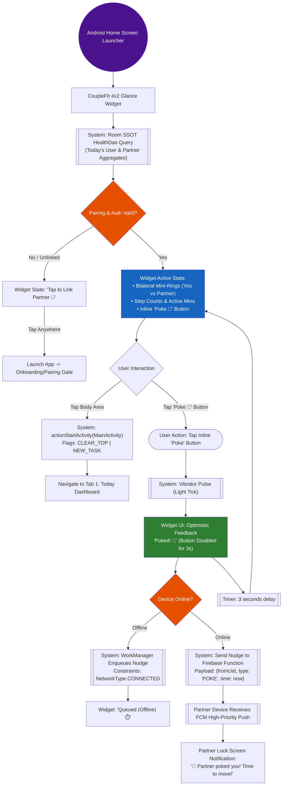
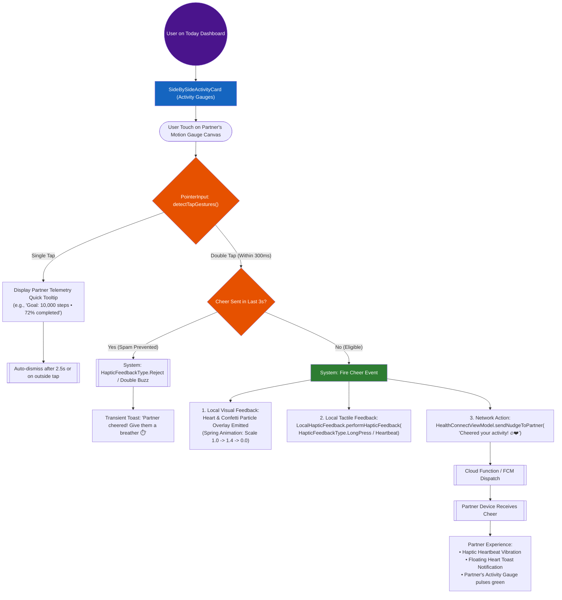
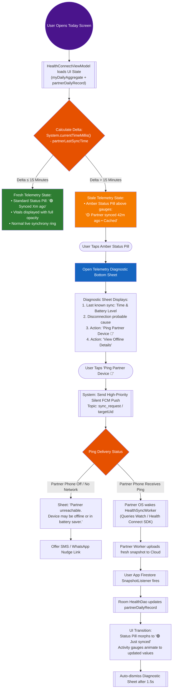

# User Flow Diagrams & Architectural Analysis: FLOW-01, FLOW-02, FLOW-03 🗺️

> **Skill Invocation**: [`/designer-skills:user-flow-diagram`](file:///C:/Users/akash/.gemini/config/plugins/designer-skills/skills/user-flow-diagram/SKILL.md)  
> **Target Subsystems**: 
> - **`FLOW-01`**: Zero-Tap Home Screen Glance Widget & Quick Poke Flow  
> - **`FLOW-02`**: Direct Manipulation Double-Tap Partner Ring Cheer Flow  
> - **`FLOW-03`**: Offline / Stale Telemetry Transparency & Diagnostics Flow  
> **Governance & Specs**: [`Documentation/card-sort-analysis.md`](file:///D:/Couple_fit/CoupleFit/Documentation/card-sort-analysis.md), [`Documentation/Fixinglist.md`](file:///D:/Couple_fit/CoupleFit/Documentation/Fixinglist.md) (§6), and [`AGENTS.md`](file:///D:/Couple_fit/CoupleFit/AGENTS.md)  
> **Date**: October 2026

---

## 1. Executive Summary

This document presents the complete interaction architecture, state transition trees, and end-to-end user flow diagrams for three foundational engagement innovations in **CoupleFit**:

1. **`FLOW-01` (Zero-Tap Home Screen Widget & Quick Poke)**: Bypasses the application cold-start barrier by bringing bilateral activity telemetry and zero-tap partner nudging directly to the Android Home Screen via Jetpack Glance.
2. **`FLOW-02` (Double-Tap Ring to Cheer Micro-Interaction)**: Implements direct-manipulation gestures on the `Today` screen dual activity gauges, allowing instant partner encouragement with heart particle bursts and physical haptics without scrolling to reaction rows.
3. **`FLOW-03` (Offline / Stale Telemetry Transparency)**: Solves the critical ambiguity between a partner being physically sedentary versus their wearable being disconnected, utilizing an adaptive status pill and one-tap background ping protocol.

---

## 2. Standard Flow Diagram Notation

All diagrams follow the formal user flow notation specified by `/designer-skills:user-flow-diagram`:

| Symbol / Shape | Meaning | Purpose in CoupleFit |
| :--- | :--- | :--- |
| `(( Entry / Exit ))` | Entry or Exit Point | Android OS Launcher, Notification Tap, or User Dismissal |
| `[ Rectangle ]` | View / Screen | Jetpack Glance Widget, Today Screen, Bottom Sheet Modal |
| `{ Diamond }` | Decision Branch | Auth check, Pairing check, Online status, Time delta |
| `([ Rounded Rect ])` | User Action | Tap widget, Double-tap ring, Click Poke button |
| `[[ Subroutine / Sys ]]` | System / Background Process | Room SSOT query, FCM push, Health Connect sync |

---

## 3. FLOW-01: Zero-Tap Home Screen Glance Widget & Quick Poke

### 3.1 Flow Overview & User Goal
- **User Goal**: View partner synchrony at a glance and send quick accountability nudges directly from the Android Home Screen without unlocking and launching the full app.
- **Velocity Impact**: Increases daily partner touchpoints from 2×/day (morning/evening app opens) to 10–12×/day (ambient glances during phone unlocks).

### 3.2 End-to-End User Flow Diagram

### 3.3 Error Paths & Edge Cases
1. **Room Database Empty (Fresh Boot)**: Displays neutral skeleton placeholder with cached fallback values until first `GlanceAppWidget.updateAll()` triggers.
2. **Rapid Multi-Tap (Poke Spamming)**: Button disables immediately on first tap for 3,000ms with debouncing to prevent flooding FCM downstream pipelines.
3. **Widget Sizing Adaptability**: Supports 3x2, 4x2, and 4x3 layouts; collapses step breakdown labels on smaller grid sizes while preserving ring geometry.

---

## 4. FLOW-02: Direct Manipulation "Double-Tap Partner's Ring to Cheer"

### 4.1 Flow Overview & User Goal
- **User Goal**: Send an instant cheer or celebration to the partner through direct touch manipulation on their activity ring, avoiding vertical scrolling or hunting for action buttons.
- **Ergonomic Context**: On compact phone screens (<600dp), the bottom reaction bar is often below the fold; double-tapping the hero ring provides immediate spatial affordance.

### 4.2 End-to-End User Flow Diagram

### 4.3 Micro-Interaction Specifications
- **Double-Tap Window**: 300ms max between pointer down events; touch slop radius ≤ 18dp.
- **Particle Dynamics**: 8–12 semi-transparent floating hearts and sparks radiating outward from the gauge center with gravity damping and 450ms lifetime.
- **Accessibility Alternative (WCAG 2.5.1)**: Double-tap is an enhanced shortcut; the standard accessible single-tap `QuickNudgeRow` buttons remain fully available below for assistive tech and TalkBack.

---

## 5. FLOW-03: Offline / Stale Telemetry Transparency & Recovery

### 5.1 Flow Overview & User Goal
- **User Goal**: Immediately distinguish between a partner who is resting vs. a partner whose device is disconnected/dead, with zero guesswork and an active path to sync.
- **The Core Problem**: In wearable IoT pairing, static values cause relationship anxiety ("Is my partner okay? Why haven't they walked?").

### 5.2 End-to-End User Flow Diagram

### 5.3 Diagnostic Status Taxonomy

| Delta Horizon | Visual Token | Status Copy | Interaction Affordance |
| :--- | :--- | :--- | :--- |
| **0 – 15 mins** | `SystemGreen` (🟢) | `Synced Xm ago` | Passive confirmation; no action required. |
| **16 – 60 mins** | `SystemOrange` (🟡) | `Partner synced Xm ago • Showing cached vitals` | Tappable pill; opens Diagnostic Sheet. |
| **> 60 mins** | `SystemRed` (🔴) | `Partner inactive since HH:MM • Sync stalled` | Emphasized banner; highlights "Ping Partner" CTA. |
| **Local User Offline**| `SystemGray` (⚪) | `You are offline • Showing local device cache` | Prompts local Wi-Fi / Cellular check. |

---

## 6. Implementation Blueprint & File Touchpoints

| Flow ID | Feature Component | Primary Files Touched | Architectural Layer |
| :--- | :--- | :--- | :--- |
| **`FLOW-01`** | Interactive Glance Widget | [`CoupleFitAppWidget.kt`](file:///D:/Couple_fit/CoupleFit/app/src/main/java/com/couplefit/widget/CoupleFitAppWidget.kt), `PokeActionCallback.kt` | UI / Glance AppWidget & WorkManager |
| **`FLOW-02`** | Double-Tap Ring Cheer | [`DashboardScreen.kt`](file:///D:/Couple_fit/CoupleFit/app/src/main/java/com/couplefit/ui/dashboard/DashboardScreen.kt) (`SideBySideActivityCard`), `ConfettiParticleOverlay.kt` | Compose UI / PointerInput & Motion |
| **`FLOW-03`** | Stale Telemetry Status Pill & Ping | [`DashboardScreen.kt`](file:///D:/Couple_fit/CoupleFit/app/src/main/java/com/couplefit/ui/dashboard/DashboardScreen.kt), `HealthConnectViewModel.kt`, `SyncNotificationService.kt` | UI / ViewModel & Cloud Messaging |

---

## 7. Quality & Verification Gates

1. **Automated Unit Tests**:
   - `testDebugUnitTest`: Verify delta time calculation logic, status string formatting, and FCM payload serialization.
2. **Instrumented Compose Tests**:
   - Verify double-tap detection on `SideBySideActivityCard` without interfering with scroll.
   - Verify Glance widget provides content without crashing when Room is empty.
3. **Live ARTEMIS Device Verification**:
   - Verify visual rendering of widget, double-tap particle burst, and amber status pill on `emulator-5554`.
